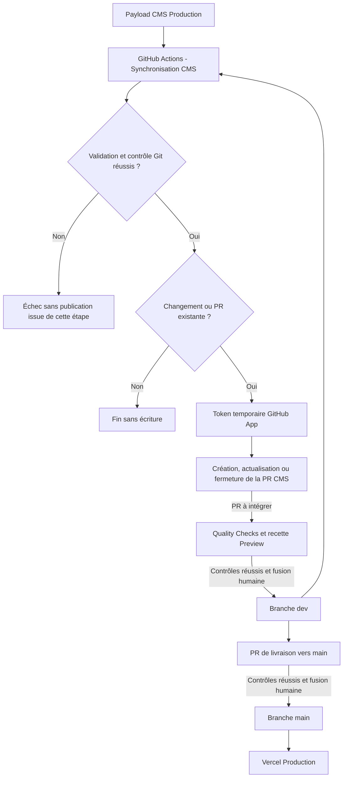

# CI/CD - T-IA-KI Website

**Dépôt :** `StudioFabrique/tiaki-website`  
**Emplacement :** `docs/CI_CD.md`  
**Version :** 1.1 — 27 novembre 2026  
**Statut :** CI et synchronisation CMS opérationnelles ; recette du déclenchement planifié et de la migration vers `client-id` à finaliser.

## 1. Objectifs et périmètre

La stratégie CI/CD du site T-IA-KI vise à garantir la qualité du code, la reproductibilité des builds, l'intégrité des snapshots de secours, la détection des régressions avant livraison et la traçabilité des modifications. Elle sépare les environnements de développement, de recette et de production et protège les branches d'intégration et de production.

L'automatisation CMS complète cette stratégie : elle maintient les contenus de secours en cohérence avec Payload CMS, sans contourner les contrôles qualité ni le processus de validation humaine. Elle évite les publications inutiles lorsque les contenus n'ont pas changé.

Ce document couvre le site web public. Le back-office Payload possède son propre processus de CI/CD, de publication Docker et de déploiement OVH, décrit dans `tiaki-backoffice/docs/DEPLOYMENT.md`.

## 2. Architecture générale

| Service | Responsabilité |
|---|---|
| GitHub Actions | Intégration continue, tests et synchronisation CMS. |
| GitHub Rulesets | Protection des branches et application des règles de fusion. |
| GitHub App TIAKI CMS Sync | Identité dédiée aux opérations Git d'écriture de la synchronisation. |
| Vercel | Construction, livraison continue et hébergement du site. |
| Payload CMS | Source éditoriale de référence des contenus publics. |

GitHub Actions et Vercel disposent d'environnements d'exécution distincts. Les workflows actuels ne déploient pas directement le site sur Vercel : le déploiement est piloté par l'intégration Git de Vercel.



Une synchronisation réussie ne signifie pas que les snapshots ont déjà été déployés en production. La fusion dans `dev`, la livraison dans `main` et le succès du déploiement restent nécessaires.

## 3. Environnement technique

| Composant | Technologie ou configuration |
|---|---|
| Framework | Next.js |
| Langage | TypeScript |
| Runtime CI | Node.js 24.22.1 |
| Gestionnaire de dépendances | pnpm 12.11.2 |
| Analyse statique | ESLint |
| Validation de données | Zod |
| Exécution des scripts TypeScript | tsx |
| Tests CMS | `node:test` |
| Gestion du code source | GitHub |
| Runner de synchronisation | `ubuntu-latest` |
| Livraison continue | Vercel |

Les versions indiquées correspondent à la configuration de référence de la recette du 27 novembre 2026. Les workflows et le champ `packageManager` de `package.json`, lorsqu'il existe, font foi. Les versions utilisées par les workflows CI et CMS doivent rester cohérentes. L'installation utilise `pnpm install --frozen-lockfile` et les autorisations explicites de scripts de compilation définies dans le projet.

## 4. Stratégie de branches

| Branche | Responsabilité |
|---|---|
| `main` | Branche par défaut et référence des déploiements de production. |
| `dev` | Branche d'intégration, base de synchronisation des snapshots. |
| `feature/*` | Développement de fonctionnalités. |
| `fix/*` | Correction d'anomalies. |
| `hotfix/*` | Correction urgente ; réintégrer dans `dev` toute correction livrée directement en production. |
| `docs/*` | Mise à jour documentaire. |
| `automation/cms-fallback-sync` | Branche exclusivement réservée aux PR automatiques de synchronisation. |
| `test/*` | Branches temporaires de recette isolée, à nettoyer après validation. |

Flux standard : `feature/*` → PR vers `dev` → recette → PR vers `main` → production.

Flux CMS : Payload → synchronisation sur un checkout de `dev` → branche d'automatisation → PR vers `dev` → contrôles et fusion humaine → PR vers `main` → Vercel Production.

Le workflow de synchronisation planifié est défini sur `main` mais récupère explicitement `dev`. Aucun push direct vers `dev` ou `main` ni aucune fusion automatique ne sont configurés dans ce workflow. Ne pas utiliser la branche d'automatisation pour des développements manuels : l'action de gestion des PR peut réécrire son historique ou la supprimer.

## 5. Intégration continue — GitHub Actions

### 5.1. Organisation et déclenchement

| Workflow | Fichier | Responsabilité |
|---|---|---|
| CI - TIAKI Website | `.github/workflows/ci.yml` | Contrôles qualité et build. |
| CMS - Fallback Synchronization | `.github/workflows/sync-cms-fallbacks.yml` | Synchronisation et gestion des PR CMS. |

Le workflow CI comporte le job obligatoire `Quality Checks`. Il est déclenché par les Pull Requests ciblant `dev` ou `main`, les push sur ces deux branches et les demandes manuelles (`workflow_dispatch`). Les PR automatiques de la GitHub App sont soumises aux mêmes contrôles que les PR humaines.

### 5.2. Étapes du pipeline Quality Checks

| Ordre | Étape | Commande ou responsabilité |
|---|---|---|
| 1 | Checkout repository | Récupération du code ; `persist-credentials: false`. |
| 2 | Setup pnpm | Configuration du gestionnaire de dépendances. |
| 3 | Setup Node.js | Configuration du runtime et du cache pnpm. |
| 4 | Install dependencies | `pnpm install --frozen-lockfile` |
| 5 | Generate Next.js types | `pnpm exec next typegen` |
| 6 | TypeScript validation | `pnpm exec tsc --noEmit` |
| 7 | ESLint validation | `pnpm lint` |
| 8 | CMS regression tests | `pnpm cms:test` |
| 9 | Build and CMS fallback validation | `pnpm build` |

L'échec d'une étape obligatoire entraîne l'échec du job. Les tests CMS automatisés ne nécessitent aucune connexion à Payload. Le workflow CI utilise un `GITHUB_TOKEN` limité à `contents: read`.

### 5.3. Contrôles locaux avant une PR

```bash
pnpm cms:test && \
pnpm cms:validate && \
pnpm exec next typegen && \
pnpm exec tsc --noEmit && \
pnpm lint && \
pnpm build
```

Pour le détail des contrats de données et des tests CMS, consulter `docs/CMS_INTEGRATION.md`.

## 6. Protection des branches et gouvernance

Le Ruleset `TIAKI Website - Quality Gate` protège `dev` et `main`.

| Règle | Objectif |
|---|---|
| Restrict deletions | Empêcher la suppression des branches protégées. |
| Block force pushes | Empêcher la réécriture forcée de leur historique. |
| Require a pull request before merging | Imposer l'intégration via une PR. |
| Require status checks to pass | Imposer la réussite des contrôles obligatoires. |
| Require branches to be up to date before merging | Valider le code par rapport à la branche cible actualisée. |

Le contrôle obligatoire est `Quality Checks`. Le nombre minimal d'approbations formelles est actuellement fixé à zéro, conformément à l'organisation initiale de l'équipe. La revue et la décision humaine de fusion constituent une règle de travail, et non une exigence technique d'approbation par une deuxième personne. La GitHub App ne bénéficie d'aucune autorisation de contournement du Ruleset.

Vérifier le résultat du contrôle sur le dernier commit de la PR, ainsi que l'absence de conflit et le périmètre du diff, avant toute fusion. Le contrôle Vercel Preview est également vérifié dans le processus de recette ; il n'est pas établi ici qu'il soit configuré comme contrôle bloquant dans le Ruleset.

## 7. Livraison continue — Vercel

### 7.1. Environnements

- **Preview :** recette fonctionnelle, responsive design, validation des contenus FR/ES et des intégrations CMS, partage des versions intermédiaires avec les parties prenantes.
- **Production :** déploiement depuis `main`, après fusion d'une PR de livraison.

Le push d'une branche d'automatisation ou de test peut générer un déploiement Preview selon les paramètres Vercel. Il ne constitue pas un déploiement de production.

### 7.2. Variables d'environnement

| Variable | Responsabilité |
|---|---|
| `TIAKI_BACKOFFICE_URL` | Adresse du back-office Payload utilisé par le site. |

Configurer les variables pour chaque environnement Vercel concerné. La Preview a utilisé le CMS de production lors de la recette Contact ; elle ne constitue donc pas une préproduction CMS indépendante. Les essais destructifs doivent utiliser un CMS local ou isolé.

Les secrets et les paramètres sensibles ne doivent jamais être versionnés. Les identifiants GitHub App sont destinés à GitHub Actions, pas à Vercel ni au navigateur.

## 8. Validation et intégrité des snapshots — CMS-03

Le site embarque des snapshots JSON permettant un rendu de secours lorsque Payload est indisponible ou retourne des données non conformes, selon la politique du modèle de contenu.

| Commande | Responsabilité |
|---|---|
| `pnpm cms:validate` | Validation de tous les snapshots déclarés dans `cmsRegistry`, sans accès réseau. |
| `pnpm cms:test` | Tests automatisés de non-régression CMS. |
| `pnpm build` | Validation des snapshots, puis compilation Next.js. |

La commande de build est `pnpm cms:validate && next build`. En cas de snapshot absent, illisible, malformé ou non conforme au schéma Zod, la compilation n'est pas exécutée. Le contrôle s'applique aux builds locaux, à GitHub Actions et à Vercel lorsque le script de build du projet est utilisé.

La validation garantit la conformité au contrat de données, pas la fraîcheur, la justesse éditoriale ou la langue réelle des textes. Les deux tests automatisés actuels couvrent la persistance et la liste blanche Git ; ils ne constituent pas une suite exhaustive de tests de toutes les pages ou de tous les cas de résilience.

## 9. Automatisation de la synchronisation — CMS-02

### 9.1. Déclenchements

| Paramètre | Valeur |
|---|---|
| Événement planifié | `schedule` |
| Expression CRON | `17 5 * * *` |
| Fréquence | Quotidienne à 05 h 17 UTC |
| Heure locale France / Espagne continentale | 06 h 17 en hiver, 07 h 17 en été |
| Événement manuel | `workflow_dispatch` |

L'heure planifiée est indicative : l'exécution peut être retardée par GitHub Actions. Le workflow doit être présent sur la branche par défaut pour permettre les déclenchements planifiés et manuels. Les exécutions planifiées utilisent la définition du workflow de la branche par défaut.

Pour une synchronisation à la demande : dépôt → Actions → **CMS - Fallback Synchronization** → **Run workflow** → sélectionner `main` → confirmer. Un lancement manuel depuis une branche temporaire est possible pour une recette contrôlée ; il utilise la définition de workflow de cette branche, mais le checkout interne demeure `dev` sauf modification explicite.

Le déclenchement manuel est opérationnel et a été testé. La première exécution réellement planifiée reste à observer (INT09). CMS-05 pourra couvrir les éventuelles évolutions du déclenchement manuel ; sa fonctionnalité de base existe déjà.

### 9.2. Configuration du job

| Paramètre | Configuration |
|---|---|
| Job | `Synchronize CMS Fallbacks` |
| Runner | `ubuntu-latest` |
| Durée maximale | 15 minutes |
| Checkout | `dev`, `persist-credentials: false` |
| CMS distant | `https://backoffice.tiaki.step.eco` |
| Groupe de concurrence | `cms-fallback-sync` |
| Annulation de l'exécution en cours | `cancel-in-progress: false` |

Le groupe de concurrence empêche les exécutions simultanées du workflow au sein de ce groupe. Une exécution active n'est pas annulée au profit d'une nouvelle ; avec la configuration actuelle, toutes les demandes en attente ne sont pas nécessairement conservées dans une file FIFO. Cette protection ne verrouille ni les éditions dans Payload ni les fusions humaines dans GitHub.

### 9.3. Cycle d'exécution

| Ordre | Étape | Responsabilité |
|---|---|---|
| 1 | Checkout repository | Récupérer `dev`. |
| 2 | Setup pnpm / Setup Node.js | Configurer les outils. |
| 3 | Install dependencies | Installer avec le lockfile figé. |
| 4 | Synchronize CMS fallbacks | Exécuter `pnpm cms:sync`. |
| 5 | Validate CMS fallbacks | Exécuter `pnpm cms:validate`. |
| 6 | Detect and validate snapshot changes | Contrôler les modifications Git ; produire `changed`. |
| 7 | Check existing CMS pull request | Consulter les PR ouvertes ; produire `exists`. |
| 8 | Generate GitHub App token | Générer conditionnellement le token d'écriture. |
| 9 | Create or update CMS synchronization pull request | Réconcilier la branche et la PR CMS. |
| 10 | Post-job cleanup | Révoquer le token généré. |

Une erreur lors de la récupération, de la validation ou du contrôle Git bloque les étapes de publication suivantes. Un échec pendant la publication elle-même peut cependant laisser un état distant partiellement modifié ; examiner la branche et la PR avant de relancer. Une PR ouverte par une exécution antérieure n'est pas automatiquement annulée par un échec réseau ultérieur.

La synchronisation et la validation complète des contenus sont détaillées dans `docs/CMS_INTEGRATION.md`.

## 10. Authentification et permissions de la GitHub App

### 10.1. Application dédiée

| Paramètre | Valeur |
|---|---|
| Nom | TIAKI CMS Sync |
| Slug | `tiaki-cms-sync` |
| Organisation propriétaire | StudioFabrique |
| Type | GitHub App privée |
| Dépôt autorisé | `StudioFabrique/tiaki-website` |
| Webhook | Désactivé |
| OAuth utilisateur | Non utilisé |
| Contournement du Ruleset | Aucun |

L'utilisation d'une GitHub App sépare l'identité de l'automatisation des comptes utilisateurs. Elle permet de générer des tokens temporaires, de limiter les accès au dépôt concerné et de déclencher les workflows CI des PR créées par l'application. Contrairement à un PAT personnel, son identité n'est pas liée à un collaborateur particulier.

### 10.2. Permissions et séparation des identités

| Permission de l'App | Niveau |
|---|---|
| Contents | Read & Write |
| Pull requests | Read & Write |
| Metadata | Read (obligatoire) |
| Actions, Administration, Checks, Deployments, Secrets, Workflows et autres | No access |

| Identité | Permissions | Utilisation |
|---|---|---|
| `GITHUB_TOKEN` du workflow CI | `contents: read` | Lecture du dépôt. |
| `GITHUB_TOKEN` du workflow CMS | `contents: read`, `pull-requests: read` | Checkout et consultation des PR. |
| Token d'installation GitHub App | Contents et Pull requests en écriture ; Metadata en lecture | Création et actualisation de la branche et des PR CMS. |

Les permissions globales du workflow concernent son `GITHUB_TOKEN`, et non le token distinct de la GitHub App. La configuration `persist-credentials: false` évite la persistance des identifiants de checkout. Cette séparation ne constitue pas une isolation absolue entre les étapes exécutées dans le même runner.

### 10.3. Secrets et variables

Configuration : dépôt GitHub → Settings → Secrets and variables → Actions.

| Nom | Type | État au 27 novembre 2026 |
|---|---|---|
| `CMS_SYNC_CLIENT_ID` | Repository variable | Créée ; utilisée dans la correction du workflow en cours de livraison. |
| `CMS_SYNC_PRIVATE_KEY` | Repository secret | Clé privée PEM de l'App ; inchangée. |
| `CMS_SYNC_APP_ID` | Repository variable | Ancienne variable numérique conservée temporairement, encore nécessaire au workflow déployé avant la migration. |

Le Client ID et l'App ID sont des identifiants distincts et ne sont pas secrets. La clé privée est un identifiant sensible persistant : ne jamais la versionner, la journaliser, la placer dans le navigateur ou la transmettre par un canal non sécurisé. Limiter les copies locales et protéger leur stockage. La durée de vie courte des tokens ne rend pas la clé privée elle-même temporaire.

### 10.4. Génération et cycle de vie du token

L'action `actions/create-github-app-token@v3` génère un JWT signé en RS256 à partir des identifiants de l'App, puis obtient auprès de GitHub un token d'installation. Le token est limité au dépôt courant dans la configuration retenue, avec les permissions d'écriture explicites nécessaires. Sa durée de validité maximale est d'une heure ; l'action tente de le révoquer lors du nettoyage de fin de job, comme observé pendant la recette.

Le token n'est généré qu'après réussite des contrôles précédents, lorsque `changed` ou `exists` vaut `true`.

### 10.5. Migration de `app-id` vers `client-id`

La recette du 27 novembre 2026 a signalé la dépréciation de `app-id`. La branche `fix/cms-sync-client-id` contient la correction suivante, encore à intégrer et à valider sur GitHub Actions :

```yaml
- name: Generate GitHub App token
  if: steps.changes.outputs.changed == 'true' || steps.existing-pr.outputs.exists == 'true'
  id: app-token
  uses: actions/create-github-app-token@v3
  with:
    client-id: ${{ vars.CMS_SYNC_CLIENT_ID }}
    private-key: ${{ secrets.CMS_SYNC_PRIVATE_KEY }}
    permission-contents: write
    permission-pull-requests: write
```

La clé privée, les permissions et l'installation ne changent pas. Conserver `CMS_SYNC_APP_ID` jusqu'à la livraison du workflow corrigé sur `main` et au succès d'une exécution qui génère effectivement un token avec le Client ID (INT11). Un run sans modification ni PR ouverte ignore cette étape et ne valide donc pas la migration. Vérifier également l'absence de l'avertissement de dépréciation avant de supprimer l'ancienne variable.

## 11. Contrôle du périmètre des modifications

Le script `pnpm exec tsx scripts/check-cms-sync-changes.ts` établit une liste blanche à partir des chemins de snapshots déclarés dans `lib/cms/registry.ts`.

Il autorise uniquement les modifications non indexées (` M`) de fichiers suivis déclarés dans le registre. Il refuse les modifications du code ou des workflows, les ajouts non suivis, suppressions, renommages et changements indexés. Il transmet à GitHub Actions la sortie `steps.changes.outputs.changed`.

Ce contrôle s'appuie sur le statut Git : il ne recense pas les fichiers ignorés et ne constitue pas une restriction des permissions GitHub à certains chemins. La permission Contents reste accordée à l'échelle du dépôt. Le contrôle doit être exécuté dans un checkout initialement propre et avant toute publication.

L'autre sortie, `steps.existing-pr.outputs.exists`, provient d'une requête GitHub CLI en lecture seule filtrant les PR ouvertes de `automation/cms-fallback-sync` vers `dev`, pour le propriétaire du dépôt.

## 12. Gestion automatique des Pull Requests

### 12.1. Configuration

| Paramètre | Valeur |
|---|---|
| Action | `peter-evans/create-pull-request` |
| SHA utilisé lors de la recette | `5f6978faf089d4d20b00c7766989d076bb2fc7f1` (version indiquée : 8.1.1) |
| Branche source | `automation/cms-fallback-sync` |
| Branche cible | `dev` |
| Titre et message de commit | `chore(cms): synchronize fallback snapshots` |
| Signature des commits | `sign-commits: true` |
| Nettoyage de branche | `delete-branch: true` |
| Fusion automatique | Non configurée |

Le workflow déclenche la génération du token et la gestion de la PR lorsque :

```yaml
if: steps.changes.outputs.changed == 'true' || steps.existing-pr.outputs.exists == 'true'
```

### 12.2. Cycle de vie

| Snapshots différents de `dev` | PR ouverte | Comportement |
|---|---|---|
| Non | Non | Fin du workflow sans opération d'écriture. |
| Oui | Non | Création d'une PR vers `dev`. |
| Oui | Oui | Actualisation de la même PR si nécessaire. |
| Non | Oui | Réconciliation et fermeture de la PR devenue obsolète. |

La fermeture automatique a été validée pendant INT07. Le nettoyage de la branche est configuré, mais sa suppression effective doit être vérifiée séparément si nécessaire. Une branche résiduelle sans PR ouverte n'entraîne pas à elle seule une opération de nettoyage avec la condition actuelle.

L'état éditorial n'est réconcilié qu'au moment des synchronisations. Avant de fusionner une PR CMS, vérifier que les contenus proposés sont toujours souhaités et que les contrôles portent sur son dernier commit. En cas de doute, lancer une nouvelle synchronisation avant la fusion.

### 12.3. Cas réel — PR #56

Lors de la recette, une différence espagnole subsistait après restauration des contenus de test. Le mode `--dry-run` a identifié une inversion des titres et descriptions entre `hero` et `faqSection` dans le snapshot espagnol de référence. Les contenus actuels de Payload ont été retenus comme référence éditoriale.

La PR automatique #56 a été fusionnée vers `dev` pour intégrer cette correction. Une vérification ultérieure a confirmé quatre snapshots valides et inchangés. Le test de fermeture d'une PR obsolète a ensuite été rejoué avec une modification française isolée, et la fermeture a été confirmée.

La correction espagnole est intégrée à `dev` ; sa livraison vers `main` reste à réaliser à la date de cette révision. La conformité Zod seule ne permet pas de détecter une inversion sémantique entre deux champs textuels valides.

## 13. Processus standard de développement et de livraison

1. Créer une branche fonctionnelle ou de maintenance depuis `dev` actualisée.
2. Développer, documenter et exécuter les contrôles locaux (§ 5.3).
3. Vérifier les fichiers modifiés et indexer explicitement le périmètre attendu.
4. Effectuer un commit documenté puis pousser la branche.
5. Créer une PR vers `dev`, vérifier `Quality Checks`, le diff et la Preview.
6. Fusionner après validation et effectuer la recette fonctionnelle.
7. Créer une PR de `dev` vers `main` et vérifier à nouveau les contrôles et le périmètre de livraison.
8. Fusionner, vérifier le déploiement Vercel Production et réaliser la recette finale.

Pour une PR générée par la synchronisation, les étapes de préparation et de publication de la branche sont effectuées par le workflow ; les étapes de revue, de fusion et de livraison restent sous responsabilité humaine.

## 14. Gestion des incidents et diagnostic

| Incident | Diagnostic et action recommandée |
|---|---|
| Échec TypeScript ou ESLint | Examiner les logs et corriger les erreurs avant fusion. |
| Échec d'installation pnpm | Vérifier les versions, dépendances, lockfile et autorisations de scripts de compilation. |
| Snapshot invalide | Identifier le fichier et les champs Zod signalés ; corriger le contenu ou le contrat selon la cause. |
| Échec du build Next.js | Examiner les logs de validation et de compilation. |
| CMS indisponible / `ECONNREFUSED` | Vérifier l'adresse et la disponibilité de Payload ; relancer après rétablissement. |
| Timeout HTTP | Examiner la latence et la disponibilité ; le timeout est de 5 s par requête. |
| Pagination incohérente ou doublon | Examiner les métadonnées et les éditions concurrentes ; relancer après stabilisation. |
| Modification Git non autorisée | Identifier le chemin et la source du changement ; ne pas élargir la liste blanche sans justification. |
| Échec de génération du token | Vérifier le Client ID (ou l'App ID pour l'ancien workflow), la clé privée, l'installation et les permissions de l'App. |
| HTTP 403 | Vérifier les permissions de l'App et les restrictions du dépôt ; ne pas accorder de droits excessifs. |
| Échec de création ou actualisation de PR | Examiner les logs, la branche d'automatisation et la PR existante avant de relancer. |
| PR CMS toujours ouverte | Contrôler `changed`, `exists` et les différences réelles avec `pnpm cms:sync --dry-run` depuis `dev` actualisée et propre. |
| Quality Checks en échec | Corriger la cause et attendre le résultat des contrôles sur le dernier commit. |
| Échec du déploiement Vercel | Examiner les logs et les variables de l'environnement cible. |
| Régression en production | Identifier la dernière version stable et appliquer un correctif ou un rollback compatible avec le CMS. |

Diagnostic local sans modification des snapshots :

```bash
TIAKI_BACKOFFICE_URL=https://backoffice.tiaki.step.eco pnpm cms:sync --dry-run
```

Consulter les logs des étapes de synchronisation, de validation, de contrôle Git et de gestion de la PR. Distinguer une synchronisation sans modification, un échec et une actualisation réussie. Ne pas contourner le Ruleset pour résoudre un incident. Si une ancienne PR reste ouverte après un échec, vérifier sa fraîcheur avant toute fusion.

## 15. Sécurité et maintenance des identifiants

Les mesures existantes comprennent la limitation des permissions, la désactivation de la persistance des identifiants de checkout, la protection des branches, l'installation figée des dépendances, l'autorisation explicite des scripts de compilation nécessaires, la validation des contenus avant build, la séparation des environnements et la gestion des secrets hors du code source.

### 15.1. Rotation de la clé privée

1. Générer une nouvelle clé privée dans les paramètres de la GitHub App.
2. Remplacer le secret `CMS_SYNC_PRIVATE_KEY` du dépôt.
3. Déclencher une recette contrôlée qui exécute réellement la génération d'un token.
4. Vérifier le fonctionnement du workflow avec la nouvelle clé.
5. Révoquer l'ancienne clé dans les paramètres de l'App.
6. Supprimer les anciennes copies locales non nécessaires.

En cas de suspicion de compromission, révoquer rapidement la clé concernée, évaluer les tokens déjà émis et examiner les opérations réalisées avec l'identité de l'application.

### 15.2. Maintenance de la chaîne de livraison

Maintenir les versions des outils et des actions GitHub, vérifier les mises à jour de sécurité et privilégier les références immuables par SHA de commit pour les actions recevant des secrets ou des permissions d'écriture. L'action de création de PR utilise déjà un SHA ; `actions/create-github-app-token@v3` reste référencée par un tag majeur. Son épinglage à un SHA vérifié constitue une amélioration à planifier, et non une mesure déjà appliquée.

Les collaborateurs autorisés à modifier les workflows ou le code exécuté par ces workflows disposent d'un périmètre de confiance important. La liste blanche des snapshots ne protège pas contre une modification malveillante de la logique qui l'applique. Toute évolution des workflows et des permissions doit être revue.

## 16. Recette d'intégration et état de validation

Recette initiale : **27 novembre 2026**. Les statuts ci-dessous s'appuient sur les logs et confirmations communiqués pendant la recette.

| ID | Scénario | Critère d'acceptation | Statut |
|---|---|---|---|
| INT01 | Exécution sur GitHub Actions | Workflow exécuté correctement. | Validé |
| INT02 | Synchronisation sans modification | Aucun token d'écriture ni nouvelle PR. | Validé |
| INT03 | Authentification GitHub App avec App ID | Token valide, utilisé puis révoqué. | Validé |
| INT04 | Création automatique d'une PR | PR vers `dev`, fichiers attendus. | Validé |
| INT05 | Déclenchement automatique de la CI | Quality Checks exécuté sur la PR automatique. | Validé |
| INT06 | Actualisation d'une PR existante | Même PR actualisée sans doublon. | Validé |
| INT07 | Fermeture automatique d'une PR obsolète | Fermeture sans fusion après restauration du contenu. | Validé |
| INT08 | Échec de synchronisation sans publication | Échec réseau simulé et interruption avant publication. | Validé selon retour de recette |
| INT09 | Déclenchement quotidien planifié | Exécution dont l'événement est `schedule`. | À valider |
| INT10 | Fusion effective d'une PR automatique | Correction espagnole intégrée à `dev` ; dry-run sans différence. | Validé — PR #56 |
| INT11 | Authentification GitHub App avec Client ID | Génération effective du token, sans avertissement `app-id`. | À valider |

Le test INT08 a utilisé une branche temporaire avec une adresse CMS locale inaccessible (`127.0.0.1:65534`). Le runner a retourné `ECONNREFUSED` et le code de sortie 1 ; le nettoyage de la branche de test a été confirmé. Ce scénario ne constitue pas un test de panne réelle du CMS de production. Les logs détaillés des étapes ignorées ne sont pas reproduits ici.

### Actions restantes avant clôture de CMS-02

1. Versionner la migration `client-id` et la documentation consolidée sur `fix/cms-sync-client-id`.
2. Intégrer la correction dans `dev`, puis livrer vers `main` avec le snapshot espagnol corrigé.
3. Vérifier les contrôles CI et le déploiement Vercel Production.
4. Valider INT11 lors d'une exécution nécessitant réellement un token d'écriture ; restaurer les contenus de test et vérifier la fermeture de la PR si une modification temporaire a été utilisée.
5. Retirer `CMS_SYNC_APP_ID` après validation et vérification de l'absence d'autres consommateurs de cette variable.
6. Valider INT09 depuis l'historique GitHub Actions, en identifiant un événement `schedule` et son résultat.
7. Actualiser les statuts de recette dans les documents CMS et CI/CD.

## 17. Supervision, limites et évolutions

Les résultats des synchronisations sont consultables depuis l'onglet Actions. Le workflow contrôle les différences avec Payload lors de ses exécutions, mais il ne mesure pas en continu la fraîcheur des snapshots effectivement déployés. Le workflow CI classique ne vérifie pas la disponibilité fonctionnelle du CMS de production ; la synchronisation CMS, elle, nécessite sa disponibilité.

| Sujet | État ou évolution |
|---|---|
| CMS-01 — Socle CMS commun | Déployé. |
| CMS-03 — Validation des snapshots | Déployée et intégrée au build. |
| CMS-02 — Synchronisation automatique | Déployée ; recette finale et livraison corrective à terminer. |
| CMS-05 — Déclenchement manuel | Fonctionnalité de base validée ; éventuels compléments à arbitrer. |
| CMS-04 — Supervision | À réaliser : indicateur de dernière synchronisation réussie, alertes d'échec et de fraîcheur. |
| CMS-06 — Retrait et dépublication | À réaliser : politique de prévention de la réapparition de contenus obsolètes. |
| CMS-07 — Last Known Good | Stockage externe des derniers contenus valides à étudier. |
| Tests CMS | Deux tests automatisés intégrés à la CI ; autres scénarios de résilience testés manuellement. Étendre la couverture unitaire, intégration et E2E. |
| Audit des dépendances et analyse de sécurité | Aucun audit automatique ni pipeline de sécurité dédié établi dans la CI actuelle. |
| Synchronisation événementielle | Aucun webhook Payload → GitHub Actions configuré. |
| Épinglage des actions | Privilégier les SHA vérifiés et définir leur maintenance. |

La synchronisation n'est ni une réplication transactionnelle ni une garantie de disponibilité absolue. Un contenu dépublié peut encore figurer dans un snapshot ancien tant que la nouvelle version du site n'est pas déployée. Une erreur pendant le remplacement des fichiers peut laisser des modifications locales partielles, mais les étapes de publication du workflow ne sont pas exécutées si le script échoue. La revue humaine, la protection des branches et le déploiement restent nécessaires.

## 18. Documents associés et références techniques

### Documentation interne

- `docs/CMS_INTEGRATION.md` — Architecture CMS, contrats, validation et synchronisation.
- `docs/CONTACT_PAGE.md` — Intégration fonctionnelle et technique de la page Contact.
- `.github/workflows/ci.yml` — Configuration CI.
- `.github/workflows/sync-cms-fallbacks.yml` — Configuration de la synchronisation CMS.
- `package.json` — Commandes de développement, de validation, de test et de build.
- `tiaki-backoffice/docs/DEPLOYMENT.md` — Livraison et exploitation du back-office.

### Documentation officielle et références des actions

- [GitHub Actions — Workflow syntax](https://docs.github.com/en/actions/reference/workflows-and-actions/workflow-syntax)
- [GitHub Actions — Events that trigger workflows](https://docs.github.com/en/actions/reference/workflows-and-actions/events-that-trigger-workflows)
- [GitHub Actions — Using secrets](https://docs.github.com/en/actions/security-for-github-actions/security-guides/using-secrets-in-github-actions)
- [GitHub Apps — Authentication](https://docs.github.com/en/apps/creating-github-apps/authenticating-with-a-github-app)
- [GitHub — Create GitHub App Token](https://github.com/actions/create-github-app-token)
- [Create Pull Request Action](https://github.com/peter-evans/create-pull-request)
- [Node.js — Test runner](https://nodejs.org/api/test.html)
- [Vercel — Git deployments](https://vercel.com/docs/git)

---

**Note de révision :** document consolidé à partir de la documentation CI/CD existante et des résultats de recette communiqués le 27 novembre 2026. Le dépôt et ses paramètres n'ont pas été inspectés directement lors de cette révision. Les fichiers de workflow et les paramètres GitHub/Vercel font foi ; les évolutions et validations restantes sont explicitement distinguées des fonctionnalités déjà opérationnelles.
