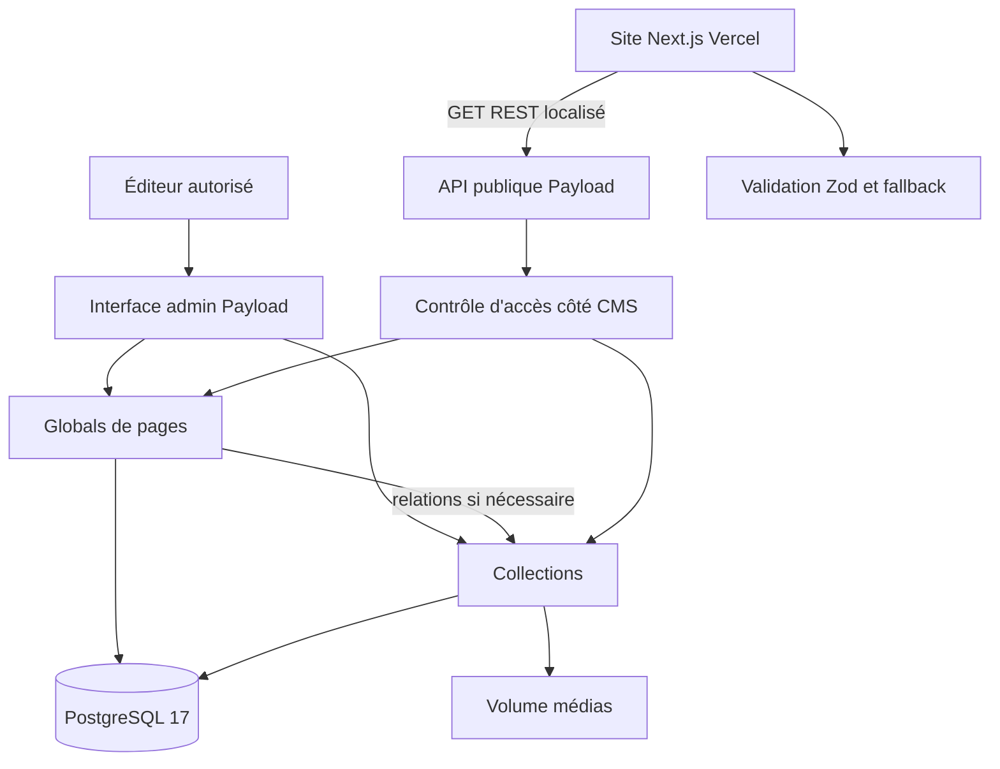
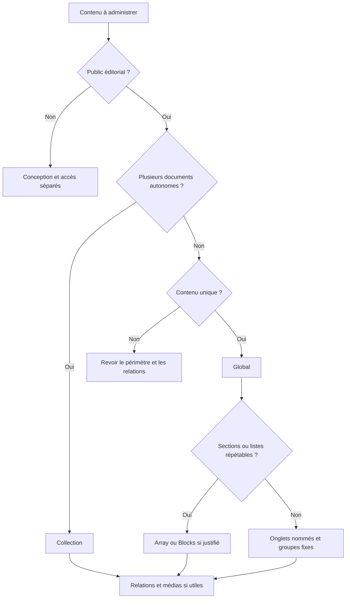
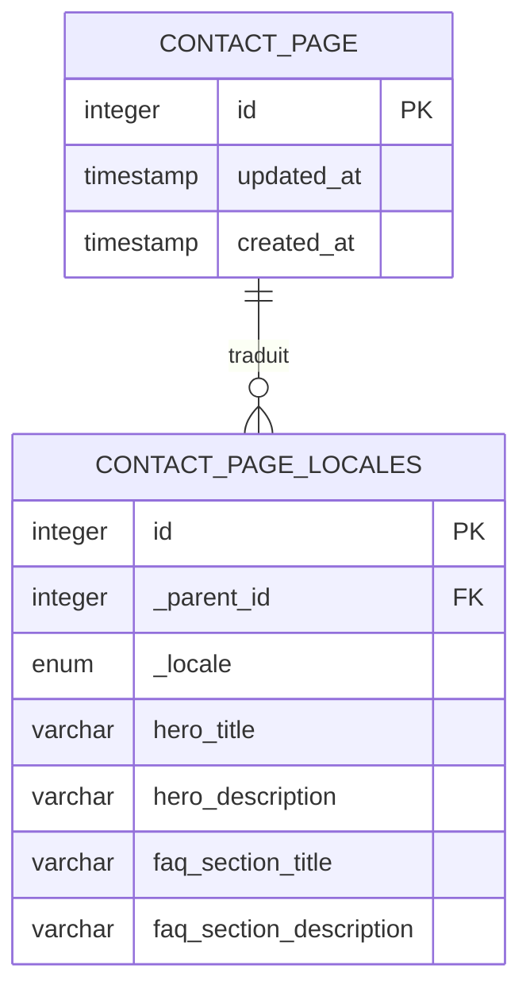

# T-IA-KI — Architecture et conventions Payload CMS

**Dépôt :** `tiaki-backoffice` · **Emplacement :** `docs/CMS_ARCHITECTURE.md`  
**Révision :** 25 novembre 2026 · **Statut :** conventions proposées ; modèle Contact et collection FAQ déjà déployés.

## 1. Objectif et limites

Ce document définit un cadre commun pour l'administration des contenus éditoriaux publics du site T-IA-KI. Il prépare les intégrations Accueil, À propos, Plateforme et suivantes en capitalisant sur le Global `contact-page`.

Payload CMS est responsable de la structure éditoriale, des traductions, de l'administration et des autorisations d'accès. PostgreSQL assure la persistance ; Next.js consomme l'API REST, valide les données et contrôle l'interface publique. Les mécanismes de résilience côté site sont documentés dans `tiaki-website/docs/CMS_INTEGRATION.md`.

Cette architecture ne couvre pas les comptes des aidant(e)s, les profils des personnes aidées, le stockage de données de santé, les traitements IA ou la soumission effective du formulaire de contact. Le back-office éditorial utilise des comptes administratifs ; il ne doit pas devenir implicitement le système d'identité de la future plateforme. Toute évolution vers des données sensibles nécessitera une analyse et une architecture spécifiques (classification, accès, hébergement, journalisation, conservation et obligations applicables).

## 2. Architecture logique



| Couche | Responsabilité |
|---|---|
| Configuration Payload | Collections, Globals, groupes, relations, champs localisés et validations |
| Autorisations | Lecture publique limitée aux contenus destinés à la publication ; écriture authentifiée et autorisée |
| Stockage PostgreSQL | Contraintes, relations, tables de localisation, historique de migrations |
| Stockage média | Fichiers sur volume persistant ; métadonnées dans PostgreSQL |
| API | Contrat stable pour consommateurs publics ; contrôle d'accès indépendant de l'UI |
| Next.js | Contrat de lecture Zod, présentation, interactions, état dégradé |
| CI/CD | Livraison contrôlée, migrations versionnées, sauvegardes et recette |

Les frontières de responsabilité restent les mêmes même si des modules sont mutualisés. Un type généré dans le back-office ne remplace pas la validation d'une réponse réseau dans le site.

## 3. Inventaire des modèles et choix de modélisation

### 3.1. Référence observée et évolutions proposées

| Modèle | État | Rôle |
|---|---|---|
| Global `contact-page` | Déployé | Cinq sections, 75 textes localisés |
| Collection `faqs` | Déployée | Questions et réponses indépendantes, publication et ordre |
| Articles, ressources, catégories, médias, organisations, lieux | Tables observées en production/test | Modèles à inventorier avant de créer des doublons ; slugs, champs et accès à vérifier dans le code |
| Global `home-page` | Proposé | Accueil si sections fixes |
| Global `about-page` | Proposé | Présentation du projet si structure fixe |
| Global `platform-page` | Proposé | Présentation publique de la plateforme, pas ses données métier |
| Globals navigation/footer | À arbitrer | Contenus transversaux si un besoin d'édition est confirmé |
| Partenaires/fonctionnalités | À arbitrer | Groupes fixes, tableaux, relations ou collection selon besoin |

Ne pas présumer des champs des futures pages. Les analyser avec le code du site et les besoins des éditeurs avant toute migration.

### 3.2. Arbre de décision



| Type | Choisir si… | Éviter si… |
|---|---|---|
| Global | Entité unique à l'échelle du site ou d'une page | Plusieurs documents autonomes avec cycle de publication propre |
| Collection | Éléments filtrables, réutilisables, publiables individuellement | Une page unique à structure fixe |
| Group / onglet nommé | Ensemble de champs fixes, sémantiquement cohérents | L'éditeur doit créer/réordonner librement des éléments |
| Array | Liste de répétitions homogènes, administrable et ordonnée | Le nombre et les identifiants des éléments sont des invariants du code |
| Blocks | Plusieurs types de sections et composition réellement éditable | Simple page fixe ; coût inutile de validation et de rendu |
| Relationship | Réutilisation d'entités existantes, intégrité de référence | Texte indépendant sans besoin de relation |
| Upload | Image ou fichier administrable avec métadonnées | Asset purement technique qui doit rester lié au code |

**Exemple réel :** Contact est un Global, mais les FAQ forment une collection. Les sujets du formulaire sont des identifiants stables conservés dans le site ; seuls les libellés sont localisés dans le CMS. Les cartes de ressources et audiences Contact sont des groupes fixes, pas un constructeur libre de page.

## 4. Arborescence et conventions

```text
tiaki-backoffice/
├── src/
│   ├── globals/
│   │   ├── ContactPage.ts          # existant
│   │   ├── HomePage.ts             # proposé
│   │   ├── AboutPage.ts            # proposé
│   │   └── PlatformPage.ts         # proposé
│   ├── collections/               # modèles autonomes
│   │   └── FAQs.ts                 # référence existante
│   ├── fields/                    # optionnel : fragments réutilisables
│   ├── access/                    # optionnel : règles partagées
│   ├── migrations/                # historique SQL + snapshots + index
│   ├── payload.config.ts
│   └── payload-types.ts
└── docs/
    ├── CMS_ARCHITECTURE.md
    ├── CONTACT_GLOBAL.md
    └── DEPLOYMENT.md
```

`fields/` et `access/` sont des emplacements proposés, non des dossiers confirmés. Les créer au moment où un besoin commun réel apparaît.

| Élément | Convention | Exemple |
|---|---|---|
| Global | Nom exporté PascalCase, slug kebab-case | `ContactPage` / `contact-page` |
| Fichier | `<Page>Page.ts` | `HomePage.ts` |
| Champ, groupe, onglet nommé | camelCase stable, sens fonctionnel | `faqSection`, `contactForm` |
| Label admin | Libellé compréhensible pour l'éditeur | `Page Contact` |
| Groupe admin | Regrouper les Globals éditoriaux | `Pages du site` |
| Migration | Nom explicite | `add-home-page` |
| Documentation | `<PAGE>_GLOBAL.md` si Global | `HOME_GLOBAL.md` |

Ne pas confondre le `label` affiché dans l'admin et le `name` utilisé par le contrat API. Modifier un label est normalement une opération éditoriale/configurative ; renommer une clé peut modifier les colonnes SQL et casser les consommateurs. Vérifier aussi les longueurs de noms générés PostgreSQL pour les groupes profondément imbriqués.

## 5. Modèle de Global de référence

### 5.1. Contact déployé

| Groupe | Champs localisés | Contraintes observées |
|---|---:|---|
| `hero` | 2 | `NOT NULL` |
| `faqSection` | 2 | `NOT NULL` |
| `contactForm` | 42 | Nullable en DB |
| `resources` | 8 | Nullable en DB |
| `participation` | 21 | Nullable en DB |
| Total | 75 | 150 valeurs FR/ES possibles |

`CONTACT_GLOBAL.md` contient le dictionnaire complet. Les 71 champs nullable sont une décision de l'évolution Contact : ils permettent un modèle ajouté progressivement, alors que le site exige des textes valides après fallback. Ce n'est pas une obligation de rendre toutes les futures colonnes optionnelles.

### 5.2. Exemple de futur Global textuel (proposition)

Exemple minimal pour illustrer la convention, à ne pas considérer comme le schéma définitif de l'Accueil :

```ts
import type { GlobalConfig } from 'payload'

export const HomePage: GlobalConfig = {
  slug: 'home-page',
  label: 'Page Accueil',
  admin: {
    group: 'Pages du site',
    description: 'Gestion des contenus publics de la page Accueil.',
  },
  access: {
    read: () => true,
    // Reprend la règle actuelle de Contact ; renforcer avec des rôles
    // si la collection d'authentification contient plusieurs profils.
    update: ({ req }) => Boolean(req.user),
  },
  fields: [
    {
      type: 'tabs',
      tabs: [
        {
          name: 'hero',
          label: 'Introduction',
          fields: [
            { name: 'title', type: 'text', localized: true, required: true },
            { name: 'description', type: 'textarea', localized: true, required: true },
          ],
        },
      ],
    },
  ],
}
```

Le Global doit être importé et ajouté au tableau `globals` existant dans `src/payload.config.ts` sans retirer `ContactPage`. Générer les types et la migration seulement après avoir validé l'inventaire réel. Cet exemple n'a pas été exécuté dans le projet et ne vaut pas validation de son modèle d'accès.

### 5.3. Facteurs communs à extraire progressivement

Les fragments de champs sont pertinents lorsqu'ils partagent des contraintes réelles (par exemple titre/description localisés, métadonnées d'image ou CTA). Garder des labels, descriptions et obligations adaptés à chaque usage. Une fabrique qui rend toutes les propriétés identiques peut masquer des différences de modèle.

La validation éditoriale Payload doit être définie indépendamment de la validation de lecture Zod. Les contraintes fortes sont utiles lorsqu'elles représentent un invariant ; une évolution d'un Global déjà rempli doit prévoir l'initialisation des données avant de rendre une colonne obligatoire. Éviter de modifier d'anciennes migrations déjà exécutées pour résoudre ce problème.

## 6. Localisation et administration

Les langues actuellement utilisées sont le français (`fr`) et l'espagnol (`es`), le français servant de langue par défaut dans la configuration observée antérieurement. Vérifier le bloc `localization` actuel de Payload avant toute modification. Activer `localized: true` au niveau des champs textuels réellement traduisibles ; les identifiants techniques, relations ou règles métier ne sont pas automatiquement localisés.

### 6.1. Politique de traduction

- Définir pour chaque champ : obligatoire ou facultatif, localisé ou partagé, valeur vide autorisée ou non.
- Les requêtes du site utilisent une locale explicite et `fallback-locale=none` afin de ne pas mélanger les langues.
- Le CMS peut autoriser un fallback linguistique dans d'autres contextes ; le contrat du site public le désactive à la lecture.
- Les éditeurs remplissent et relisent les deux langues. Dans les contenus français, utiliser la convention éditoriale `aidant(e)s`.
- Un statut HTTP 200 n'indique pas que les traductions sont complètes. Contrôler les valeurs avec le contrat de lecture et comparer les exports.

### 6.2. Ergonomie de l'administration

Organiser les onglets selon la structure perçue par l'éditeur, expliciter le rôle des champs, indiquer les limites de longueur si elles découlent du design ou de l'accessibilité. Ajouter des aperçus ou mécanismes de brouillon uniquement après validation du besoin et de leurs conséquences sur les modèles et la publication.

Contact n'implémente pas de workflow de brouillon/versionnement éditorial dédié dans le périmètre documenté. Une mise à jour publique du Global peut être visible dès la prochaine lecture du site. Pour les prochaines pages, décider explicitement si une édition immédiate est acceptable ou si une validation avant publication est nécessaire.

## 7. Autorisations, publication et sécurité

### 7.1. État actuel

Pour Contact, la règle communiquée est :

```ts
access: {
  read: () => true,
  update: ({ req }) => Boolean(req.user),
}
```

Le contenu est public à la lecture, l'écriture exige un utilisateur authentifié. **Authentifié ne signifie pas éditeur autorisé par rôle.** Cette configuration est acceptable seulement si le périmètre des comptes authentifiés est maîtrisé. Elle doit être revue avant d'ouvrir l'authentification à d'autres profils.

Pour les FAQ, la règle observée permet la lecture publique des documents `published: true`, tandis que les utilisateurs authentifiés peuvent lire les autres documents. Le site filtre explicitement les documents publiés en plus du contrôle serveur. Le filtre client ne remplace jamais la règle d'accès Payload.

### 7.2. Cible à arbitrer : séparation des rôles

| Opération | Visiteur public | Éditeur | Administrateur |
|---|---|---|---|
| Lire contenu publié/public | Oui | Oui | Oui |
| Lire brouillons | Non | Selon périmètre | Selon périmètre |
| Modifier contenu | Non | Selon droits | Selon droits |
| Publier / dépublier | Non | À arbitrer | À arbitrer |
| Administrer comptes et rôles | Non | Non | Autorisation dédiée |

Cette matrice est une proposition, pas le RBAC actuellement déployé. Le champ `role`, les rôles exacts, la gestion des approbations, la piste d'audit et la séparation des collections d'authentification doivent faire l'objet d'une décision et de tests. Ne pas ajouter des vérifications sur des propriétés supposées de `req.user` sans modifier et valider le modèle correspondant.

### 7.3. Contrôles à réaliser

- Requêtes anonymes en lecture sur chaque Global public ; aucune donnée privée, aucun champ administratif non nécessaire.
- Requêtes anonymes en écriture : refus, état inchangé.
- Comptes authentifiés insuffisamment autorisés : refus lorsque RBAC introduit.
- Comptes éditeurs autorisés : écriture ciblée et vérification FR/ES.
- Collections : document non publié inaccessible anonymement même via recherche par identifiant, filtre ou relation ; aucun contournement par une requête directe.
- API locale : tenir compte du comportement de `overrideAccess` ; les opérations appelées au nom d'un utilisateur doivent respecter les permissions (en particulier `overrideAccess: false` lorsque nécessaire).
- Fichiers médias : droits et exposition directe vérifiés séparément des documents Payload ; ne jamais mettre de fichiers privés dans un espace servi publiquement.

La visibilité de l'interface admin et CORS ne constituent pas des contrôles d'autorisation suffisants. Conserver les secrets côté serveur, ne pas publier les logs d'authentification, évaluer les validations de liens et les contenus riches. Les tests négatifs sont proposés comme standard futur ; ils ne sont pas tous attestés pour Contact.

## 8. Contrat REST et gestion des médias

### 8.1. API de lecture et mise à jour

| Action | Méthode / endpoint |
|---|---|
| Lire Global Contact FR | `GET /api/globals/contact-page?locale=fr&fallback-locale=none` |
| Mettre à jour Global Contact ES | `POST /api/globals/contact-page?locale=es&fallback-locale=none` (authentifié) |
| Lire FAQ publiées | `GET /api/faqs?locale=fr&fallback-locale=none&where[published][equals]=true&sort=displayOrder&limit=100` |
| Authentification admin | `POST /api/users/login` |

L'URL de production est `https://backoffice.tiaki.step.eco`. La mise à jour par API utilise le JWT Payload dans `Authorization: JWT <token>` selon la procédure Contact validée. Ne pas exposer ce JWT au site public ni le stocker dans Git. Les endpoints exacts, règles et filtres doivent être documentés pour chaque nouvelle page.

### 8.2. Relations, médias et listes

Un champ relationnel peut être représenté par un identifiant ou un document peuplé selon la requête et la configuration. Fixer la profondeur (`depth`), la projection des champs lorsque nécessaire et le contrat consommateur. Éviter de renvoyer des objets administratifs ou des graphes de relations inutilement volumineux. Pour les listes, documenter pagination, tri stable, identifiant et statut de publication ; ne pas supposer que les 100 premiers éléments sont l'ensemble de la collection.

Pour les futures illustrations administrables : réutiliser la collection média existante après vérification de son slug et de ses accès ; stocker des fichiers autorisés, contrôler taille/type, texte alternatif et droits d'usage. Vérifier que les URLs publiques retournées sont accessibles depuis le site déployé et que les origines sont compatibles avec sa configuration d'image. Prévoir des visuels locaux autorisés ou un état sans image, plutôt que de stocker simplement des références cassées dans les snapshots.

Le stockage actuel des médias se trouve sur un volume Docker ; la sauvegarde de PostgreSQL seule ne suffit pas à restaurer les fichiers. Les migrations de médias et modifications d'assets doivent inclure la stratégie de transfert et les contrôles associés.

## 9. Persistance PostgreSQL et migrations

### 9.1. Exemple relationnel Contact



Le modèle réel contient également les 71 autres colonnes textuelles. La table locale possède une contrainte d'unicité composite `(_locale, _parent_id)` et une clé étrangère `ON DELETE CASCADE` vers la table parent. Cette contrainte interdit deux traductions de même langue pour un même parent. Elle ne garantit pas qu'une traduction existe pour chaque langue ni qu'un champ non nul soit non vide.

L'organisation physique des tables dépend de l'adaptateur et de la structure Payload. Ne pas supposer que des Arrays ou Blocks seront stockés comme de simples colonnes textuelles : examiner le SQL généré et son snapshot.

### 9.2. Politique d'évolution

| Changement | Approche recommandée |
|---|---|
| Nouveau Global | Migration additive, test sur schéma antérieur, import ensuite |
| Nouveau champ facultatif | Ajouter, renseigner FR/ES, adapter le consommateur |
| Nouveau champ obligatoire sur données existantes | Ajouter de manière compatible, backfill contrôlé, puis renforcer la contrainte |
| Renommage ou changement de type | Stratégie d'expansion/contraction, transfert de données, validation inter-dépôts |
| Suppression de champ | Confirmer absence de consommateurs, archiver données si nécessaire, livrer séparément |
| Changement de localisation | Évaluer la transformation des données et toutes les langues avant migration |

La séquence expansion/contraction consiste à supporter temporairement ancien et nouveau contrat, puis retirer l'ancien une fois tous les consommateurs migrés. Ne jamais accepter automatiquement une opération de perte de données en mode développement ; ne jamais modifier une migration déjà appliquée pour réécrire l'historique.

### 9.3. Registre et tests

Chaque évolution de schéma inclut les types générés, fichiers de migration et snapshot, et registre `src/migrations/index.ts`. La production utilise `prodMigrations: migrations` et `DATABASE_URL`. Suivre `DEPLOYMENT.md` pour la procédure de génération, l'exécution isolée et la livraison.

Pour le 25 novembre 2026, le batch Contact est le batch 3 en production. Son rollback supprime d'abord `contact_page_locales`, puis `contact_page`, sans `CASCADE` explicite dans le `DROP TABLE`. Cette opération détruit les contenus du Global. Le test `up → down → up` sur une base jetable a validé les structures, pas la préservation des données réelles de production.

## 10. Import, export et cycle éditorial

Les migrations créent ou modifient le schéma ; elles ne transfèrent pas automatiquement les contenus éditoriaux saisis en local. Le transfert vers production se fait via l'API authentifiée, pas par remplacement de la base entière.

### Procédure standard

1. Exporter les contenus approuvés FR et ES depuis l'environnement source, sans fallback linguistique.
2. Vérifier la structure, les champs obligatoires, l'exhaustivité des traductions et l'absence de contenu temporaire ou privé.
3. Conserver uniquement les champs éditoriaux du modèle ; exclure les métadonnées techniques. Les relations et IDs locaux de médias ne sont pas forcément valides en production : prévoir leur correspondance et leur import.
4. Déployer la migration du CMS et vérifier la disponibilité du modèle public.
5. Sauvegarder ou exporter les contenus cibles déjà existants si l'import les remplace. Authentifier l'opérateur avec un compte autorisé ; confirmer l'environnement et la portée de l'écriture.
6. Importer les deux langues, dans un ordre documenté, puis relire les réponses publiques indépendamment de la réponse d'écriture.
7. Comparer chaque champ avec la source approuvée, contrôler l'état des collections et traductions, puis autoriser le déploiement du site.

Un import FR/ES en deux requêtes n'est pas atomique : si la seconde échoue, la première peut rester enregistrée. En cas d'échec partiel, conserver les preuves, corriger ou restaurer les textes depuis l'export cible ; ne pas utiliser un rollback SQL pour annuler une simple édition.

Pour les scripts Contact testés pendant la livraison et les scripts améliorés proposés, consulter `CONTACT_GLOBAL.md`. Ne pas réutiliser les scripts de Contact pour des modèles comprenant des médias, relations ou tableaux sans les adapter à leur contrat.

## 11. Gouvernance des prochaines intégrations

### 11.1. Fiche de modélisation à compléter

| Rubrique | Décision attendue |
|---|---|
| Page, slug, routes FR/ES | Identification stable et consommateurs |
| Sources actuelles | Fichiers, composants, contenus statiques, médias et collections existants |
| Modèle CMS | Global, collection, groupe, Array, Blocks ou relations ; justification |
| Dictionnaire de champs | Chemin API, type, localisation, caractère obligatoire, sémantique du vide |
| Accès et publication | Lecture publique, rôles autorisés, brouillons, retrait de contenu |
| Relations et médias | Cibles, profondeur, pagination, droits, migration des assets |
| Contrat site | Schéma Zod, politique de fallback, compatibilité et cache |
| Migration | Impact SQL, données existantes, test et rollback |
| Import/export | Source approuvée, validation des deux langues, gestion des échecs partiels |
| Recette | Tests API, contrôles négatifs, UI, Preview et production |
| Exploitation | Responsable éditorial, suivi, mise à jour des snapshots, décisions ouvertes |

Cette fiche doit être partagée entre développeurs front-end, back-office et responsables éditoriaux avant implémentation. Le détail du contrat validé est ensuite consigné dans le document propre à la page.

### 11.2. Ordre de mise en œuvre proposé

| Lot | Travail |
|---|---|
| Contact | Livré ; conserver le comportement, traiter les points de maintenance |
| Accueil | Inventaire, modèle et seconde intégration ; identifier les fragments réellement réutilisables |
| À propos | Réutiliser les conventions validées, éviter les duplications de contenus transversaux |
| Plateforme | Limiter le modèle à la présentation publique ; séparer les futures fonctions authentifiées |
| Autres contenus | Prioriser selon le backlog : articles, ressources, médias, navigation, etc. |

L'ordre au-delà de Contact est proposé et peut être modifié selon les priorités produit. Ne pas créer trois Globals simultanément sans analyse et test de chaque périmètre.

## 12. Assurance qualité et définition de terminé

| Contrôle | Attendu |
|---|---|
| Modèle et génération de types | Config valide, champs et noms cohérents |
| Localisation | FR/ES complètes selon contrat, pas de fallback interlangue implicite à la lecture du site |
| Accès | Lecture publique ciblée, écriture réservée, tests négatifs |
| Publication | Brouillons ou documents retirés non exposés selon la politique choisie |
| Migration | Installation vide et montée de version représentative réussies ; rollback testé si applicable |
| Données préexistantes | Assertions avant/après sur données synthétiques ou copies autorisées |
| Import | Source approuvée, contrôles avant écriture, comparaison après écriture |
| API | Réponses publiques conformes, pagination/relations vérifiées |
| Site | Validation Zod, fallback, Preview et recette de production |
| Déploiement | CI, digest, sauvegarde, registre de migrations et logs vérifiés |
| Documentation | Modèle, décisions, maintenance et limites à jour |

Les tests de schéma, d'accès, de migration et de publication doivent être automatisés progressivement. Le pipeline CI actuel assure principalement installation, audit, typage, lint et build ; ne pas présumer l'exécution de tests E2E ou d'intégration qui n'ont pas été confirmés.

## 13. Dette technique et décisions ouvertes

| Sujet | Action proposée |
|---|---|
| Contrôle d'accès | Concevoir les rôles éditoriaux avant d'ajouter des profils authentifiés non administrateurs |
| Préproduction | Mettre en place un CMS et une DB isolés, sans données sensibles |
| Contrats | Automatiser les tests de compatibilité API ↔ schémas de lecture |
| Champs partagés | Mutualiser les fragments éprouvés, pas les structures métier différentes |
| Publication | Définir approbations, brouillons, historique et procédure de retrait impératif |
| Médias | Formaliser droits, métadonnées, URLs, transfert, sauvegarde et rétention |
| Observabilité | Suivre erreurs API, migrations, sauvegardes et fallbacks côté site |
| Maintenance | Examiner vulnérabilités résiduelles, exceptions et warnings ; planifier rotation PAT |
| Formulaire de contact | Conception séparée pour envoi réel, anti-abus, confidentialité et conservation |
| Plateforme sensible | Architecture distincte ; exigences RGPD/HDS et sécurité à évaluer selon le périmètre réel |

## 14. Références et traçabilité

- `CONTACT_GLOBAL.md` : modèle déployé, dictionnaire des champs, procédures Contact.
- `DEPLOYMENT.md` : CI/CD, migrations, sauvegardes, incidents et rotation GHCR.
- `tiaki-website/docs/CMS_INTEGRATION.md` : standard de consommation et résilience.
- `tiaki-website/docs/CONTACT_PAGE.md` : implémentation Contact effective.
- [Payload — Globals](https://payloadcms.com/docs/configuration/globals)
- [Payload — Collections](https://payloadcms.com/docs/configuration/collections)
- [Payload — Localization](https://payloadcms.com/docs/configuration/localization)
- [Payload — Access control](https://payloadcms.com/docs/access-control/overview)
- [Payload — Local API](https://payloadcms.com/docs/local-api/overview)
- [Payload — REST API](https://payloadcms.com/docs/rest-api/overview)
- [Payload — Fields](https://payloadcms.com/docs/fields/overview)
- [Payload — Migrations](https://payloadcms.com/docs/database/migrations)

Les faits déployés proviennent des configurations, migrations et résultats communiqués, ainsi que des documents Contact et du guide de déploiement. Le dépôt complet n'a pas été inspecté directement. L'arborescence future, l'exemple HomePage, la matrice de rôles et les standards de tests constituent des propositions à confirmer et valider avant implémentation.
