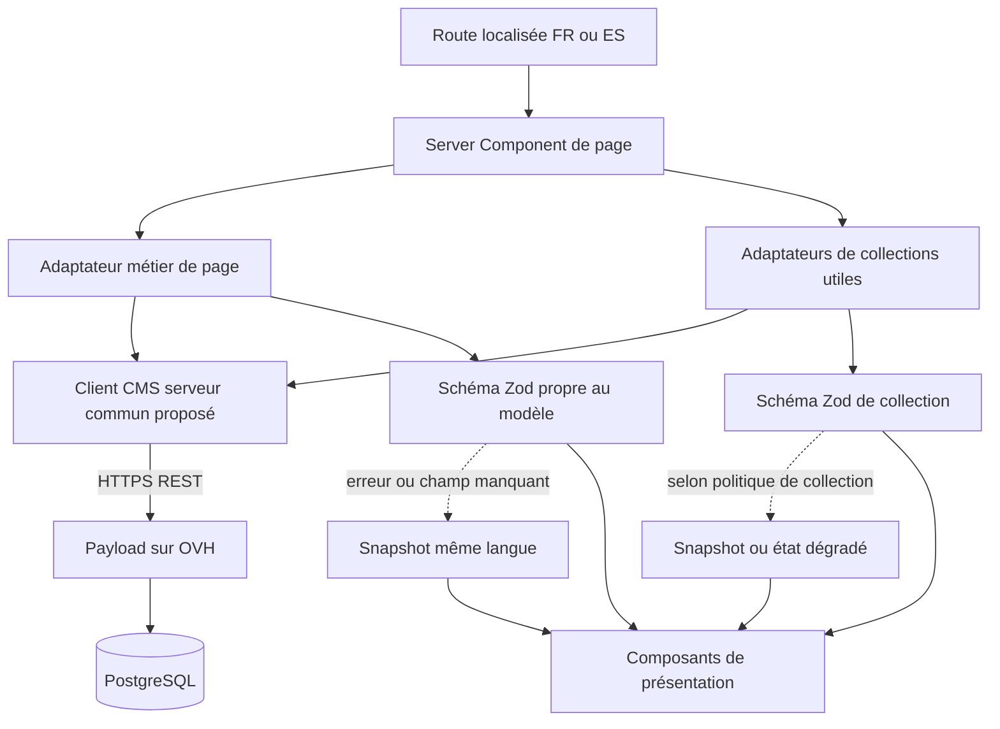
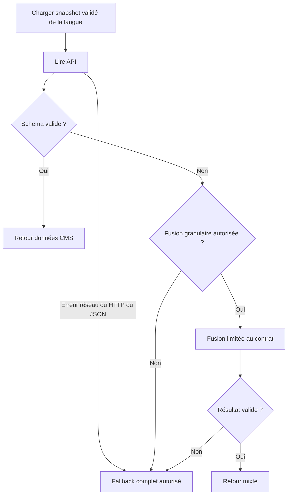

# T-IA-KI — Standard d'intégration CMS côté site web

**Dépôt :** `tiaki-website` · **Emplacement :** `docs/CMS_INTEGRATION.md`  
**Révision :** 25 novembre 2026 · **Statut :** standard proposé pour les futures intégrations ; Contact est la référence déployée.

## 1. Objet et périmètre

Ce document définit le contrat d'intégration des contenus publics de Payload CMS dans le site Next.js bilingue T-IA-KI. Il vise à éviter la duplication de la logique de récupération, de validation et de résilience lorsque les pages Accueil, À propos, Plateforme et d'autres pages seront progressivement administrables.

Il complète `CONTACT_PAGE.md`, qui décrit l'implémentation réelle de la page Contact. Le document correspondant côté serveur est `tiaki-backoffice/docs/CMS_ARCHITECTURE.md`. Les conventions proposées ici ne sont pas encore des modules implémentés dans le dépôt.

Principes :

- Payload est la source éditoriale de référence en fonctionnement nominal ; les snapshots versionnés sont des contenus de secours, pas une deuxième source à éditer manuellement en parallèle.
- Next.js maîtrise le rendu, les composants, les interactions, l'accessibilité, les règles métier et les identifiants techniques.
- Chaque modèle de contenu a un contrat d'exécution explicite, validé avant utilisation.
- Les deux langues (`fr`, `es`) sont traitées séparément ; aucune traduction implicite entre langues.
- L'intégration doit être livrée page par page, sans refonte inutile de l'interface déjà validée.
- Aucun accès privé ni traitement de données de santé n'est couvert par cette architecture publique. Les contenus de formulaire ne constituent pas une soumission ou un traitement de demandes.

## 2. État actuel et cible

| Capacité | État actuel | Cible |
|---|---|---|
| Contact | Global `contact-page` + collection `faqs`, FR/ES, déployé | Conserver le comportement ; mutualisation progressive |
| Accueil | Intégration complète à réaliser | Global `home-page` si structure fixe confirmée |
| À propos | Intégration complète à réaliser | Global `about-page` si structure fixe confirmée |
| Plateforme | Intégration complète à réaliser | Global `platform-page` pour la présentation publique |
| Articles, ressources, médias | Collections existantes côté CMS ; intégration détaillée à inventorier | Consommateurs adaptés aux listes et relations |
| Navigation, footer | À inventorier | Globals transversaux uniquement si besoin éditorial validé |

Les noms des pages et slugs futurs sont des propositions. Ne pas supposer que leurs routes, composants, champs et permissions sont déjà définis.



## 3. Organisation du code

### 3.1. Modules existants de référence

```text
lib/contact/
  getContactPage.ts
  getFaqs.ts
  schema.ts
  faqSchema.ts
  types.ts
  fallback.ts
  fallback.fr.json
  fallback.es.json
  faqFallback.ts
  faq-fallback.fr.json
  faq-fallback.es.json
  mergeWithFallback.ts
  validation.ts
  submission.ts
components/contact/
  ContactPage.tsx
  ContactHero.tsx
  ContactFAQ.tsx
  ContactForm.tsx
  ContactResources.tsx
  ContactParticipation.tsx
```

Arborescence partielle. Certains modules de constantes statiques peuvent subsister lorsqu'ils servent aux règles métier. Ne supprimer aucun fichier sur la seule base de son nom ; vérifier les imports et usages, puis reconstruire.

### 3.2. Arborescence cible proposée

```text
tiaki-website/
├── lib/
│   ├── i18n/                        # configuration des langues existante
│   ├── cms/                         # à créer progressivement
│   │   ├── config.ts                # origine et timeout
│   │   ├── client.ts                # lecture HTTP serveur
│   │   ├── validation.ts            # primitives Zod communes
│   │   └── mergeWithFallback.ts     # fusion textuelle, si réutilisable
│   ├── contact/                     # existant
│   ├── home/                        # proposé
│   │   ├── schema.ts
│   │   ├── types.ts
│   │   ├── getHomePage.ts
│   │   ├── fallback.ts
│   │   ├── fallback.fr.json
│   │   └── fallback.es.json
│   ├── about/                       # proposé, même convention
│   └── platform/                    # proposé, même convention
├── components/                      # composants propres à chaque page
└── docs/
    ├── CMS_INTEGRATION.md
    └── CONTACT_PAGE.md
```

Un fichier `types.ts` peut réexporter les types inférés, mais ne doit pas redéfinir à la main un contrat déjà décrit par Zod. Les schémas et snapshots restent propres à chaque modèle ; un adaptateur de collection peut devenir partagé lorsqu'il est réellement consommé par plusieurs pages.

**Règle de mutualisation :** extraire une responsabilité seulement lorsqu'un deuxième cas concret confirme qu'elle est commune. Ne pas refactoriser Contact pour créer abstraitement une architecture universelle avant d'avoir étudié la page suivante.

## 4. Configuration et accès au CMS

### 4.1. Environnements

| Variable | Local | Preview et Production lors de Contact |
|---|---|---|
| `TIAKI_BACKOFFICE_URL` | `http://localhost:3009` | `https://backoffice.tiaki.step.eco` |

Configuration dans `.env.local` en développement et Vercel Environment Variables pour les environnements concernés. Le domaine doit être une origine de confiance contrôlée par l'équipe. Ne jamais construire la destination réseau à partir d'une URL saisie par un visiteur. Ne pas utiliser de secret administrateur dans les requêtes de lecture publique ; ne pas exposer de jeton dans `NEXT_PUBLIC_*`.

Preview pointait vers le CMS de production lors des tests Contact. Cette configuration permet de vérifier la compatibilité, mais ne constitue pas une préproduction CMS indépendante. Pour tester des modifications de modèle ou des contenus non approuvés, utiliser le CMS local ou une instance de préproduction séparée.

### 4.2. Endpoints et localisation

| Modèle | Exemple de lecture |
|---|---|
| Global existant | `/api/globals/contact-page?locale=fr&fallback-locale=none` |
| Global futur | `/api/globals/home-page?locale=es&fallback-locale=none` |
| Collection | `/api/faqs?locale=fr&fallback-locale=none&where[published][equals]=true&sort=displayOrder&limit=100` |

Le paramètre `fallback-locale=none` empêche Payload de compléter silencieusement une traduction manquante à partir d'une autre langue. Le site gère sa propre stratégie de fallback, limitée à la langue demandée.

Utiliser `SiteLocale` depuis `lib/i18n/config` et la validation de locale de la couche de routage. Ne pas convertir arbitrairement une locale inconnue en français dans les adaptateurs CMS. Les règles de langue par défaut relèvent du routage.

Pour les collections, la politique de lecture publique doit être appliquée par le CMS ; les filtres côté site ne constituent pas un contrôle d'accès. Définir aussi le tri, la pagination, la profondeur des relations et les champs nécessaires. Le `limit=100` est le choix actuel des FAQ, pas une convention universelle.

### 4.3. Client serveur commun : proposition à valider

Le client commun devrait seulement gérer le transport (URL, paramètres, politique de cache, timeout, erreurs HTTP/JSON). Il ne doit pas connaître les modèles de page ni décider du fallback métier. Chaque adaptateur conserve la validation et la décision de dégradation.

Exemple minimal de futur `lib/cms/client.ts` (non implémenté à ce jour) :

```ts
import 'server-only'
import type { SiteLocale } from '@/lib/i18n/config'

const CMS_TIMEOUT_MS = 5_000

export async function readCmsJson(
  path: `/api/${string}`,
  locale: SiteLocale,
  params: Record<string, string> = {},
): Promise<unknown> {
  const base = process.env.TIAKI_BACKOFFICE_URL
  if (!base) throw new Error('CMS URL not configured')
  const origin = new URL(base)
  if (!['http:', 'https:'].includes(origin.protocol) || origin.username || origin.password) {
    throw new Error('Invalid CMS origin')
  }
  const url = new URL(path, origin)
  if (url.origin !== origin.origin || !url.pathname.startsWith('/api/')) {
    throw new Error('Invalid CMS path')
  }
  for (const [key, value] of Object.entries(params)) {
    url.searchParams.set(key, value)
  }
  url.searchParams.set('locale', locale)
  url.searchParams.set('fallback-locale', 'none')
  const response = await fetch(url, {
    cache: 'no-store',
    signal: AbortSignal.timeout(CMS_TIMEOUT_MS),
    redirect: 'error',
  })
  if (!response.ok) throw new Error(`CMS HTTP ${response.status}`)
  return response.json()
}
```

Les chemins et paramètres doivent provenir d'adaptateurs internes, jamais directement de l'utilisateur. `redirect: 'error'` est une proposition de durcissement à tester sur les endpoints réels ; ce n'est pas une propriété annoncée de l'implémentation Contact actuelle. Le client ci-dessus doit être compilé, testé et adapté au projet avant adoption. Une politique de cache différente devra être explicitement justifiée par modèle.

### 4.4. Journalisation et classification des erreurs

Distinguer la configuration manquante, la connexion refusée, le timeout, le HTTP non-2xx, le JSON invalide et l'échec de schéma. Les adaptateurs peuvent journaliser un contexte de page/collection, locale, type d'erreur et chemin Zod, sans exposer de données sensibles, en-têtes ou contenu complet.

Convention proposée :

```text
[HomePage][fr] CMS invalid content: hero.title
[HomePage][es] Using local fallback: timeout
[FAQs][fr] Using local fallback: HTTP 503
```

Éviter les messages de succès trompeurs lorsque le rendu repose sur des données de secours. Une métrique de fallback par page/locale serait utile pour l'exploitation ; aucun système de métriques dédié n'est revendiqué ici.

## 5. Contrats de données et typage

### 5.1. Validation avant rendu

Les types TypeScript décrivent les valeurs attendues à la compilation. Les types générés par Payload décrivent son modèle, mais ne valident pas un JSON reçu sur le réseau. Les schémas Zod de Next.js constituent le contrat de consommation à l'exécution.

Exemple de structure textuelle hypothétique pour une page Accueil (l'inventaire réel reste à faire) :

```ts
import { z } from 'zod'

const requiredText = z.string().trim().min(1)
export const homePageSchema = z.object({
  hero: z.object({ title: requiredText, description: requiredText }),
})
export type HomePageContent = z.infer<typeof homePageSchema>
```

Le schéma peut ignorer les métadonnées inconnues qui ne sont pas consommées. Il doit en revanche détecter tous les champs réellement nécessaires au rendu. Ne pas rendre toutes les propriétés optionnelles pour masquer des erreurs. Distinguer les champs facultatifs dans PostgreSQL des champs indispensables au site après fallback.

### 5.2. Types de valeurs et règles

| Type de contenu | Validation à prévoir |
|---|---|
| Texte requis | Chaîne non vide après trim |
| Texte facultatif | Absence/null/vide selon sémantique documentée |
| Identifiant métier | Valeurs énumérées ou identifiants stables, non traduits |
| Lien | Protocoles, destinations et routes autorisés ; refuser les schémas dangereux |
| Image / média | Forme de la relation, URL de confiance, texte alternatif, taille/type selon usage |
| Nombre / booléen | Type strict, bornes et sémantique ; `0` et `false` peuvent être valides |
| Tableau / blocs | Schéma de chaque élément, ordre et identité ; discriminer le type de bloc |
| Texte riche | Format et rendu contrôlés ; ne pas injecter de HTML arbitraire non assaini |

Les champs de texte ne doivent pas être utilisés pour injecter des classes CSS, du JavaScript ou des règles de sécurité. En présence de contenus riches, utiliser un rendu adapté au modèle Payload et une liste de composants autorisés ; définir la politique de sanitisation.

## 6. Fallbacks et résilience

### 6.1. Choix par nature des données

| Données | Stratégie |
|---|---|
| Global Contact : groupes textuels fixes | Fusion par feuille invalide, puis validation du résultat |
| FAQ : collection publiée | Snapshot complet si API/schéma échoue ; liste valide vide respectée |
| Tableau administrable et ordonné | Politique à définir : snapshot complet ou fusion par identifiant stable, jamais par index sans justification |
| Médias/relations | Politique à définir : visuel local autorisé, omission ou autre état explicite ; vérifier disponibilité et droits |
| Information urgente, rétractée, sensible | État dégradé sans ancienne donnée si nécessaire ; pas de snapshot public par défaut |

L'algorithme `mergeWithFallback` de Contact suit la structure du snapshot et remplace uniquement les feuilles textuelles invalides. Il ne convient pas automatiquement aux objets contenant des tableaux, des booléens, des valeurs numériques ou des champs volontairement vides. Une valeur valide `false`, `0` ou `[]` n'est pas une erreur.

### 6.2. Pipeline standard



Les schémas de secours doivent être validés avant commit et build. Contact valide les snapshots à l'import du module ; un snapshot invalide peut empêcher le rendu, y compris en mode normal. Ne pas avaler une erreur de snapshot et retourner des données non typées. Préférer des contrôles automatisés explicites en CI avant le déploiement.

### 6.3. Maintenance des snapshots

Pour chaque page, stocker un snapshot FR et ES, exportés depuis un environnement approuvé, avec métadonnées techniques inutiles retirées et validés avec le schéma réel. La procédure détaillée Contact est dans `CONTACT_PAGE.md` § 7.

1. Télécharger dans un dossier temporaire, avec `curl -fsS` et timeout.
2. Vérifier la langue, le statut de publication, la pagination et les valeurs attendues.
3. Parser les deux réponses avec Zod et produire les objets validés.
4. Comparer les changements, vérifier l'absence de contenu de test ou de données privées.
5. Remplacer les fichiers après validation de l'ensemble, tester, commiter et redéployer.

Les snapshots ne se mettent pas à jour automatiquement lorsque l'éditeur modifie Payload. Définir un responsable et des déclencheurs de mise à jour. Une FAQ dépubliée peut réapparaître pendant une indisponibilité si le snapshot n'a pas été actualisé. Pour une suppression impérative, appliquer rapidement une politique adaptée (mise à jour/redéploiement ou absence de fallback pour ce contenu). Ne pas promettre de disponibilité absolue.

## 7. Rendu et performance

Un Server Component de page orchestre les adaptateurs et transmet des props validées aux composants. Garder les composants interactifs côté client seulement si nécessaire (`useState`, événements, etc.). Le navigateur ne doit pas recevoir de secret, config privée ou réponse API plus large que nécessaire.

Contact est la référence :

```tsx
const [content, questions] = await Promise.all([
  getContactPage(locale),
  getFaqs(locale),
])
```

Les deux fonctions récupèrent indépendamment les données. Avec un timeout nominal de 5 s chacune, la concurrence réduit l'attente réseau maximale théorique du couple d'environ 10 s à environ 5 s si elles atteignent simultanément leur délai. Ce n'est pas une garantie sur le temps de rendu total. `Promise.all` rejette si une promesse rejette ; la résilience dépend donc du contrat de chaque adaptateur. Un snapshot invalide ou une erreur non prévue peut toujours faire échouer la page.

Ne pas paralléliser sans limite des requêtes dépendantes ou de nombreuses relations. Déterminer si un Global suffit, si les relations sont peuplées avec une profondeur raisonnable, ou si une collection exige pagination. Mesurer la latence et la charge avant d'introduire retries, cache ou révalidation. Contact utilise `cache: 'no-store'` : une nouvelle requête serveur consulte le CMS, mais cela ne garantit pas une actualisation instantanée d'une page déjà ouverte ou d'un cache de navigation.

Un futur cache devra définir sa durée, son invalidation, la séparation FR/ES et la stratégie de contenu rétracté. Ne pas appliquer automatiquement la politique Contact à toutes les pages.

## 8. Démarche d'intégration page par page

| Étape | Travail et résultat attendu |
|---:|---|
| 1 | Inventorier composants, textes statiques FR/ES, assets, liens, listes, données partagées, contraintes d'accessibilité et logique métier. |
| 2 | Arbitrer Global, collection ou relation avec l'équipe CMS et les éditeurs ; figer le contrat de champs et les règles de fallback. |
| 3 | Implémenter le modèle Payload, localiser et exporter des contenus approuvés ; générer et tester la migration. |
| 4 | Construire les schémas Zod, types et snapshots FR/ES ; les valider en local. |
| 5 | Implémenter la récupération serveur et la stratégie de résilience ; extraire seulement les mécanismes partagés réellement nécessaires. |
| 6 | Adapter les props des composants section par section sans changer leur rendu ou leurs interactions involontairement. |
| 7 | Tester API, données, langues, fallback et non-régression ; compiler et contrôler le lint. |
| 8 | Déployer le CMS et importer les contenus avant le site ; valider les réponses de production. |
| 9 | PR vers `dev`, recette Vercel Preview, PR vers `main`, recette de production. |
| 10 | Documenter le modèle et les fichiers de secours, les décisions de cache et les limites. |

La prochaine intégration recommandée est Accueil, sous réserve de l'arbitrage du backlog. Commencer par l'inventaire, pas par la création automatique d'un Global ou d'un client générique.

### Fiche de contrat à remplir avant chaque intégration

```markdown
# Page : [nom]
- Routes et locales :
- Composants existants :
- Source actuelle des textes et médias :
- Global / collections / relations proposés :
- Champs éditoriaux et règles de localisation :
- Identifiants et règles métier conservés dans le code :
- Valeurs requises et valeurs volontairement vides :
- Stratégie fallback par type de contenu :
- Contrat Zod et snapshots :
- Politique cache, timeout, pagination :
- Accessibilité, liens et médias :
- Migration et ordre de livraison :
- Tests de recette et responsable éditorial :
- Risques et décisions ouvertes :
```

## 9. Tests et critères d'acceptation

| ID | Scénario | Attendu |
|---|---|---|
| T01 | Champ requis absent/invalide | Fallback granulaire si autorisé, autres champs conservés |
| T02 | CMS indisponible | Rendu dégradé conformément au contrat ; pas d'erreur non gérée |
| T03 | CMS rétabli | Retour aux données CMS lors d'une nouvelle requête serveur |
| T04 | Traduction manquante | Aucun mélange de langues ; traitement selon politique de locale |
| T05 | CMS accepte la connexion mais ne répond pas | Requête interrompue ; rendu dégradé, temps mesuré hors compilation |
| T06 | JSON invalide / HTTP 500 | Erreur classifiée, fallback ou état explicite |
| T07 | Collection volontairement vide | Pas de réapparition d'éléments si la réponse vide est valide |
| T08 | Snapshot non conforme | Contrôle local/CI échoue avant livraison |
| T09 | Champs supplémentaires dans API | Pas de rupture pour les consommateurs compatibles |
| T10 | Liens, médias, listes et responsive | Contrat spécifique respecté, accessibilité contrôlée |
| T11 | Modifications CMS FR/ES | Nouvelles données visibles, contenus originaux restaurés après essai autorisé |
| T12 | Autres pages et langues | Absence de régression dans le périmètre testé |

T01 à T05 ont été réalisés pour Contact selon la recette communiquée. Les tests supplémentaires sont proposés pour les futures intégrations ; leur automatisation n'est pas établie. Les scénarios destructifs et timeouts doivent être exécutés en local ou en environnement isolé, jamais en arrêtant la production.

Contrôles techniques depuis le site :

```bash
pnpm exec tsc --noEmit
pnpm run lint
pnpm run build
```

Recommandation CI : tests unitaires des schémas, de la fusion et de la récupération (transport simulé), validation des snapshots dans les deux langues, tests d'intégration contre CMS isolé, tests E2E sur Preview. Ne pas remplacer ces contrôles par la seule compilation.

## 10. Livraison, exploitation et compatibilité

Le site suit `branche fonctionnelle → dev → main`. Le CMS suit sa CI, publication Docker et déploiement OVH séparés. Livrer d'abord le schéma et les contenus CMS, puis le consommateur du site. Voir `tiaki-backoffice/docs/DEPLOYMENT.md` pour la procédure détaillée.

Préférer les évolutions additives : ajouter une propriété compatible, remplir FR/ES, déployer le nouveau lecteur, puis retirer l'ancien champ dans une livraison ultérieure si plus aucun consommateur ne l'utilise. Un renommage ou changement de type peut casser les schémas et les snapshots. Un rollback du site ne nécessite pas nécessairement de revenir sur la DB ; vérifier la compatibilité avant toute action.

| Symptôme | Première vérification |
|---|---|
| Site OK mais contenu CMS invisible | `TIAKI_BACKOFFICE_URL`, logs fallback, réponse publique sans fallback linguistique |
| Erreur uniquement ES | Traductions ES, schéma et snapshot ES |
| Page lente | Temps API, concurrence, nombre de requêtes, timeout, compilation |
| Champ vide | Distinguer valeur volontaire et erreur ; examiner contrat et édition |
| Média absent | URL, droits, relation, configuration Next Image si utilisée |
| FAQ dépubliée toujours visible | Source CMS, publication, cache éventuel et snapshot |

## 11. Critères de fin et dette technique

Une page est intégrée lorsque le modèle est déployé, les contenus FR/ES approuvés et validés, les composants et interactions testés, la politique de fallback documentée, le build et les contrôles réussis, la Preview et la production validées et les limites consignées. Un HTTP 200 ne suffit pas à démontrer le fonctionnement nominal du CMS.

Travaux transversaux à prioriser : client commun à extraire au deuxième cas réel ; validation automatisée des snapshots ; gestion des médias et des listes ; métriques d'erreurs/fallback ; environnement de préproduction isolé ; règles de publication et retrait de contenu. Ne pas modifier l'intégration Contact déjà stable sans tests de non-régression.

## 12. Références

- `CONTACT_PAGE.md` : implémentation réelle de référence et maintenance des snapshots.
- `tiaki-backoffice/docs/CONTACT_GLOBAL.md` : modèle de données Contact, droits, API et import.
- `tiaki-backoffice/docs/CMS_ARCHITECTURE.md` : standard de modélisation proposé.
- `tiaki-backoffice/docs/DEPLOYMENT.md` : runbook de livraison.
- [Next.js — Fetch API](https://nextjs.org/docs/app/api-reference/functions/fetch)
- [Next.js — Server and Client Components](https://nextjs.org/docs/app/getting-started/server-and-client-components)
- [Zod — Documentation](https://zod.dev/)
- [Payload — REST API](https://payloadcms.com/docs/rest-api/overview)
- [Payload — Localization](https://payloadcms.com/docs/configuration/localization)

Ce document est fondé sur la livraison Contact et les documents de référence disponibles. Les exemples d'Accueil et du client commun sont des propositions, non du code déjà livré ; ils n'ont pas été compilés contre le dépôt réel.
