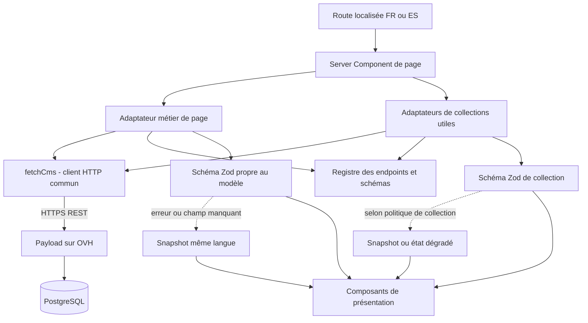
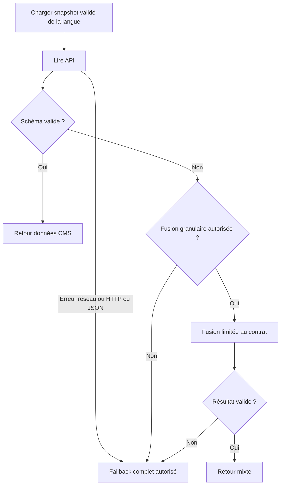
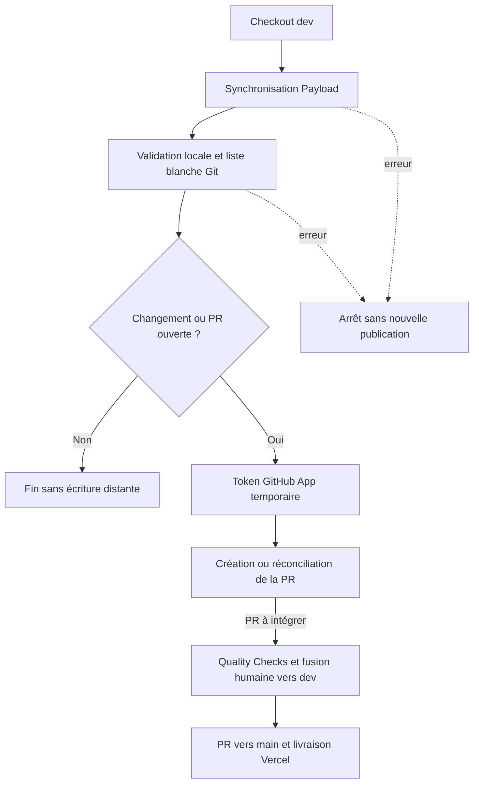

# T-IA-KI — Standard d'intégration CMS côté site web

**Dépôt :** `tiaki-website` · **Emplacement :** `docs/CMS_INTEGRATION.md`

**Révision :** 27 novembre 2026 · **Statut :** socle CMS opérationnel ; recette manuelle CMS-02 validée, déclenchement planifié et migration Client ID à confirmer.

## 1. Objet et périmètre

Ce document définit le contrat d'intégration des contenus publics de Payload CMS dans le site Next.js bilingue T-IA-KI. Il vise à éviter la duplication de la logique de récupération, de validation et de résilience lorsque les pages Accueil, À propos, Plateforme et d'autres pages seront progressivement administrables.

Il complète `CONTACT_PAGE.md`, qui décrit l'implémentation réelle de la page Contact. Le document correspondant côté serveur est `tiaki-backoffice/docs/CMS_ARCHITECTURE.md`. Le socle commun (CMS-01), la validation des snapshots (CMS-03) et leur synchronisation automatisée (CMS-02) sont implémentés. La page Contact constitue la référence déployée ; les conventions des prochaines pages restent à adapter à leurs besoins.

Principes :

- Payload est la source éditoriale de référence en fonctionnement nominal ; les snapshots versionnés sont des contenus de secours, pas une deuxième source à éditer manuellement en parallèle.
- Next.js maîtrise le rendu, les composants, les interactions, l'accessibilité, les règles métier et les identifiants techniques.
- Chaque modèle de contenu a un contrat d'exécution explicite, validé avant utilisation.
- Les deux langues (`fr`, `es`) sont traitées séparément ; aucune traduction implicite entre langues.
- L'intégration doit être livrée page par page, sans refonte inutile de l'interface déjà validée.
- Aucun accès privé ni traitement de données de santé n'est couvert par cette architecture publique. Les contenus de formulaire ne constituent pas une soumission ou un traitement de demandes.

## 2. État actuel et cible

|Capacité|État actuel|Cible|
|---|---|---|
|Contact|Global `contact-page` + collection `faqs`, FR/ES ; CMS-01 déployé|Référence pour les futures pages|
|Couche commune|Socle CMS-01 et modules de synchronisation CMS-02|Réutiliser pour les prochaines pages|
|Validation des snapshots (CMS-03)|Implémentée et intégrée au build et à la CI|Maintenir la conformité pour chaque nouveau modèle|
|Synchronisation des snapshots (CMS-02)|Workflow déployé sur `main` ; recette manuelle validée|Confirmer la première exécution planifiée et la migration vers `client-id`|
|Déclenchement manuel (CMS-05)|`workflow_dispatch` opérationnel|Formaliser les éventuels besoins complémentaires|
|Accueil|Intégration complète à réaliser|Global `home-page` si structure fixe confirmée|
|À propos|Intégration complète à réaliser|Global `about-page` si structure fixe confirmée|
|Plateforme|Intégration complète à réaliser|Global `platform-page` pour la présentation publique|
|Articles, ressources, médias|Collections existantes côté CMS ; intégration détaillée à inventorier|Consommateurs adaptés aux listes et relations|
|Navigation, footer|À inventorier|Globals transversaux uniquement si besoin éditorial validé|

Les noms des pages et slugs futurs sont des propositions. Ne pas supposer que leurs routes, composants, champs et permissions sont déjà définis.



## 3. Organisation du code

### 3.1. Modules existants de référence

```
lib/cms/
  config.ts
  client.ts
  validation.ts
  mergeWithFallback.ts
  registry.ts
  pagination.ts
  comparison.ts
  persistence.ts
lib/contact/
  getContactPage.ts
  getFaqs.ts
  schema.ts
  faqSchema.ts
  types.ts
  fallback.ts
  fallback.fr.json
  fallback.es.json
  faqFallback.ts
  faq-fallback.fr.json
  faq-fallback.es.json
  validation.ts
  submission.ts
components/contact/
  ContactPage.tsx
  ContactHero.tsx
  ContactFAQ.tsx
  ContactForm.tsx
  ContactResources.tsx
  ContactParticipation.tsx
scripts/
  validate-cms-fallbacks.ts
  sync-cms-fallbacks.ts
  check-cms-sync-changes.ts
  tests/
    persistence.test.ts
    check-cms-sync-changes.test.ts
.github/workflows/
  ci.yml
  sync-cms-fallbacks.yml
```

Arborescence partielle. Certains modules de constantes statiques peuvent subsister lorsqu'ils servent aux règles métier. Ne supprimer aucun fichier sur la seule base de son nom ; vérifier les imports et usages, puis reconstruire.

### 3.2. Arborescence cible proposée

```
tiaki-website/
├── lib/
│   ├── i18n/                        # configuration des langues existante
│   ├── cms/                         # socle CMS-01 et CMS-02
│   │   ├── config.ts                # origine et timeout
│   │   ├── client.ts                # lecture HTTP serveur
│   │   ├── validation.ts            # primitives Zod communes
│   │   ├── mergeWithFallback.ts     # fusion textuelle
│   │   ├── registry.ts              # types, endpoints, schémas, paramètres, snapshots
│   │   ├── pagination.ts            # pagination de synchronisation
│   │   ├── comparison.ts            # comparaison et sérialisation
│   │   └── persistence.ts           # préparation et remplacement
│   ├── contact/                     # existant
│   ├── home/                        # proposé
│   │   ├── schema.ts
│   │   ├── types.ts
│   │   ├── getHomePage.ts
│   │   ├── fallback.ts
│   │   ├── fallback.fr.json
│   │   └── fallback.es.json
│   ├── about/                       # proposé, même convention
│   └── platform/                    # proposé, même convention
├── components/                      # composants propres à chaque page
├── scripts/                         # validation, synchronisation et tests
├── .github/workflows/               # CI et automatisation
└── docs/
    ├── CMS_INTEGRATION.md
    ├── CONTACT_PAGE.md
    └── CI_CD.md
```

Un fichier `types.ts` peut réexporter les types inférés, mais ne doit pas redéfinir à la main un contrat déjà décrit par Zod. Les schémas et snapshots restent propres à chaque modèle ; un adaptateur de collection peut devenir partagé lorsqu'il est réellement consommé par plusieurs pages.

**Règle de mutualisation :** CMS-01 extrait les mécanismes déjà communs à Contact et FAQ, notamment pour préparer la synchronisation. Ne pas généraliser les modèles métier ou la fusion textuelle à des types de données non couverts ; enrichir le socle selon les besoins réels.

## 4. Configuration et accès au CMS

### 4.1. Environnements

|Variable|Local|Preview et Production lors de Contact|
|---|---|---|
|`TIAKI_BACKOFFICE_URL`|`http://localhost:3009`|`https://backoffice.tiaki.step.eco`|

Configuration dans `.env.local` en développement et Vercel Environment Variables pour les environnements concernés. Le domaine doit être une origine de confiance contrôlée par l'équipe. Ne jamais construire la destination réseau à partir d'une URL saisie par un visiteur. Ne pas utiliser de secret administrateur dans les requêtes de lecture publique ; ne pas exposer de jeton dans `NEXT_PUBLIC_*`.

Preview pointait vers le CMS de production lors des tests Contact. Cette configuration permet de vérifier la compatibilité, mais ne constitue pas une préproduction CMS indépendante. Pour tester des modifications de modèle ou des contenus non approuvés, utiliser le CMS local ou une instance de préproduction séparée.

### 4.2. Endpoints et localisation

|Modèle|Exemple de lecture|
|---|---|
|Global existant|`/api/globals/contact-page?locale=fr&fallback-locale=none`|
|Global futur|`/api/globals/home-page?locale=es&fallback-locale=none`|
|Collection|`/api/faqs?locale=fr&fallback-locale=none&where[published][equals]=true&sort=displayOrder,id&limit=100`|

Le paramètre `fallback-locale=none` empêche Payload de compléter silencieusement une traduction manquante à partir d'une autre langue. Le site gère sa propre stratégie de fallback, limitée à la langue demandée.

Utiliser `SiteLocale` depuis `lib/i18n/config` et la validation de locale de la couche de routage. Ne pas convertir arbitrairement une locale inconnue en français dans les adaptateurs CMS. Les règles de langue par défaut relèvent du routage.

Pour les collections, la politique de lecture publique doit être appliquée par le CMS ; les filtres côté site ne constituent pas un contrôle d'accès. Définir aussi le tri, la pagination, la profondeur des relations et les champs nécessaires. Le `limit=100` est le choix actuel des FAQ, pas une convention universelle.

### 4.3. Configuration et client commun (CMS-01)

`lib/cms/config.ts` centralise `CMS_REQUEST_TIMEOUT_MS = 5_000`, `CMS_FALLBACK_LOCALE = "none"`, `CMS_MAX_PAGINATION_PAGES = 100` et `getCmsBaseUrl()`. Cette dernière lit et nettoie `TIAKI_BACKOFFICE_URL` à l'appel, construit une `URL`, exige HTTP ou HTTPS et lève une exception si la configuration est invalide. Les adaptateurs interceptent cette exception pour appliquer leur fallback.

Le client implémenté est le suivant (extrait de l'implémentation réalisée pendant CMS-01) :

```
import {
  CMS_REQUEST_TIMEOUT_MS,
  CMS_FALLBACK_LOCALE,
  getCmsBaseUrl,
} from "./config"
type CmsRequestOptions = {
  locale: "fr" | "es"
  query?: Record<string, string>
}
export async function fetchCms(
  endpoint: `/api/${string}`,
  { locale, query = {} }: CmsRequestOptions,
): Promise<unknown> {
  const url = new URL(endpoint, getCmsBaseUrl())
  for (const [key, value] of Object.entries(query)) {
    url.searchParams.set(key, value)
  }
  url.searchParams.set("locale", locale)
  url.searchParams.set("fallback-locale", CMS_FALLBACK_LOCALE)
  const response = await fetch(url, {
    cache: "no-store",
    signal: AbortSignal.timeout(CMS_REQUEST_TIMEOUT_MS),
  })
  if (!response.ok) {
    throw new Error(`[CMS][${locale}] ${endpoint}: HTTP ${response.status}`)
  }
  return response.json()
}
```

Les paramètres linguistiques sont imposés après les paramètres spécifiques. Le retour `unknown` ne présume pas de la conformité du JSON : le schéma métier doit être appliqué avant le rendu. Le client propage les erreurs réseau, HTTP et JSON sans appliquer de fallback. Les adaptateurs `getContactPage.ts` et `getFaqs.ts` restent protégés par `import "server-only"` ; le client et les schémas partagés n'importent volontairement pas cette protection pour préparer leur utilisation hors Next.js. Ne jamais les importer dans un composant client pour réaliser une lecture CMS depuis le navigateur.

La destination et les paramètres proviennent du code interne. La signature TypeScript n'est pas une validation de sécurité à l'exécution. La restriction explicite de l'origine, le refus des identifiants intégrés à l'URL et des redirections demeurent des pistes de durcissement, non implémentées ici. Une politique de cache différente doit être explicitement justifiée par modèle.

#### 4.3.1. Registre déclaratif

`lib/cms/registry.ts` exporte `CmsContentDefinition`, `cmsRegistry` et `CmsContentKey` (`"contact" | "faqs"` à ce stade). Chaque entrée fournit `kind` (`global` ou `collection`), `endpoint`, `schema`, `snapshotPaths` pour FR/ES et éventuellement `query`. Le registre est déclaré avec `satisfies Record<string, CmsContentDefinition>` pour préserver les types précis des schémas et des clés.

|Clé|Type|Endpoint|Schéma|Snapshots sous `lib/contact/`|
|---|---|---|---|---|
|`contact`|`global`|`/api/globals/contact-page`|`contactPageSchema`|`fallback.fr.json`, `fallback.es.json`|
|`faqs`|`collection`|`/api/faqs`|`faqResponseSchema`|`faq-fallback.fr.json`, `faq-fallback.es.json`|

L'entrée `faqs` fixe `where[published][equals]=true`, `sort=displayOrder,id`, `limit=100`. Les chemins sont relatifs à la racine du dépôt. Le registre référence les schémas métier ; ceux-ci importent les primitives communes, jamais le registre (éviter les cycles). La lecture et l’écriture des fichiers relèvent des scripts, pas du registre. CMS-02 récupère toutes les pages des collections pour les snapshots ; la lecture des FAQ au rendu reste limitée à une requête de 100 documents. Les futurs modèles nécessitant d’autres transformations doivent définir une politique adaptée.

### 4.4. Journalisation et classification des erreurs

Distinguer la configuration manquante, la connexion refusée, le timeout, le HTTP non-2xx, le JSON invalide et l'échec de schéma. Les adaptateurs peuvent journaliser un contexte de page/collection, locale, type d'erreur et chemin Zod, sans exposer de données sensibles, en-têtes ou contenu complet.

Convention proposée :

```
[HomePage][fr] CMS invalid content: hero.title
[HomePage][es] Using local fallback: timeout
[FAQs][fr] Using local fallback: HTTP 503
```

Éviter les messages de succès trompeurs lorsque le rendu repose sur des données de secours. Une métrique de fallback par page/locale serait utile pour l'exploitation ; aucun système de métriques dédié n'est revendiqué ici.

## 5. Contrats de données et typage

### 5.1. Validation avant rendu

Les types TypeScript décrivent les valeurs attendues à la compilation. Les types générés par Payload décrivent son modèle, mais ne valident pas un JSON reçu sur le réseau. Les schémas Zod de Next.js constituent le contrat de consommation à l'exécution.

Exemple de structure textuelle hypothétique pour une page Accueil (l'inventaire réel reste à faire) :

```
import { z } from 'zod'
import { requiredText } from '../cms/validation'
export const homePageSchema = z.object({
  hero: z.object({ title: requiredText, description: requiredText }),
})
export type HomePageContent = z.infer<typeof homePageSchema>
```

Le schéma peut ignorer les métadonnées inconnues qui ne sont pas consommées. Il doit en revanche détecter tous les champs réellement nécessaires au rendu. Ne pas rendre toutes les propriétés optionnelles pour masquer des erreurs. Distinguer les champs facultatifs dans PostgreSQL des champs indispensables au site après fallback.

`lib/cms/validation.ts` exporte actuellement une seule primitive : `requiredText = z.string().trim().min(1)`. Contact et FAQ l'utilisent ; les autres primitives seront ajoutées selon les besoins.

### 5.2. Types de valeurs et règles

|Type de contenu|Validation à prévoir|
|---|---|
|Texte requis|Chaîne non vide après trim|
|Texte facultatif|Absence/null/vide selon sémantique documentée|
|Identifiant métier|Valeurs énumérées ou identifiants stables, non traduits|
|Lien|Protocoles, destinations et routes autorisés ; refuser les schémas dangereux|
|Image / média|Forme de la relation, URL de confiance, texte alternatif, taille/type selon usage|
|Nombre / booléen|Type strict, bornes et sémantique ; `0` et `false` peuvent être valides|
|Tableau / blocs|Schéma de chaque élément, ordre et identité ; discriminer le type de bloc|
|Texte riche|Format et rendu contrôlés ; ne pas injecter de HTML arbitraire non assaini|

Les champs de texte ne doivent pas être utilisés pour injecter des classes CSS, du JavaScript ou des règles de sécurité. En présence de contenus riches, utiliser un rendu adapté au modèle Payload et une liste de composants autorisés ; définir la politique de sanitisation.

## 6. Fallbacks et résilience

### 6.1. Choix par nature des données

|Données|Stratégie|
|---|---|
|Global Contact : groupes textuels fixes|Fusion par feuille invalide, puis validation du résultat|
|FAQ : collection publiée|Snapshot complet si API/schéma échoue ; liste valide vide respectée|
|Tableau administrable et ordonné|Politique à définir : snapshot complet ou fusion par identifiant stable, jamais par index sans justification|
|Médias/relations|Politique à définir : visuel local autorisé, omission ou autre état explicite ; vérifier disponibilité et droits|
|Information urgente, rétractée, sensible|État dégradé sans ancienne donnée si nécessaire ; pas de snapshot public par défaut|

L'algorithme `lib/cms/mergeWithFallback.ts`, transféré sans changement de logique depuis Contact, suit la structure du snapshot et remplace uniquement les feuilles textuelles invalides. Il ne convient pas automatiquement aux objets contenant des tableaux, des booléens, des valeurs numériques ou des champs volontairement vides. Une valeur valide `false`, `0` ou `[]` n'est pas une erreur.

### 6.2. Pipeline standard



Les snapshots de secours doivent être validés avant commit et build. `pnpm cms:validate` est intégré au build depuis CMS-03. Contact valide les snapshots à l'import du module ; un snapshot invalide peut empêcher le rendu, y compris en mode normal. Ne pas avaler une erreur de snapshot et retourner des données non typées. Préférer des contrôles automatisés explicites en CI avant le déploiement.

### 6.3. Maintenance des snapshots

Pour chaque modèle, conserver un snapshot FR et ES, issu de contenus publics approuvés et conforme au schéma réel. La maintenance courante est assurée par `pnpm cms:sync` ou le workflow GitHub Actions (voir § 13). La procédure d’export manuel historique de Contact reste documentée dans `CONTACT_PAGE.md` § 7 ; elle est réservée à l’initialisation ou au diagnostic.

La synchronisation est distincte du rendu dynamique : une édition dans Payload ne modifie pas immédiatement les snapshots embarqués. La version de secours en production ne change qu’après fusion vers `dev`, livraison vers `main` et déploiement Vercel.

Une FAQ dépubliée peut réapparaître pendant une indisponibilité si le snapshot déployé est ancien. Pour un retrait impératif, appliquer rapidement une politique adaptée (mise à jour/redéploiement ou désactivation du fallback concerné). Ne pas promettre de disponibilité absolue.

### 6.4. Feuille de route des snapshots

| User Story | État au 27 novembre 2026 |
|---|---|
| CMS-01 — Socle commun | Déployé |
| CMS-03 — Validation et intégrité | Déployée, intégrée au build et à la CI (voir § 12) |
| CMS-02 — Synchronisation automatique | Déployée ; recette manuelle validée, recette finale à clôturer (voir § 13) |
| CMS-05 — Déclenchement manuel | Déclenchement opérationnel dans CMS-02 ; éventuels compléments à arbitrer |
| CMS-04 — Supervision | À réaliser |
| CMS-06 — Retrait et dépublication | À réaliser |
| CMS-07 — Stockage Last Known Good | À étudier |

## 7. Rendu et performance

Un Server Component de page orchestre les adaptateurs et transmet des props validées aux composants. Garder les composants interactifs côté client seulement si nécessaire (`useState`, événements, etc.). Le navigateur ne doit pas recevoir de secret, config privée ou réponse API plus large que nécessaire.

Contact est la référence :

```
const [content, questions] = await Promise.all([
  getContactPage(locale),
  getFaqs(locale),
])
```

Les deux fonctions récupèrent indépendamment les données. Avec un timeout nominal de 5 s chacune, la concurrence réduit l'attente réseau maximale théorique du couple d'environ 10 s à environ 5 s si elles atteignent simultanément leur délai. Ce n'est pas une garantie sur le temps de rendu total. `Promise.all` rejette si une promesse rejette ; la résilience dépend donc du contrat de chaque adaptateur. Un snapshot invalide ou une erreur non prévue peut toujours faire échouer la page.

Ne pas paralléliser sans limite des requêtes dépendantes ou de nombreuses relations. Déterminer si un Global suffit, si les relations sont peuplées avec une profondeur raisonnable, ou si une collection exige pagination. Mesurer la latence et la charge avant d'introduire retries, cache ou révalidation. Contact utilise `cache: 'no-store'` : une nouvelle requête serveur consulte le CMS, mais cela ne garantit pas une actualisation instantanée d'une page déjà ouverte ou d'un cache de navigation.

Un futur cache devra définir sa durée, son invalidation, la séparation FR/ES et la stratégie de contenu rétracté. Ne pas appliquer automatiquement la politique Contact à toutes les pages.

## 8. Démarche d'intégration page par page

|Étape|Travail et résultat attendu|
|--:|---|
|1|Inventorier composants, textes statiques FR/ES, assets, liens, listes, données partagées, contraintes d'accessibilité et logique métier.|
|2|Arbitrer Global, collection ou relation avec l'équipe CMS et les éditeurs ; figer le contrat de champs et les règles de fallback.|
|3|Implémenter le modèle Payload, localiser et exporter des contenus approuvés ; générer et tester la migration.|
|4|Construire les schémas Zod, types et snapshots FR/ES ; les valider en local.|
|5|Déclarer le contenu dans `cmsRegistry`, réutiliser `fetchCms()` et les primitives communes ; définir la stratégie de résilience propre au modèle.|
|6|Adapter les props des composants section par section sans changer leur rendu ou leurs interactions involontairement.|
|7|Tester API, données, langues, fallback et non-régression ; compiler et contrôler le lint.|
|8|Déployer le CMS et importer les contenus avant le site ; valider les réponses de production.|
|9|PR vers `dev`, recette Vercel Preview, PR vers `main`, recette de production.|
|10|Documenter le modèle et les fichiers de secours, les décisions de cache et les limites.|

Le socle CMS-01 et la validation CMS-03 sont déployés ; CMS-02 est opérationnel en déclenchement manuel et sa recette finale reste à clôturer. La prochaine intégration éditoriale recommandée est Accueil. Commencer cette page par son inventaire, non par la création automatique d'un Global.

### 8.1. Fiche de contrat à remplir avant chaque intégration

```
# Page : [nom]
- Routes et locales :
- Composants existants :
- Source actuelle des textes et médias :
- Global / collections / relations proposés :
- Champs éditoriaux et règles de localisation :
- Identifiants et règles métier conservés dans le code :
- Valeurs requises et valeurs volontairement vides :
- Stratégie fallback par type de contenu :
- Contrat Zod et snapshots :
- Politique cache, timeout, pagination :
- Accessibilité, liens et médias :
- Migration et ordre de livraison :
- Tests de recette et responsable éditorial :
- Risques et décisions ouvertes :
```

## 9. Tests et critères d'acceptation

|ID|Scénario|Attendu|
|---|---|---|
|T01|Champ requis absent/invalide|Fallback granulaire si autorisé, autres champs conservés|
|T02|CMS indisponible|Rendu dégradé conformément au contrat ; pas d'erreur non gérée|
|T03|CMS rétabli|Retour aux données CMS lors d'une nouvelle requête serveur|
|T04|Traduction manquante|Aucun mélange de langues ; traitement selon politique de locale|
|T05|CMS accepte la connexion mais ne répond pas|Requête interrompue ; rendu dégradé, temps mesuré hors compilation|
|T06|JSON invalide / HTTP 500|Erreur classifiée, fallback ou état explicite|
|T07|Collection volontairement vide|Pas de réapparition d'éléments si la réponse vide est valide|
|T08|Snapshot non conforme|Contrôle local/CI échoue avant livraison|
|T09|Champs supplémentaires dans API|Pas de rupture pour les consommateurs compatibles|
|T10|Liens, médias, listes et responsive|Contrat spécifique respecté, accessibilité contrôlée|
|T11|Modifications CMS FR/ES|Nouvelles données visibles, contenus originaux restaurés après essai autorisé|
|T12|Autres pages et langues|Absence de régression dans le périmètre testé|

T01 à T05, T07 et les modifications éditoriales de T11 ont été validés localement pour Contact/FAQ après CMS-01, selon les retours de recette du développeur. TypeScript, lint et build ont également été confirmés. La dépublication de toutes les FAQ puis leur restauration ont été vérifiées. Ces tests de rendu ne constituent pas une suite automatisée et aucun résultat chiffré de latence n’est établi ici. Les tests automatisés CMS-02 couvrent séparément la persistance et la liste blanche Git (voir § 13). Les autres scénarios de rendu constituent des critères à tester. Les scénarios destructifs et timeouts doivent être exécutés en local ou en environnement isolé, jamais en arrêtant la production.

Contrôles techniques depuis le site :

```
pnpm cms:test
pnpm cms:validate
pnpm exec next typegen
pnpm exec tsc --noEmit
pnpm lint
pnpm build
```

La CI inclut la validation des snapshots et les tests automatisés CMS-02. Pour étendre la couverture, prévoir des tests unitaires des schémas, de la fusion et de la récupération (transport simulé), des tests d’intégration contre un CMS isolé et des tests E2E sur Preview. Ne pas remplacer ces contrôles par la seule compilation.

## 10. Livraison, exploitation et compatibilité

Le site suit `branche fonctionnelle → dev → main`. Le CMS suit sa CI, publication Docker et déploiement OVH séparés. Livrer d'abord le schéma et les contenus CMS, puis le consommateur du site. Voir `tiaki-backoffice/docs/DEPLOYMENT.md` pour la procédure détaillée.

Préférer les évolutions additives : ajouter une propriété compatible, remplir FR/ES, déployer le nouveau lecteur, puis retirer l'ancien champ dans une livraison ultérieure si plus aucun consommateur ne l'utilise. Un renommage ou changement de type peut casser les schémas et les snapshots. Un rollback du site ne nécessite pas nécessairement de revenir sur la DB ; vérifier la compatibilité avant toute action.

|Symptôme|Première vérification|
|---|---|
|Site OK mais contenu CMS invisible|`TIAKI_BACKOFFICE_URL`, logs fallback, réponse publique sans fallback linguistique|
|Erreur uniquement ES|Traductions ES, schéma et snapshot ES|
|Page lente|Temps API, concurrence, nombre de requêtes, timeout, compilation|
|Champ vide|Distinguer valeur volontaire et erreur ; examiner contrat et édition|
|Média absent|URL, droits, relation, configuration Next Image si utilisée|
|FAQ dépubliée toujours visible|Source CMS, publication, cache éventuel et snapshot|

## 11. Critères de fin et dette technique

Une page est intégrée lorsque le modèle est déployé, les contenus FR/ES approuvés et validés, les composants et interactions testés, la politique de fallback documentée, le build et les contrôles réussis, la Preview et la production validées et les limites consignées. Un HTTP 200 ne suffit pas à démontrer le fonctionnement nominal du CMS.

CMS-01 et CMS-03 sont livrés en production. CMS-02 est déployé et sa recette manuelle est validée ; restent à confirmer l’authentification avec le Client ID et le déclenchement planifié. Les travaux suivants sont la supervision (CMS-04), la gestion des retraits (CMS-06), les éventuels compléments du déclenchement manuel (CMS-05), puis les nouvelles pages. Les médias, listes complexes, préproduction isolée et Last Known Good (CMS-07) restent à traiter.

## 12. Validation et intégrité des snapshots CMS (CMS-03)

### 12.1. Objectif

Garantir que les contenus de fallback embarqués dans le site respectent les contrats de données définis par les schémas Zod, indépendamment de la disponibilité du back-office Payload CMS.

### 12.2. Architecture

Le mécanisme de validation repose sur les composants suivants :

| Composant | Responsabilité |
|---|---|
| `lib/cms/registry.ts` | Registre centralisé des contenus CMS, des endpoints, des schémas et des chemins des snapshots. |
| `lib/cms/validation.ts` | Règles de validation réutilisables. |
| `scripts/validate-cms-fallbacks.ts` | Script générique de validation des snapshots. |
| `package.json` | Commandes de validation et de construction du site. |
| `.github/workflows/ci.yml` | Pipeline d'intégration continue. |

### 12.3. Fonctionnement du validateur

Le script parcourt dynamiquement les contenus déclarés dans `cmsRegistry` pour chacune des langues supportées (`fr` et `es`).

Pour chaque snapshot, il réalise les opérations suivantes :

1. Résolution du chemin du fichier JSON.
2. Lecture du fichier depuis le système de fichiers.
3. Analyse syntaxique du contenu JSON.
4. Validation structurelle avec le schéma Zod associé.
5. Enregistrement du résultat de la validation.
6. Passage au snapshot suivant, même en cas d'erreur.

Un rapport consolidé présente le nombre total de snapshots contrôlés, le nombre de snapshots valides et invalides ainsi que la durée d'exécution.

### 12.4. Commandes disponibles

- `pnpm cms:validate` : validation indépendante de tous les snapshots.
- `pnpm build` : validation des snapshots suivie du build Next.js.

Le script retourne un code de sortie `0` lorsque tous les snapshots sont valides et `1` lorsqu'au moins une erreur est détectée.

### 12.5. Gestion des erreurs

| Type d'erreur | Comportement |
|---|---|
| Fichier absent | Identification du chemin et message `File not found`. |
| Fichier inaccessible | Affichage de l'erreur de lecture. |
| JSON malformé | Message `Malformed JSON`. |
| Non-conformité au schéma Zod | Affichage du chemin des champs invalides et des erreurs associées. |
| Erreurs multiples | Poursuite de la validation de tous les snapshots. |

Une collection FAQ vide (`{"docs": []}`) est considérée comme valide. Elle peut correspondre à une absence volontaire de contenus publiés.

### 12.6. Intégration dans le processus de livraison

La validation est intégrée directement à la commande de construction du site :

`pnpm cms:validate && next build`

En cas d'échec de la validation, la compilation Next.js n'est pas exécutée.

Ce mécanisme s'applique aux builds locaux, au pipeline GitHub Actions et aux déploiements Vercel utilisant le script de build du projet.

### 12.7. Extensibilité

Lors de l'intégration d'un nouveau contenu CMS, son endpoint, son schéma Zod et les chemins de ses snapshots doivent être déclarés dans `cmsRegistry`.

Le script de validation prendra automatiquement en charge ce nouveau contenu sans modification de sa logique.

### 12.8. Tests fonctionnels

| ID | Scénario | Résultat |
|---|---|---|
| T00 | Ensemble des snapshots valides | Réussi |
| T01 | Champ obligatoire vide | Réussi |
| T02 | JSON malformé | Réussi |
| T03 | Snapshot absent | Réussi |
| T04 | Erreurs multiples simultanées | Réussi |
| T05 | Collection FAQ vide | Réussi |
| T06 | Blocage du build en présence d'un snapshot invalide | Réussi |

Les tests ont été réalisés manuellement en environnement local. L'intégration de la validation dans le build Vercel a également été vérifiée.

### 12.9. Limites actuelles

- La validation garantit la conformité structurelle des snapshots, mais pas leur exactitude éditoriale.
- Elle ne vérifie pas la fraîcheur des contenus par rapport au CMS.
- Elle ne garantit pas que les textes correspondent effectivement à la langue du snapshot.
- La validation locale ne déclenche pas la synchronisation avec Payload CMS ; celle-ci est assurée séparément par CMS-02 (voir § 13).
- La validation ne nécessite aucune connexion au back-office.
- Les tests fonctionnels du validateur CMS-03 ont été réalisés manuellement ; les tests automatisés CMS-02 couvrent un périmètre distinct.

### 12.10. Articulation avec les autres User Stories

- CMS-02 : synchronisation automatique implémentée (voir § 13).
- CMS-04 : supervision et journalisation des synchronisations.
- CMS-05 : déclenchement manuel opérationnel ; éventuels compléments à définir.
- CMS-06 : gestion des suppressions et dépublications.
- CMS-07 : étude d'un mécanisme Last Known Good.

**Référence : CMS-03 — Validation et intégrité des contenus de fallback.**

## 13. Synchronisation automatique des snapshots de secours (CMS-02)

### 13.1. Objectif

Le mécanisme de synchronisation automatique des snapshots permet de maintenir les fichiers JSON locaux en cohérence avec les contenus éditoriaux publiés dans Payload CMS.

Payload CMS constitue la source de vérité des contenus éditoriaux du site web T-IA-KI. Les snapshots locaux constituent un mécanisme de secours (*fallback*) permettant de maintenir un rendu dégradé à partir de snapshots valides lorsque le CMS est indisponible ou retourne des données non conformes.

Cette synchronisation vise notamment à :

- Maintenir les contenus de secours à jour.
- Réduire les interventions manuelles de maintenance.
- Garantir la conformité des contenus avec les contrats de données.
- Éviter les modifications et déploiements inutiles.
- Assurer la traçabilité des évolutions éditoriales à travers Git.
- Respecter les processus de validation et de mise en production existants.

### 13.2. Architecture technique

Le mécanisme de synchronisation repose sur une architecture modulaire permettant de séparer les responsabilités et de faciliter l'intégration de nouveaux contenus.

| Fichier | Responsabilité |
|---|---|
| `lib/cms/config.ts` | Configuration du CMS, délai maximal des requêtes HTTP et limite de pagination. |
| `lib/cms/client.ts` | Communication HTTP avec Payload CMS. |
| `lib/cms/registry.ts` | Registre central des contenus, endpoints, schémas de validation et chemins des snapshots. |
| `lib/cms/validation.ts` | Règles de validation communes. |
| `lib/cms/pagination.ts` | Récupération des collections paginées et contrôle de leur intégrité. |
| `lib/cms/comparison.ts` | Comparaison structurelle des contenus, identification des différences et sérialisation JSON. |
| `lib/cms/persistence.ts` | Préparation des fichiers temporaires, remplacement des snapshots et nettoyage. |
| `scripts/sync-cms-fallbacks.ts` | Orchestration du processus de synchronisation. |
| `scripts/validate-cms-fallbacks.ts` | Validation des snapshots locaux. |
| `scripts/check-cms-sync-changes.ts` | Contrôle du périmètre des modifications Git autorisées. |
| `scripts/tests/` | Tests automatisés de non-régression. |

Le registre CMS constitue le point central de configuration du mécanisme. Il permet d'ajouter de nouveaux contenus sans modifier la logique principale de synchronisation.

### 13.3. Cycle de synchronisation

Le processus de synchronisation se déroule selon les étapes suivantes :

1. Chargement des définitions de contenus depuis le registre CMS.
2. Récupération des contenus distants pour chaque langue prise en charge.
3. Récupération de l'ensemble des pages dans le cas des collections paginées.
4. Validation et normalisation des données à l'aide des schémas Zod.
5. Conservation en mémoire de l'ensemble des contenus validés.
6. Comparaison structurelle des contenus distants avec les snapshots locaux.
7. Identification des snapshots nécessitant une mise à jour.
8. Préparation de l'ensemble des fichiers temporaires.
9. Remplacement des snapshots modifiés.
10. Nettoyage des fichiers et répertoires temporaires.

Aucun snapshot local n'est remplacé tant que l'ensemble des contenus distants n'a pas été récupéré et validé avec succès.

Cette approche permet notamment d'éviter qu'une erreur de récupération ou de validation sur un contenu entraîne une synchronisation partielle des autres contenus.

### 13.4. Contenus actuellement pris en charge

| Contenu | Type Payload | Langues | Endpoint |
|---|---|---|---|
| Page Contact | Global | FR, ES | `/api/globals/contact-page` |
| Questions fréquentes (FAQ) | Collection | FR, ES | `/api/faqs` |

Les snapshots correspondants sont :

- `lib/contact/fallback.fr.json`
- `lib/contact/fallback.es.json`
- `lib/contact/faq-fallback.fr.json`
- `lib/contact/faq-fallback.es.json`

L'intégration de nouveaux contenus nécessite de définir dans `cmsRegistry` :

- Le type de contenu : `global` ou `collection`.
- L'endpoint de l'API Payload.
- Le schéma de validation Zod correspondant.
- Les éventuels paramètres de requête.
- Les chemins des snapshots pour chaque langue.

### 13.5. Commandes disponibles

#### Validation des snapshots locaux

`pnpm cms:validate`

Cette commande vérifie la conformité de l'ensemble des snapshots locaux avec leurs schémas Zod respectifs.

Elle ne nécessite aucune connexion à Payload CMS et ne modifie aucun fichier.

#### Simulation de la synchronisation

`TIAKI_BACKOFFICE_URL=https://backoffice.tiaki.step.eco pnpm cms:sync --dry-run`

Le mode `--dry-run` permet de :

- Récupérer les contenus distants.
- Vérifier leur conformité.
- Identifier les snapshots nécessitant une mise à jour.
- Afficher les différences entre les contenus locaux et distants.
- Simuler la synchronisation sans modifier les fichiers locaux.

#### Synchronisation effective

`TIAKI_BACKOFFICE_URL=https://backoffice.tiaki.step.eco pnpm cms:sync`

Cette commande exécute l'ensemble du processus de synchronisation et remplace uniquement les snapshots dont le contenu a évolué.

#### Tests automatisés

`pnpm cms:test`

Cette commande exécute les tests automatisés présents dans le répertoire `scripts/tests/`.

Ces tests sont indépendants de la disponibilité de Payload CMS.

### 13.6. Normalisation et comparaison des données

Les données récupérées depuis Payload sont traitées par les schémas Zod avant d'être comparées avec les snapshots locaux.

La normalisation permet notamment :

- De supprimer les métadonnées techniques de Payload non déclarées dans les schémas.
- De conserver uniquement les propriétés nécessaires au fonctionnement du site.
- De supprimer les espaces superflus conformément aux règles de validation.
- D'assurer une structure de données cohérente entre les contenus distants et locaux.

La comparaison est réalisée sur la structure des objets JSON et non sur leur représentation textuelle.

Ainsi, une différence d'indentation ou d'ordre des propriétés d'un objet JSON ne déclenche pas de mise à jour inutile. En revanche, une modification de l'ordre des éléments d'un tableau peut être considérée comme une modification effective.

Le mécanisme de synchronisation est idempotent : plusieurs exécutions successives sur des contenus distants inchangés ne produisent aucune modification supplémentaire des snapshots.

### 13.7. Sécurisation de la pagination

La récupération des collections paginées intègre plusieurs mécanismes de contrôle :

| Mécanisme | Objectif |
|---|---|
| Limite maximale de 100 pages par collection et par langue | Éviter un nombre excessif de requêtes HTTP. |
| Vérification des numéros de page | Détecter les réponses de pagination inattendues. |
| Contrôle des métadonnées | Détecter les incohérences entre les pages successives. |
| Détection des identifiants dupliqués | Empêcher l'intégration de documents dupliqués. |
| Vérification du nombre total de documents | Contrôler la conformité du volume de données récupéré. |
| Sélection explicite de la langue | Éviter la récupération involontaire de contenus dans une autre langue. |

Une collection vide est considérée comme valide lorsque le schéma métier correspondant l'autorise.

Dans le cas des FAQ, cela permet notamment de synchroniser correctement une collection dont tous les documents ont été dépubliés.

### 13.8. Gestion des erreurs et résilience

Le processus de synchronisation retourne un code de sortie non nul lorsqu'une erreur empêche son exécution complète.

Le délai maximal d'une requête HTTP est configuré à 5 000 millisecondes.

Ce délai s'applique individuellement à chaque requête et non à la durée totale du processus de synchronisation.

Les scénarios suivants ont été testés et validés :

| ID | Scénario | Comportement attendu |
|---|---|---|
| T01 | CMS indisponible | Interruption de la synchronisation sans modification des snapshots. |
| T02 | Timeout HTTP | Interruption de la requête et préservation des snapshots. |
| T03 | Contenu distant non conforme | Rejet des données par les schémas Zod. |
| T04 | Pagination incohérente | Interruption de la récupération de la collection. |
| T05 | Documents dupliqués | Rejet de la collection. |
| T06 | Dépassement de la limite de pagination | Interruption de la récupération. |
| T07 | Collection FAQ vide | Synchronisation de la collection vide. |
| T08 | Échec de préparation des fichiers temporaires | Préservation des snapshots originaux. |
| T09 | Exécution en mode dry-run | Aucune modification des fichiers locaux. |
| T10 | Contenus distants inchangés | Aucune réécriture des snapshots. |

En cas d’erreur bloquante, les étapes normales de publication ne sont pas exécutées ; les opérations de nettoyage peuvent néanmoins avoir lieu.

### 13.9. Persistance des snapshots

Le mécanisme de persistance repose sur deux phases distinctes.

#### Phase de préparation

L'ensemble des nouveaux snapshots est écrit dans des fichiers temporaires situés dans les répertoires de destination.

Cette phase doit réussir intégralement avant le remplacement des fichiers originaux.

#### Phase de remplacement

Une fois tous les fichiers temporaires préparés, les snapshots originaux sont remplacés à l'aide de l'opération `rename()` du système de fichiers.

La suppression des répertoires temporaires est tentée dans un bloc `finally`. Les échecs de nettoyage sont journalisés ; une interruption brutale peut laisser des fichiers résiduels.

Cette approche limite les risques de corruption des fichiers lors de leur écriture.

#### Garanties et limites

Le remplacement de chaque fichier individuel repose sur une opération atomique de renommage sur le même système de fichiers.

Toutefois, le remplacement de plusieurs fichiers ne constitue pas une transaction atomique globale.

Une erreur survenant pendant la phase de remplacement peut donc entraîner une mise à jour locale partielle.

Par conséquent, le processus de synchronisation automatisé doit réussir intégralement avant toute publication des modifications dans le dépôt Git.

### 13.10. Contrôle du périmètre des modifications Git

Avant la création d'une Pull Request automatique, le workflow vérifie l'ensemble des modifications présentes dans le dépôt Git.

Cette vérification repose sur une liste blanche dynamique générée à partir des chemins de snapshots déclarés dans `cmsRegistry`.

Seules les modifications non indexées de fichiers de snapshots existants et déclarés dans le registre (statut Git ` M`) sont autorisées. Le contrôle porte sur les entrées retournées par `git status` ; les fichiers ignorés par Git ne sont pas recensés.

| Type de modification | Autorisation |
|---|---|
| Modification d'un snapshot déclaré | Autorisée |
| Modification d'un snapshot non déclaré | Refusée |
| Modification du code source | Refusée |
| Modification des workflows GitHub Actions | Refusée |
| Modification des dépendances | Refusée |
| Création d'un nouveau fichier non suivi | Refusée |
| Suppression d'un snapshot | Refusée |
| Renommage d'un fichier | Refusé |
| Modification déjà indexée dans Git | Refusée |

Toute modification inattendue détectée provoque l’échec du workflow. Ce contrôle applicatif ne réduit pas les permissions d’écriture de la GitHub App au niveau du dépôt et ne remplace pas le Ruleset.

### 13.11. Synchronisation automatisée avec GitHub Actions

Le workflow `.github/workflows/sync-cms-fallbacks.yml`, présent sur `main`, récupère explicitement `dev`. Il est configuré pour une exécution quotidienne à 05 h 17 UTC et un déclenchement manuel (`workflow_dispatch`). La première exécution planifiée reste à confirmer ; le déclenchement manuel est validé.

Après synchronisation et validation locale, le workflow contrôle les modifications Git et recherche une PR ouverte depuis `automation/cms-fallback-sync` vers `dev`. Il génère un token d’installation de la GitHub App privée `TIAKI CMS Sync` uniquement si des changements sont détectés ou si une PR existante doit être réconciliée.

| Changements par rapport à `dev` | PR ouverte | Comportement |
|---|---|---|
| Non | Non | Fin sans token d’écriture ni nouvelle PR |
| Oui | Non | Création d’une PR |
| Oui | Oui | Actualisation de la PR existante |
| Non | Oui | Réconciliation et fermeture de la PR obsolète |

Aucun push direct vers `dev` ou `main` ni fusion automatique n’est prévu. Les PR sont soumises au job obligatoire `Quality Checks` et au processus de fusion humaine. La disponibilité d’une PR ne garantit pas sa fraîcheur entre deux synchronisations ; vérifier son contenu avant fusion.



L’authentification initiale avec `app-id` a été validée. La branche de maintenance `fix/cms-sync-client-id` remplace ce paramètre par `client-id` associé à `CMS_SYNC_CLIENT_ID`, sans modifier `CMS_SYNC_PRIVATE_KEY`. Cette migration reste à tester sur GitHub Actions. Conserver `CMS_SYNC_APP_ID` tant que le workflow déployé en a besoin, puis supprimer cette ancienne variable après validation.

Les détails d’authentification, de permissions, de rotation des clés et de diagnostic figurent dans `docs/CI_CD.md`.

### 13.12. Tests automatisés de non-régression

Les tests utilisent `node:test` et `tsx`, sans dépendre de Payload Production.

| Fichier | Périmètre |
|---|---|
| `scripts/tests/persistence.test.ts` | Préservation du snapshot original et nettoyage après échec de préparation du deuxième fichier |
| `scripts/tests/check-cms-sync-changes.test.ts` | Six scénarios de contrôle Git dans un dépôt temporaire, avec vérification de `GITHUB_OUTPUT` |

| ID | Scénario de liste blanche | Résultat |
|---|---|---|
| WL01 | Dépôt propre | Accepté |
| WL02 | Snapshot déclaré modifié | Accepté |
| WL03 | Fichier non autorisé modifié | Refusé |
| WL04 | Fichier non suivi | Refusé |
| WL05 | Snapshot supprimé | Refusé |
| WL06 | Snapshot indexé | Refusé |

La commande `pnpm cms:test` exécute les deux tests automatisés et est intégrée à `Quality Checks`. Les tests HTTP et de pagination ont été exécutés manuellement avec des serveurs simulés. Les suites de tests de rendu (§ 9), du validateur CMS-03 (§ 12) et de synchronisation (§ 13.8) utilisent chacune leur propre numérotation Txx.

### 13.13. Limites et perspectives

- **Fraîcheur :** les snapshots embarqués ne sont actualisés qu’après fusion et déploiement. L’exécution quotidienne ne garantit pas une actualisation quotidienne en production.
- **Retrait :** un contenu dépublié peut encore apparaître depuis un ancien snapshot si le CMS est indisponible. CMS-06 doit définir une politique de retrait adaptée.
- **Cohérence :** les contrôles de pagination ne garantissent pas une lecture transactionnelle à un instant donné en cas de modifications concurrentes.
- **Pagination au rendu :** la récupération exhaustive est implémentée dans le script de synchronisation, pas dans l’adaptateur runtime des FAQ (limite actuelle : 100 documents).
- **Validation :** les schémas vérifient les types et contraintes déclarés, pas la pertinence éditoriale ni la langue réelle des textes. Les deux locales sont demandées explicitement.
- **Persistance :** pas de transaction atomique globale ni de rollback automatique des fichiers en cas d’échec pendant les renommages.
- **Supervision :** pas de système externe d’alerte sur les échecs ou la fraîcheur des snapshots (CMS-04).
- **Last Known Good :** pas de stockage indépendant des snapshots versionnés (CMS-07).
- **Couverture :** Contact et FAQ uniquement ; les médias, relations et structures complexes nécessitent des contrats propres. Les tests automatisés ne couvrent pas encore tous les scénarios manuels.

### 13.14. État de validation et bilan de recette

**Date de la recette initiale : 27 novembre 2026.** Les tests locaux, la CI, la fusion dans `dev` puis dans `main` et les exécutions manuelles du workflow ont été confirmés par le développeur.

| ID | Scénario d’intégration | Statut |
|---|---|---|
| INT01 | Exécution du workflow sur GitHub Actions | Validé |
| INT02 | Synchronisation sans modification | Validé |
| INT03 | Authentification GitHub App avec App ID | Validé |
| INT04 | Création automatique d’une PR | Validé |
| INT05 | Déclenchement automatique de la CI | Validé |
| INT06 | Actualisation d’une PR existante | Validé |
| INT07 | Fermeture automatique d’une PR obsolète | Validé après retest |
| INT08 | Échec de synchronisation sans publication | Validé selon le retour de recette ; erreur ECONNREFUSED observée |
| INT09 | Déclenchement quotidien planifié | À valider |
| INT10 | Fusion effective d’une PR automatique | Validé — PR #56 |
| INT11 | Authentification GitHub App avec Client ID | À valider |

La recette a identifié une inversion des contenus des sections `hero` et `faqSection` dans le snapshot espagnol de Contact par rapport à la version correcte dans Payload. Les deux titres et les deux descriptions ont été corrigés via la PR automatique #56, fusionnée dans `dev`. Un nouveau dry-run a confirmé quatre snapshots inchangés. Cette correction illustre la distinction entre conformité structurelle et exactitude éditoriale. Sa livraison vers `main` reste à réaliser.

Le retest INT07, effectué après réalignement des snapshots, a confirmé la fermeture automatique de la PR. Le test INT08 a simulé une connexion refusée sur un runner GitHub, sans arrêter Payload Production ; la branche temporaire a été nettoyée.

La clôture de CMS-02 reste conditionnée à la livraison corrective (snapshot ES, migration d’authentification et documentation), à la réussite d’INT11 avec génération effective d’un token, au retrait de la variable obsolète et à la confirmation d’INT09. Une exécution sans modification ne suffit pas à valider INT11, puisque la génération du token est alors ignorée en l’absence de PR ouverte.

## 14. Références

- `CONTACT_PAGE.md` : implémentation réelle de référence et maintenance des snapshots.
- `tiaki-backoffice/docs/CONTACT_GLOBAL.md` : modèle de données Contact, droits, API et import.
- `tiaki-backoffice/docs/CMS_ARCHITECTURE.md` : standard de modélisation proposé.
- `tiaki-backoffice/docs/DEPLOYMENT.md` : runbook de livraison.
- [Next.js — Fetch API](https://nextjs.org/docs/app/api-reference/functions/fetch)
- [Next.js — Server and Client Components](https://nextjs.org/docs/app/getting-started/server-and-client-components)
- [Zod — Documentation](https://zod.dev/)
- [Payload — REST API](https://payloadcms.com/docs/rest-api/overview)
- [Payload — Localization](https://payloadcms.com/docs/configuration/localization)
- `CI_CD.md` : automatisation, authentification, permissions et recette des workflows.
- [GitHub — Create GitHub App Token](https://github.com/actions/create-github-app-token)
- [Create Pull Request Action](https://github.com/peter-evans/create-pull-request)
- [Node.js — Test runner](https://nodejs.org/api/test.html)

Ce document consolide le standard initial et les retours de développement et de recette communiqués au 27 novembre 2026. Le dépôt Git et les workflows n’ont pas été inspectés directement lors de cette révision. Les exemples relatifs aux futures pages restent des propositions.
