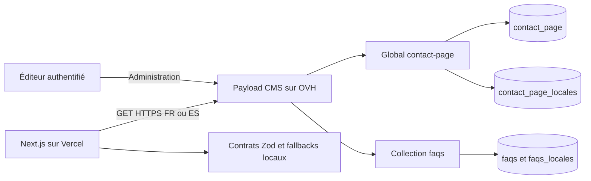
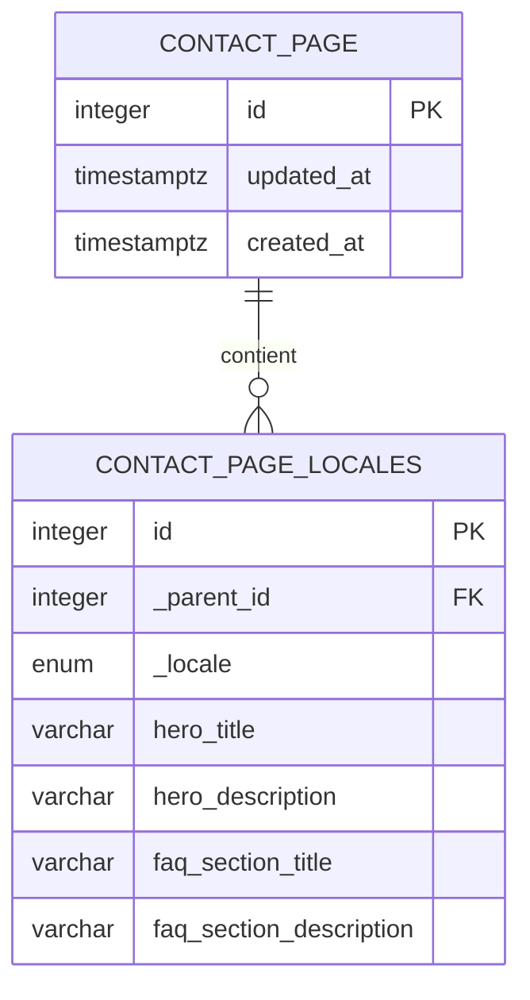

# Global ContactPage — modèle et administration Payload CMS

**Projet :** T-IA-KI  
**Dépôt :** `tiaki-backoffice`  
**Emplacement :** `docs/CONTACT_GLOBAL.md`  
**Dernière mise à jour :** 25 novembre 2026  
**Statut :** déployé sur OVH ; migration et import FR/ES validés.

## 1. Objet et périmètre

Le Global `ContactPage` permet de gérer les contenus publics de la page Contact depuis Payload CMS, indépendamment du cycle de livraison du site Next.js. Il constitue la première intégration complète d'une page éditoriale à structure fixe et sert de référence pour les futures pages Accueil, À propos et Plateforme.

La collection `faqs` reste indépendante : le Global contient le titre et l'introduction de cette section, mais pas les questions et réponses elles-mêmes. Un Global représente une entité éditoriale unique ; une collection représente plusieurs documents autonomes, administrables individuellement.

Le modèle ne traite aucune donnée de santé, demande de contact ou donnée personnelle saisie par un visiteur. Les textes du formulaire sont administrables, mais l'envoi du formulaire reste désactivé dans le site. La mise en place d'un traitement des demandes, des notifications et de règles de conservation nécessitera une conception séparée. Ne pas utiliser le Global public pour stocker ces informations.

La documentation de consommation côté Next.js est `tiaki-website/docs/CONTACT_PAGE.md`. Les procédures générales d'exploitation et de livraison relèvent de `docs/DEPLOYMENT.md`.

## 2. Architecture et organisation



| Couche | Responsabilité |
| --- | --- |
| Payload CMS | Modèle éditorial, localisation, administration et contrôle d'accès |
| PostgreSQL 17 | Stockage persistant des contenus et des traductions |
| Next.js / Vercel | Présentation, interactions, validation des données reçues et résilience |
| GitHub Actions / GHCR / OVH | Validation, publication et livraison du back-office |

Arborescence utile (non exhaustive) :

```text
tiaki-backoffice/
├── src/
│   ├── globals/
│   │   └── ContactPage.ts
│   ├── collections/
│   │   └── FAQs.ts
│   ├── payload.config.ts
│   ├── payload-types.ts
│   └── migrations/
│       ├── 20261015_131640_initial_schema.ts
│       ├── 20261103_104300_add_faqs.ts
│       ├── 20261125_111129_add_contact_page.ts
│       ├── 20261125_111129_add_contact_page.json
│       └── index.ts
├── .github/workflows/
│   ├── ci.yml
│   ├── publish-image.yml
│   └── deploy-production.yml
└── docs/
    ├── DEPLOYMENT.md
    └── CONTACT_GLOBAL.md
```

La configuration `src/globals/ContactPage.ts` est la source de vérité du modèle CMS. Le fichier `payload-types.ts` et les snapshots de migrations sont générés, puis versionnés. Ne pas modifier manuellement les types générés pour introduire un champ absent du modèle.

## 3. Configuration du Global

| Propriété | Valeur |
| --- | --- |
| Nom TypeScript | `ContactPage` |
| Slug Payload | `contact-page` |
| Libellé d'administration | Page Contact |
| Groupe d'administration | Pages du site |
| Langues | `fr`, `es` |
| Langue par défaut du CMS | `fr` |
| Lecture | Publique |
| Mise à jour | Utilisateur authentifié |
| Structure | Cinq onglets nommés, contenant des champs et groupes imbriqués |

Extrait de la configuration d'accès mise en place (pas un remplacement du fichier complet) :

```ts
access: {
  read: () => true,
  update: ({ req }) => Boolean(req.user),
},
```

Le Global doit être importé dans `src/payload.config.ts` et enregistré dans `globals`, en conservant les autres Globals éventuels. La configuration de localisation s'applique au CMS entier. Tous les champs textuels terminaux du Global Contact sont localisés ; les groupes et onglets nommés structurent les objets retournés par l'API.

```ts
// Extrait de payload.config.ts : conserver les autres paramètres.
localization: {
  locales: [
    { label: 'Français', code: 'fr' },
    { label: 'Español', code: 'es' },
  ],
  defaultLocale: 'fr',
  fallback: true,
},
```

La localisation des contenus est distincte de la traduction de l'interface d'administration Payload. Ajouter une langue de contenu ne traduit pas automatiquement les textes existants.

## 4. Dictionnaire des champs

### 4.1. Vue d'ensemble

| Onglet / groupe | Nombre de textes | Obligatoires dans le CMS / SQL |
| --- | ---: | --- |
| `hero` | 2 | 2 |
| `faqSection` | 2 | 2 |
| `contactForm` | 42 | 0 |
| `resources` | 8 | 0 |
| `participation` | 21 | 0 |
| **Total** | **75** | **4** |

Le modèle attend 75 textes par langue, soit 150 valeurs éditoriales FR/ES lorsque le contenu est complet. Ce total exclut les documents FAQ, les identifiants et les métadonnées techniques.

Les 71 autres textes sont facultatifs dans le CMS et nullable dans PostgreSQL. Cela évite notamment d'imposer immédiatement de nouvelles contraintes `NOT NULL` sur des données existantes lors de l'évolution du modèle. En revanche, le site exige les 75 chaînes non vides après application de ses fallbacks. Ces deux niveaux de validation répondent à des responsabilités différentes.

### 4.2. Hero et introduction FAQ

| Chemin API | Signification | Requis CMS |
| --- | --- | --- |
| `hero.title` | Titre principal | Oui |
| `hero.description` | Description principale | Oui |
| `faqSection.title` | Titre FAQ | Oui |
| `faqSection.description` | Introduction FAQ | Oui |

### 4.3. Formulaire — `contactForm`

Tous les champs de ce tableau sont relatifs à `contactForm`. Chaque clé terminale est un texte localisé.

| Groupe | Clés | Nombre |
| --- | --- | ---: |
| Titre | `title` | 1 |
| `labels` | `fullName`, `email`, `profile`, `subject`, `message`, `discoverySource`, `required`, `optional` | 8 |
| `placeholders` | `profile`, `subject`, `message`, `discoverySource` | 4 |
| `subjects` | `general`, `platform`, `resources`, `content`, `participation`, `demo`, `partnership`, `technical`, `other` | 9 |
| `profiles` | `caregiver`, `professional`, `association`, `institution`, `other` | 5 |
| `discoveryOptions` | `google`, `searchEngine`, `linkedin`, `socialMedia`, `advertisement`, `wordOfMouth`, `event`, `organization`, `other` | 9 |
| `hints` | `message`, `discoverySource` | 2 |
| `messages` | `validationSuccess`, `submissionUnavailable` | 2 |
| Confidentialité | `privacyLabel` | 1 |
| Bouton | `submitLabel` | 1 |
| **Total** | | **42** |

Les valeurs techniques des options, les règles de validation, les URLs et les actions du formulaire restent gérées dans le site. Par exemple, la clé CMS `searchEngine` correspond à la valeur technique `search-engine` ; seul son libellé est traduit. Le CMS ne permet pas d'ajouter arbitrairement des identifiants métier ni de réordonner ces options dans ce modèle.

Les messages ne doivent pas annoncer un envoi réussi tant que la soumission n'est pas activée. Exemple français : « Formulaire valide. Aucun message n'a été envoyé. »

### 4.4. Ressources — `resources`

| Groupe | Clés | Nombre |
| --- | --- | ---: |
| Racine | `title`, `description` | 2 |
| `topics.participation` | `title`, `description` | 2 |
| `topics.suggestion` | `title`, `description` | 2 |
| `topics.demo` | `title`, `description` | 2 |
| **Total** | | **8** |

Les trois cartes sont des groupes fixes. Ce groupe n'est pas la collection de ressources documentaires du projet ; il ne crée ni ne modifie les documents de cette collection.

### 4.5. Participation — `participation`

| Groupe | Clés | Nombre |
| --- | --- | ---: |
| Racine | `title`, `description`, `audiencesAriaLabel`, `activitiesTitle` | 4 |
| `audiences.caregivers` | `title`, `compactTitle`, `description` | 3 |
| `audiences.professionals` | `title`, `compactTitle`, `description` | 3 |
| `audiences.organizations` | `title`, `compactTitle`, `description` | 3 |
| `activities.experience` | `title`, `description` | 2 |
| `activities.workshops` | `title`, `description` | 2 |
| `activities.testing` | `title`, `description` | 2 |
| `activities.collaboration` | `title`, `description` | 2 |
| **Total** | | **21** |

`compactTitle` sert aux libellés compacts de l'interface ; `audiencesAriaLabel` est un texte d'accessibilité. Ils doivent également être traduits et validés. Les icônes, interactions et identifiants des publics restent dans le code du site.

### 4.6. Collection FAQ distincte

La collection `faqs` dispose de documents individuels avec `key`, `question`, `answer`, `displayOrder` et `published`. Les questions et réponses sont localisées ; `key`, l'ordre et l'état de publication relèvent de l'identité du document et non d'une traduction. Le site récupère les documents publiés, triés par `displayOrder`, séparément du Global.

Le mécanisme `published` de la collection FAQ n'est pas un workflow de publication pour le Global Contact. Aucune gestion de brouillons ou de versions du Global n'a été mise en place dans cette évolution.

## 5. Localisation, droits et règles éditoriales

### 5.1. Éditer dans Payload

1. Se connecter au back-office approprié (local ou production).
2. Ouvrir **Pages du site → Page Contact**.
3. Sélectionner la langue voulue (`fr` ou `es`).
4. Renseigner les champs des cinq onglets et enregistrer.
5. Vérifier l'autre langue séparément et contrôler la page publique.

Utiliser « aidant(e)s » dans les contenus français. Vérifier les textes courts, les accents, les libellés accessibles et les messages d'erreur, pas seulement les titres. Ne jamais copier automatiquement le français dans les champs espagnols pour masquer une traduction manquante.

Le CMS peut autoriser un texte facultatif vide. L'équipe éditoriale doit néanmoins garantir la complétude des deux langues. Les modifications enregistrées en production sont susceptibles d'être visibles immédiatement sur le site et sur Vercel Preview, qui utilise également le CMS de production. Préférer l'environnement local pour les tests d'édition ; toute modification temporaire en production doit être autorisée et rétablie.

### 5.2. Deux stratégies de fallback distinctes

| Mécanisme | Couche | Comportement |
| --- | --- | --- |
| Fallback de localisation Payload | CMS | Peut substituer une valeur de la langue de secours si activé |
| `fallback-locale=none` | REST | Désactive cette substitution pour la requête |
| Fallback granulaire | Next.js | Remplace un texte manquant ou invalide par le snapshot de la même langue |
| Fallback complet | Next.js | Utilise le snapshot local lorsque le Global est inaccessible ou inexploitable |
| Fallback FAQ | Next.js | Utilise une liste de secours indépendante en cas d'erreur API ou de contrat invalide |

Le site utilise explicitement `fallback-locale=none`. Cela permet de détecter les traductions manquantes au lieu de considérer une substitution FR comme une traduction ES valide. Le fallback du site ne répare pas la base de données : il protège uniquement le rendu. Les snapshots doivent être actualisés selon `tiaki-website/docs/CONTACT_PAGE.md`.

Attention : un snapshot FAQ ancien peut réafficher un contenu retiré en mode dégradé. Pour une suppression importante, mettre à jour et redéployer le snapshot approprié ; ne pas présumer que dépublier dans Payload suffit en cas de panne.

### 5.3. Contrôle d'accès

| Opération | Anonyme | Authentifié |
| --- | --- | --- |
| Lire le Global Contact | Autorisée | Autorisée |
| Modifier le Global Contact | Refusée par la règle d'accès | Autorisée par la règle du Global |
| Lire les FAQ | Documents publiés | Selon les droits de la collection |

`Boolean(req.user)` n'est pas une vérification du rôle administrateur : tout utilisateur authentifié reconnu par cette règle satisfait la condition. Si des profils non éditoriaux ou des comptes de visiteurs sont introduits, durcir le contrôle par rôle ou permission avant de leur donner accès. Ne pas confondre visibilité dans l'interface d'administration et autorisation API effective.

Les endpoints Contact sont publics en lecture : aucun secret, document sensible, jeton ni donnée personnelle ne doit être ajouté au modèle. Une future intégration de contenus restreints doit définir ses propres règles d'accès, flux et exigences d'hébergement. Les opérations Local API peuvent contourner les droits par défaut ; pour une opération exécutée au nom d'un utilisateur, examiner `overrideAccess: false` et transmettre le contexte approprié.

## 6. API REST et configuration

| Environnement | URL du back-office |
| --- | --- |
| Local | `http://localhost:3009` |
| Production | `https://backoffice.tiaki.step.eco` |

Variables du back-office : `DATABASE_URL` pour PostgreSQL, `PAYLOAD_PUBLIC_URL` pour l'URL du serveur, `PAYLOAD_SECRET` pour la sécurité Payload. Ne pas les confondre avec `TIAKI_BACKOFFICE_URL`, qui appartient au site Next.js. Les secrets ne sont pas versionnés.

| Méthode | Endpoint | Authentification |
| --- | --- | --- |
| GET | `/api/globals/contact-page?locale=fr&fallback-locale=none` | Non |
| GET | `/api/globals/contact-page?locale=es&fallback-locale=none` | Non |
| POST | `/api/users/login` | Identifiants du compte Payload |
| POST | `/api/globals/contact-page?locale=fr&fallback-locale=none` | JWT Payload ou autre méthode autorisée |
| POST | `/api/globals/contact-page?locale=es&fallback-locale=none` | Idem |
| GET | `/api/faqs` | Non pour les FAQ publiées |

Exemple de lecture :

```bash
curl -fsS 'https://backoffice.tiaki.step.eco/api/globals/contact-page?locale=es&fallback-locale=none'
```

Exemple illustratif de structure de réponse (partiel, non utilisable comme import complet) :

```json
{
  "hero": {"title": "Contacto", "description": "Texto ilustrativo"},
  "faqSection": {"title": "Preguntas frecuentes", "description": "Texto ilustrativo"},
  "contactForm": {"labels": {"email": "Correo electrónico"}},
  "resources": {"topics": {}},
  "participation": {"audiences": {}, "activities": {}}
}
```

Une réponse HTTP 200 ne garantit pas un contenu complet. Juste après la migration de production, la réponse contenait les groupes mais aucun texte, avant l'import. Contrôler la présence des valeurs et leur conformité au contrat Zod du site.

## 7. Modèle PostgreSQL et migration

### 7.1. Schéma relationnel



Diagramme simplifié : la table enfant comprend également 71 autres colonnes éditoriales. Le Global est unique au niveau de l'API Payload ; le SQL présenté n'impose pas à lui seul un nombre maximal d'enregistrements parents. Ne pas créer des lignes de Global directement en SQL.

| Table | Structure |
| --- | --- |
| `contact_page` | ID, dates de création et modification |
| `contact_page_locales` | ID, `_locale`, `_parent_id`, 75 colonnes textuelles |

Contraintes observées après exécution sur PostgreSQL 17 :

- Clé primaire sur `id` dans chaque table.
- `_locale` utilise le type enum `_locales` déjà présent.
- `_parent_id` référence `contact_page(id)` avec `ON DELETE CASCADE`.
- Index unique `contact_page_locales_locale_parent_id_unique` sur `(_locale, _parent_id)` : une traduction au maximum par langue et parent.
- Les quatre textes Hero/FAQ sont `NOT NULL`. Les autres textes sont nullable. Une valeur `NOT NULL` ne garantit pas que la chaîne soit non vide.

### 7.2. Migration livrée

`20261125_111129_add_contact_page.ts` et son snapshot JSON sont enregistrés dans `src/migrations/index.ts`. La fonction `up()` crée les deux tables, la clé étrangère et l'index unique. Elle ne contient ni `DROP`, ni modification de table FAQ ou utilisateur.

La fonction `down()` a été ajustée avant livraison :

```ts
export async function down({ db }: MigrateDownArgs): Promise<void> {
  await db.execute(sql`
    DROP TABLE "contact_page_locales";
    DROP TABLE "contact_page";
  `)
}
```

La table enfant est supprimée avant le parent, sans `CASCADE` sur les ordres `DROP TABLE`. Cette suppression reste destructive pour les contenus Contact. La clé étrangère `ON DELETE CASCADE`, qui concerne la suppression des lignes, est distincte du `DROP TABLE ... CASCADE` qui concerne les objets dépendants du schéma.

### 7.3. Historique effectivement observé en production

| Migration | Batch |
| --- | ---: |
| `20261015_131640_initial_schema` | 1 |
| `20261103_104300_add_faqs` | 2 |
| `20261125_111129_add_contact_page` | 3 |

La migration Contact a été exécutée en 33 ms selon les logs du 25 novembre 2026. Cette durée est une observation, non un engagement de performance.

### 7.4. Contrôles en lecture seule sur OVH

```bash
cd /opt/tiaki/backoffice

docker compose --env-file .env.production exec -T db \
  sh -c 'exec psql -U "$POSTGRES_USER" -d "$POSTGRES_DB" \
  -c "SELECT name, batch FROM payload_migrations ORDER BY id;"'
```

Pour inspecter le schéma (sans afficher de contenu éditorial) :

```bash
docker compose --env-file .env.production exec -T db \
  sh -c 'exec psql -U "$POSTGRES_USER" -d "$POSTGRES_DB" \
  -c "\d contact_page_locales"'
```

### 7.5. Évolutions du modèle

Modifier la configuration Payload, générer les types, puis créer une nouvelle migration :

```bash
pnpm generate:types
pnpm exec payload migrate:create update-contact-page
```

Auditer le SQL et le snapshot générés. Ne pas modifier une migration déjà appliquée pour livrer une évolution du schéma. Préférer une approche additive : ajouter un champ facultatif, renseigner les traductions, adapter et déployer les consommateurs, puis envisager de renforcer la contrainte via une migration ultérieure si nécessaire.

Ne pas appliquer les migrations manuelles sur la même base locale déjà synchronisée par le mode push de Drizzle sans stratégie explicite de réconciliation. Tester sur une base isolée et ne jamais utiliser `migrate:fresh` ou `migrate:reset` en production.

## 8. Export, import et vérification des contenus

Les migrations transportent la structure, pas les textes renseignés en local. Utiliser l'API REST pour transférer les contenus sans remplacer la base PostgreSQL de production. Les fichiers ne contiennent que des textes publics et des métadonnées éventuelles ; ne jamais exporter des secrets dans ce répertoire.

### 8.1. Export local FR/ES

Depuis le Mac, avec Payload local démarré :

```bash
umask 077
mkdir -p /tmp/tiaki-contact-export
for locale in fr es; do
  curl -fsS \
    "http://localhost:3009/api/globals/contact-page?locale=$locale&fallback-locale=none" \
    -o "/tmp/tiaki-contact-export/contact-page.$locale.json" || break
done
```

Vérifier les deux fichiers, leur complétude, la langue et l'absence de textes de test. `/tmp` n'est pas un stockage durable ; conserver les exports approuvés dans un espace de sauvegarde adapté si nécessaire. Pour actualiser les snapshots du site, utiliser la procédure spécifique de `CONTACT_PAGE.md`.

### 8.2. Import contrôlé via REST

**Opération d'écriture en production.** Avant de lancer le script, disposer d'une sauvegarde récente vérifiée, obtenir l'accord éditorial, contrôler les deux exports et éviter les modifications concurrentes. Pour un Global déjà alimenté, exporter également les deux langues de production dans un dossier distinct afin de conserver l'état précédent. Ne pas écraser cette copie avec les exports locaux.

Le script ci-dessous est une version renforcée de la procédure exécutée le 25 novembre. Il valide les 75 chemins attendus pour chaque langue, retire les métadonnées en reconstruisant les objets, demande une confirmation et compare les contenus après import. Cette version n'a pas encore été exécutée contre le CMS ; le script initial et la comparaison séparée ont réussi. Python 3 et sa bibliothèque standard suffisent.

Depuis le terminal du Mac (pas sur OVH) :

```bash
python3 - <<'PY'
import getpass
import json
from pathlib import Path
from urllib.error import HTTPError
from urllib.request import Request, urlopen

BASE = 'https://backoffice.tiaki.step.eco'
DIR = Path('/tmp/tiaki-contact-export')
SECTIONS = ('hero', 'faqSection', 'contactForm', 'resources', 'participation')

# Contrat des champs textuels : chemins du Global, pas des colonnes SQL.
paths = ['hero.title', 'hero.description',
         'faqSection.title', 'faqSection.description',
         'contactForm.title', 'contactForm.privacyLabel', 'contactForm.submitLabel',
         'resources.title', 'resources.description', 'participation.title',
         'participation.description', 'participation.audiencesAriaLabel',
         'participation.activitiesTitle']
form = {
    'labels': 'fullName email profile subject message discoverySource required optional',
    'placeholders': 'profile subject message discoverySource',
    'subjects': 'general platform resources content participation demo partnership technical other',
    'profiles': 'caregiver professional association institution other',
    'discoveryOptions': 'google searchEngine linkedin socialMedia advertisement wordOfMouth event organization other',
    'hints': 'message discoverySource',
    'messages': 'validationSuccess submissionUnavailable',
}
for group, keys in form.items():
    paths += [f'contactForm.{group}.{key}' for key in keys.split()]
for topic in ('participation', 'suggestion', 'demo'):
    paths += [f'resources.topics.{topic}.{key}' for key in ('title', 'description')]
for audience in ('caregivers', 'professionals', 'organizations'):
    paths += [f'participation.audiences.{audience}.{key}'
              for key in ('title', 'compactTitle', 'description')]
for activity in ('experience', 'workshops', 'testing', 'collaboration'):
    paths += [f'participation.activities.{activity}.{key}'
              for key in ('title', 'description')]
assert len(set(paths)) == len(paths) == 75

def select_content(data, locale):
    result = {}
    for path in paths:
        value = data
        keys = path.split('.')
        for key in keys:
            value = value.get(key) if isinstance(value, dict) else None
        if not isinstance(value, str) or not value.strip():
            raise SystemExit(f'{locale}: champ manquant ou invalide : {path}')
        node = result
        for key in keys[:-1]:
            node = node.setdefault(key, {})
        node[keys[-1]] = value
    return result

# Valider les deux langues avant toute écriture.
contents = {locale: select_content(json.loads(
    (DIR / f'contact-page.{locale}.json').read_text(encoding='utf-8')), locale)
    for locale in ('fr', 'es')}

with open('/dev/tty') as tty:
    print(f'Cible : {BASE} — import des 75 textes FR et ES.', flush=True)
    print('Sauvegarde vérifiée et contenus approuvés ? Saisir IMPORT : ',
          end='', flush=True)
    if tty.readline().strip() != 'IMPORT':
        raise SystemExit('Import annulé.')
    print('Email Payload production : ', end='', flush=True)
    email = tty.readline().strip()
password = getpass.getpass('Mot de passe Payload production : ')

def request(path, method='GET', data=None, token=None):
    headers = {'Accept': 'application/json'}
    if data is not None:
        headers['Content-Type'] = 'application/json'
    if token:
        headers['Authorization'] = f'JWT {token}'
    req = Request(BASE + path, method=method, headers=headers,
                  data=json.dumps(data).encode('utf-8') if data is not None else None)
    try:
        with urlopen(req, timeout=30) as response:
            return json.load(response)
    except HTTPError as exc:
        raise SystemExit(f'{method} {path}: HTTP {exc.code}. Vérifier les données et droits.')

login = request('/api/users/login', 'POST', {'email': email, 'password': password})
token = login['token']
del password, login
for locale, content in contents.items():
    endpoint = f'/api/globals/contact-page?locale={locale}&fallback-locale=none'
    request(endpoint, 'POST', content, token)
    print(f'Import {locale.upper()} réussi')
del token

for locale, expected in contents.items():
    endpoint = f'/api/globals/contact-page?locale={locale}&fallback-locale=none'
    actual = select_content(request(endpoint), locale)
    for section in SECTIONS:
        if actual[section] != expected[section]:
            raise SystemExit(f'{locale}: différence dans {section}')
        print(f'{locale.upper()} [OK] {section}')
print('150 textes importés et comparés aux exports.')
PY
```

Ne jamais transmettre le JWT ou le mot de passe dans les logs, dans un ticket ou dans Git. Les deux écritures FR/ES ne forment pas une transaction globale. Si l'une échoue, vérifier l'état des deux langues avant toute relance ; une interruption après l'envoi d'une requête peut avoir laissé l'écriture effective. Une restauration de contenu doit passer par un import contrôlé de l'état précédent ou une procédure de restauration adaptée, non par la suppression des tables.

Ce script vérifie le contrat textuel actuel et l'égalité des valeurs ; il ne remplace pas la relecture humaine des traductions ni le contrat Zod. Toute modification de schéma nécessite de synchroniser les chemins du script et les schémas du site, ou de mutualiser ultérieurement cette validation.

### 8.3. Validation indépendante sans écriture

```bash
python3 - <<'PY'
import json
from pathlib import Path
from urllib.request import urlopen

sections = ('hero', 'faqSection', 'contactForm', 'resources', 'participation')
failed = False
for locale in ('fr', 'es'):
    local = json.loads(Path(f'/tmp/tiaki-contact-export/contact-page.{locale}.json').read_text())
    url = f'https://backoffice.tiaki.step.eco/api/globals/contact-page?locale={locale}&fallback-locale=none'
    with urlopen(url, timeout=30) as response:
        remote = json.load(response)
    for section in sections:
        ok = section in local and section in remote and local[section] == remote[section]
        failed |= not ok
        print(f'{locale.upper()} [{"OK" if ok else "ERROR"}] {section}')
raise SystemExit(int(failed))
PY
```

Les dix comparaisons ont réussi lors de l'import initial en production. L'égalité des groupes ne démontre pas à elle seule que les exports sont complets ni que les traductions sont correctes ; c'est pourquoi la validation préalable est nécessaire.

## 9. Livraison et tests de migration

### 9.1. Séquence de livraison

1. Développer sur une branche dédiée du back-office (pour Contact : `contact-page-payload`).
2. Contrôler les types, le lint, les dépendances et le build :

   ```bash
   pnpm exec tsc --noEmit
   pnpm run lint
   pnpm audit --audit-level=high
   pnpm run build
   ```

3. Tester les migrations sur PostgreSQL 17 isolé ; vérifier le SQL, les contraintes et la compatibilité avec le schéma précédent.
4. Versionner le Global, son enregistrement, les types générés, la migration TypeScript, le snapshot JSON et le registre.
5. Ouvrir une PR vers `main` ; attendre la CI avant la fusion, puis vérifier la CI de `main`.
6. Déclencher manuellement `Publish T-IA-KI Docker Image` sur `main` et récupérer le digest de la publication réussie correspondant au commit attendu.
7. Vérifier les sauvegardes et l'état des services ; conserver le digest actuellement déployé.
8. Déclencher manuellement `Deploy T-IA-KI Back-office` avec `image_digest`. Le script sur OVH doit effectuer sa sauvegarde préalable et redémarrer le service Payload avec l'image ciblée. L'adaptateur est configuré avec `prodMigrations: migrations`.
9. Vérifier le conteneur, les logs, le registre SQL et l'endpoint REST ; importer ensuite les deux langues et valider les données.
10. Promouvoir le site via sa propre stratégie `feature → dev → main`, après validation de Vercel Preview avec le CMS de production.

Le workflow CI du back-office est déclenché par les PR vers `main` et les push sur `main`, pas par un push sur n'importe quelle branche ni par une exécution manuelle. Les workflows de publication et de déploiement sont manuels. Ne pas confondre les règles Git des deux dépôts.

Le digest identifie une image immuable, contrairement au tag `latest`. Un retour `TIAKI_DEPLOY_NOOP` signifie que le script considère l'image déjà déployée, mais ne démontre ni une nouvelle migration ni un nouveau téléchargement depuis GHCR. Vérifier l'état réel des services et de PostgreSQL.

### 9.2. Validation réalisée le 25 novembre 2026

| Contrôle | Résultat observé ou confirmé |
| --- | --- |
| TypeScript et ESLint | 0 erreur ; 15 avertissements ESLint hors nouvelle migration |
| Audit des dépendances | 2 low, 5 moderate ; aucun high/critical signalé par cette exécution (sous réserve des exclusions configurées) |
| Build back-office et website | Réussis |
| Installation des trois migrations sur base PostgreSQL 17 vide | Réussie |
| Rollback isolé du Global | Réussi ; tables Contact supprimées, structures antérieures conservées |
| Réapplication du Global | Réussie ; contraintes et index vérifiés |
| Migration en production | Batch 3 ; 33 ms observées |
| GET public du Global | HTTP 200 |
| Import et comparaison des contenus | FR et ES réussis ; 10 groupes identiques aux exports |
| Preview et recette de production du site | Confirmées par l'équipe de développement |

Le cycle `up → down → up` a été effectué sur un conteneur PostgreSQL jetable, pas sur une copie des données réelles. Pour isoler le rollback, le batch de la dernière migration a été ajusté manuellement dans ce seul environnement de test ; le registre et les tables ont ensuite été contrôlés. Ne pas reproduire cette modification du registre en production. Le log Payload annonçait trois migrations dans le batch, mais seule la migration Contact a effectivement été annulée ; la cause du message n'a pas été investiguée.

Pour les prochaines migrations, préférer construire directement un historique représentatif : appliquer les migrations de la version précédente sur une base isolée, injecter des données synthétiques représentatives, puis appliquer la nouvelle version. Comparer les données avant/après et, si pertinent, tester le dernier batch de rollback. Cette stratégie évite de modifier manuellement `payload_migrations`.

L'installation et le rollback du schéma ont été démontrés ; la conservation des données réelles lors d'un scénario de restauration n'a pas été testée pour cette évolution. Ne pas extrapoler ces tests à une preuve de restauration complète de la production.

### 9.3. Rollback applicatif, rollback SQL et restauration

| Situation | Action à envisager |
| --- | --- |
| Régression du site uniquement | Restaurer une version Vercel compatible avec le CMS |
| Régression applicative du CMS | Redéployer un digest précédent, après vérification de la compatibilité avec le schéma actuel |
| Erreur sur les textes importés | Restaurer les textes approuvés via l'API ou l'interface d'administration |
| Migration défaillante ou corruption de données | Appliquer le plan de restauration PostgreSQL, après diagnostic et décision explicite |

Le retour à une image précédente ne rétablit pas automatiquement le schéma de la base. `payload migrate:down` annule le dernier batch ; il ne faut pas l'utiliser pour annuler une simple édition de contenu. Pour Contact, son exécution supprime définitivement les deux tables et leurs traductions, sauf récupération à partir d'une sauvegarde. Une restauration complète de la base peut écraser d'autres modifications depuis la date du dump : évaluer ce risque avant de décider.

## 10. Exploitation et diagnostic

| Symptôme | Contrôle initial |
| --- | --- |
| Global absent ou HTTP 404 | Digest déployé, enregistrement du Global, route REST |
| HTTP 200 mais objets vides | Contenus initialisés ? Import FR/ES réalisé ? |
| Texte français dans la version ES | Sélecteur de langue, paramètre `locale`, désactivation du fallback Payload, données réellement traduites |
| Échec de modification REST | Authentification JWT, contrôle d'accès, méthode POST, données obligatoires |
| Erreur de schéma au démarrage | Logs Payload, migrations enregistrées, connexion PostgreSQL |
| Nouveau texte invisible sur le site | Réponse publique du CMS, variable Vercel, logs Zod et fallback du site |
| FAQ absente | Collection FAQ, état `published`, traduction, ordre ; ne pas modifier le Global pour la corriger |
| `denied` au téléchargement GHCR | Validité et portée du PAT, accès au package, configuration Docker du compte SSH |
| `No email adapter provided` | Adaptateur e-mail non configuré ; distinct du fonctionnement du Global |

Commandes de vérification sur OVH :

```bash
cd /opt/tiaki/backoffice
docker compose --env-file .env.production ps
docker compose --env-file .env.production logs --tail=100 payload
```

Le déploiement du 25 novembre a nécessité un renouvellement du PAT GHCR expiré. Le téléchargement manuel a ensuite réussi et la nouvelle image est effectivement en production. La cause précise du refus persistant observé dans le contexte automatisé n'a pas été démontrée ; le dernier lancement affichait `TIAKI_DEPLOY_NOOP`, sans nouveau pull. Vérifier les éventuelles lignes de diagnostic et la configuration explicite `DOCKER_CONFIG` du script avant de considérer ce point clôturé. Ne pas afficher `~/.docker/config.json` ni le contenu d'un token dans les logs. La procédure détaillée de rotation des identifiants doit être centralisée dans `DEPLOYMENT.md`.

## 11. Conventions proposées pour les futures pages

Les conventions suivantes constituent une cible d'architecture, pas une description de Globals déjà créés.

| Besoin | Modèle proposé | Exemple |
| --- | --- | --- |
| Page unique, sections fixes | Global avec onglets nommés et groupes | `home-page`, `about-page`, `platform-page` |
| Éléments indépendants, filtrables ou réutilisables | Collection | FAQ, ressources, articles |
| Liste de sections réellement répétables | Tableau Payload ou blocs selon le besoin | Partenaires, fonctionnalités |
| Image ou document administrable | Upload ou relation à `media` | Illustration de Hero |
| Navigation ou contenu partagé | Global transversal, si besoin confirmé | Footer, navigation |
| Donnée sensible, saisie visiteur ou règle métier | Modèle et accès distincts, ou code applicatif | Demande de contact, authentification |

Ne pas transformer chaque page en Global automatiquement : inventorier d'abord ses composants, ses champs, ses listes, ses relations et ses besoins d'édition. Une structure fixe permet de limiter les régressions de design et de conserver les invariants du code. Si les éditeurs doivent ajouter ou réordonner des éléments, choisir explicitement un modèle adapté et prévoir un contrat de validation et une stratégie de fallback spécifiques.

### 11.1. Nommage proposé

| Élément | Convention | Exemple |
| --- | --- | --- |
| Slug | `<page>-page` | `home-page` |
| Fichier | `src/globals/<Page>Page.ts` | `HomePage.ts` |
| Onglets et groupes | camelCase, identifiants stables | `hero`, `featuresSection` |
| Champs de contenu | `localized: true` si traduisibles | `title`, `description` |
| Migration | Nom explicite, versionnée | `add-home-page` |
| Documentation CMS | `docs/<PAGE>_GLOBAL.md` | `HOME_GLOBAL.md` |
| Contrat côté site | `lib/<page>/schema.ts` | `lib/home/schema.ts` |

Ne pas renommer les clés de l'API ou les slugs existants pour des raisons purement esthétiques : une telle modification constitue potentiellement une rupture de contrat et peut déclencher des changements de colonnes SQL.

### 11.2. Contrat d'intégration inter-dépôts

Pour chaque page, documenter les champs éditoriaux et leur localisation, les droits de lecture/écriture, les champs obligatoires, les identifiants techniques conservés côté site, le schéma de réponse, les relations média éventuelles et la stratégie de migration. Définir les règles de fallback en fonction de la nature des données : une fusion textuelle récursive n'est pas nécessairement adaptée aux tableaux, relations, URLs, images ou contenus sensibles.

Les types générés par Payload et les schémas Zod du site ne sont pas interchangeables : les premiers représentent le modèle CMS ; les seconds valident la réponse réelle reçue à l'exécution. Toute évolution incompatible doit faire l'objet d'une livraison coordonnée entre les dépôts. Préférer les évolutions additives, tester les deux versions des consommateurs et maintenir les snapshots par langue.

Le modèle actuel de Contact reste opérationnel. Mutualiser les configurations, primitives de validation et procédures d'import/export au fil de la deuxième intégration, sans réécrire prématurément le code déjà livré. Les conventions communes pourront ensuite être formalisées dans `docs/CMS_ARCHITECTURE.md` côté back-office et `docs/CMS_INTEGRATION.md` côté website.

## 12. Maintenance et suivi

| Action | Statut |
| --- | --- |
| Modèle Contact et migration de production | Livrés |
| Import FR/ES et comparaison | Validés |
| Documenter la rotation du PAT et le déploiement | À compléter dans `DEPLOYMENT.md` |
| Vérifier le contexte Docker automatisé et retirer les diagnostics inutiles | À vérifier |
| Automatiser les contrôles de contrats CMS / site et snapshots | Proposition |
| Tester les migrations avec données synthétiques et restauration | Proposition |
| Revoir les droits éditoriaux lors de l'introduction de nouveaux types de comptes | Nécessaire avant cette évolution |
| Examiner les vulnérabilités résiduelles et les exceptions d'audit | Maintenance de sécurité |
| Envoi réel du formulaire | Hors périmètre actuel ; à concevoir séparément |
| Intégration Accueil, À propos, Plateforme | À réaliser |

## 13. Références et traçabilité

### Références internes

- `tiaki-website/docs/CONTACT_PAGE.md` : contrat de consommation et résilience côté site.
- `tiaki-backoffice/docs/DEPLOYMENT.md` : infrastructure et exploitation (actualisation prévue).
- Migration `20261125_111129_add_contact_page.ts`, registre `src/migrations/index.ts`, sorties PostgreSQL et logs de déploiement du 25 novembre 2026.
- Guide de reproduction du déploiement T-IA-KI : configuration initiale du CMS, des variables d'environnement et de l'accès SSH.

### Documentation officielle

- [Payload — Global Configs](https://payloadcms.com/docs/configuration/globals)
- [Payload — Localization](https://payloadcms.com/docs/configuration/localization)
- [Payload — Globals Access Control](https://payloadcms.com/docs/access-control/globals)
- [Payload — REST API](https://payloadcms.com/docs/rest-api/overview)
- [Payload — Authentication Operations](https://payloadcms.com/docs/authentication/operations)
- [Payload — Local API](https://payloadcms.com/docs/local-api/overview)
- [Payload — Migrations](https://payloadcms.com/docs/database/migrations)
- [Payload — PostgreSQL adapter](https://payloadcms.com/docs/database/postgres)

Cette documentation repose sur les configurations, migrations et résultats communiqués pendant l'intégration, ainsi que sur la documentation de la page Contact et le guide de déploiement disponibles. Le dépôt GitHub et le fichier complet `src/globals/ContactPage.ts` n'ont pas été relus directement lors de cette rédaction ; le code source reste la référence en cas de divergence. Les scripts améliorés et les conventions futures doivent être revus et validés avant leur adoption.
