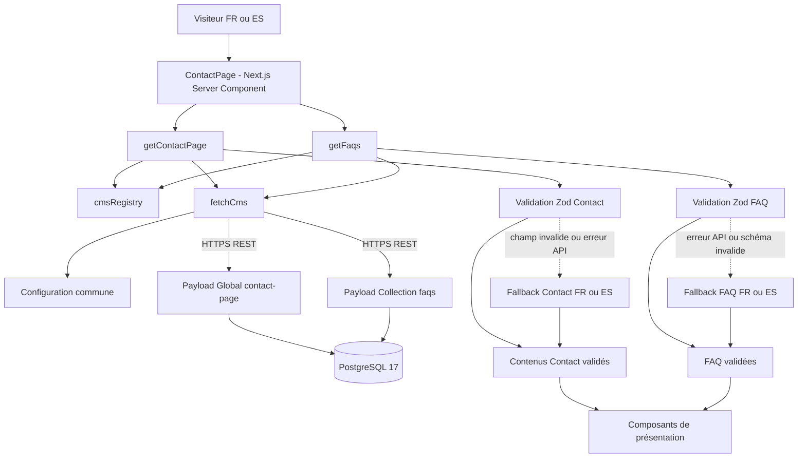

# Page Contact — intégration Payload CMS

**Projet :** T-IA-KI  
**Dépôt :** `tiaki-website`  
**Emplacement :** `docs/CONTACT_PAGE.md`  
**Dernière mise à jour :** 26 novembre 2026  
**Statut :** version initiale déployée et validée en production ; refactorisation CMS-01 validée localement sur `feature/cms-core`, en attente de livraison.

## 1. Objectif et périmètre

La page Contact permet aux visiteurs de consulter les informations de contact, les FAQ, les possibilités de participation au projet et les contenus d'un formulaire. Elle est disponible en français (`fr`) et en espagnol (`es`).

Les contenus éditoriaux sont administrables depuis Payload CMS sans modification du code ni redéploiement du site en fonctionnement nominal. Le site conserve la maîtrise de sa structure visuelle, de ses interactions, des identifiants métier et des règles de validation du formulaire.

Cette page constitue la première implémentation complète d'un modèle d'intégration CMS destiné à être réutilisé pour les autres pages éditoriales du site (Accueil, À propos, Plateforme, etc.). Les conventions communes sont décrites en section 10 ; elles ne signifient pas que ces autres pages sont déjà connectées au CMS.

### 1.1. Périmètre fonctionnel

|Section|Source éditoriale|Composant|
|---|---|---|
|Hero|Global `contact-page`, groupe `hero`|`ContactHero`|
|FAQ — titre et introduction|Global, groupe `faqSection`|`ContactFAQ`|
|FAQ — questions et réponses|Collection `faqs`|`ContactFAQ`|
|Formulaire|Global, groupe `contactForm`|`ContactForm`|
|Ressources|Global, groupe `resources`|`ContactResources`|
|Participation|Global, groupe `participation`|`ContactParticipation`|

**Hors périmètre :** envoi effectif des messages du formulaire, stockage des demandes, notifications, pièces jointes, traitement des données personnelles des visiteurs. Le bouton d'envoi reste désactivé ; la validation locale ne constitue pas une soumission. Le lien vers la politique de confidentialité doit être finalisé dans le cadre de l'activation du formulaire.

## 2. Architecture





Le composant parent déclenche les deux chargements de données de façon concurrente avec `Promise.all()`. Chaque fonction de récupération gère ses erreurs indépendamment et retourne des données typées.

|Couche|Technologie / responsabilité|
|---|---|
|Présentation|Next.js App Router, React, TypeScript ; composants et interactions existants|
|Orchestration|`ContactPage.tsx`, Server Component asynchrone|
|Accès aux données|Adaptateurs serveur `getContactPage()` et `getFaqs()` ; transport partagé `fetchCms()`|
|Configuration et registre|`lib/cms/config.ts` et `registry.ts` : URL, timeout, endpoints, schémas, paramètres et snapshots|
|Contrat de données|Zod : validation à l'exécution et inférence des types|
|Résilience|Snapshots JSON locaux par langue ; fusion granulaire du Global|
|Administration|Payload CMS, hébergé sur OVH dans Docker|
|Persistance|PostgreSQL 17|
|Hébergement du site|Vercel|

Les requêtes CMS sont réalisées côté serveur Next.js, pas directement depuis le navigateur du visiteur. Les routes publiques du CMS exposent des données éditoriales publiques ; les écritures nécessitent une authentification.

## 3. Organisation des fichiers

Principaux fichiers concernés (arborescence volontairement non exhaustive) :

```
tiaki-website/
├── components/contact/
│   ├── ContactPage.tsx
│   ├── ContactHero.tsx
│   ├── ContactFAQ.tsx
│   ├── ContactForm.tsx
│   ├── ContactResources.tsx
│   └── ContactParticipation.tsx
├── lib/cms/
│   ├── config.ts
│   ├── client.ts
│   ├── validation.ts
│   ├── mergeWithFallback.ts
│   └── registry.ts
├── lib/contact/
│   ├── getContactPage.ts
│   ├── getFaqs.ts
│   ├── schema.ts
│   ├── faqSchema.ts
│   ├── types.ts
│   ├── fallback.ts
│   ├── fallback.fr.json
│   ├── fallback.es.json
│   ├── faqFallback.ts
│   ├── faq-fallback.fr.json
│   ├── faq-fallback.es.json
│   ├── validation.ts
│   └── submission.ts
└── docs/
    ├── CMS_INTEGRATION.md
    └── CONTACT_PAGE.md
```

Les anciens modules de contenu statique peuvent encore contenir des constantes ou types métier. Ne pas les supprimer sans vérifier leurs usages. Les schémas Zod décrivent les réponses attendues ; la validation des saisies utilisateur relève de `lib/contact/validation.ts`, non du schéma éditorial ni de `lib/cms/validation.ts`.

## 4. Configuration et API

### 4.1. Variable d'environnement

|Environnement|`TIAKI_BACKOFFICE_URL`|
|---|---|
|Local (`.env.local`)|`http://localhost:3009`|
|Vercel Preview|`https://backoffice.tiaki.step.eco`|
|Vercel Production|`https://backoffice.tiaki.step.eco`|

Ne pas utiliser le préfixe `NEXT_PUBLIC_` : cette variable sert aux fonctions serveur. Ne pas versionner les fichiers d'environnement locaux. Une modification des variables Vercel nécessite un nouveau déploiement pour être prise en compte par celui-ci.

### 4.2. Endpoints publics

Global Contact :

```
GET /api/globals/contact-page?locale=fr&fallback-locale=none
```

Collection FAQ :

```
GET /api/faqs?locale=fr&fallback-locale=none&where[published][equals]=true&sort=displayOrder&limit=100
```

Remplacer `fr` par `es` pour les contenus espagnols. Dans le code, `cmsRegistry` fournit les endpoints et les paramètres FAQ ; `fetchCms()` construit les URL avec `URL` et `searchParams` et impose les paramètres linguistiques.

Le paramètre `fallback-locale=none` désactive le fallback linguistique de Payload pour ces lectures. Il évite notamment qu'un champ manquant en espagnol soit silencieusement remplacé par sa valeur française avant la validation côté site.

La collection FAQ filtre les documents publiés et les trie selon `displayOrder`. La limite actuelle de 100 documents n'est pas une pagination exhaustive : si le volume augmente, adapter le chargement et la maintenance des snapshots. Les FAQ ont une politique d'accès public limitée aux documents publiés ; les modifications sont réservées aux utilisateurs authentifiés.

### 4.3. Modèle de contenu

Le Global possède 75 champs textuels localisés, soit 150 valeurs attendues pour les deux langues.

|Groupe|Nombre de champs|Description|
|---|--:|---|
|`hero`|2|Titre, description|
|`faqSection`|2|Titre, description de la section FAQ|
|`contactForm`|42|Titre, labels, placeholders, sujets, profils, sources de découverte, aides, messages et boutons|
|`resources`|8|Titre, description, trois cartes thématiques|
|`participation`|21|Titre, description, label accessible, trois publics et quatre activités|
|**Total**|**75**|Hors documents de la collection FAQ|

Les groupes structurent la réponse API ; ils ne représentent pas cinq collections distinctes. Les quatre champs du Hero et de l'introduction FAQ sont obligatoires dans le modèle CMS et `NOT NULL` dans PostgreSQL. Les autres champs sont actuellement facultatifs dans le modèle CMS. Côté Next.js, tous les textes attendus sont néanmoins requis par le contrat Zod après application éventuelle du fallback.

Les valeurs techniques des sujets, profils et sources de découverte restent dans le code. Les libellés correspondants sont administrables. Par exemple, l'identifiant `caregiver` ne doit pas être remplacé par sa traduction ; seul son libellé change selon la langue. Les clés CMS en camelCase telles que `searchEngine` sont mappées vers les valeurs techniques existantes telles que `search-engine`.

Les structures exactes des groupes et les identifiants acceptés sont définis dans `schema.ts`, `ContactForm.tsx` et la configuration du Global dans `tiaki-backoffice`. Respecter la convention éditoriale française « aidant(e)s ».

## 5. Récupération, validation et rendu

### 5.1. Orchestration

Extrait de `ContactPage.tsx` :

```
const [content, questions] = await Promise.all([
  getContactPage(locale),
  getFaqs(locale),
])
```

Le parent transmet ensuite les groupes aux composants. `ContactFAQ` reçoit `content` et `questions` ; il ne charge plus lui-même les questions et n'a plus besoin de la prop `locale`. Les composants interactifs conservent leur logique client existante.

### 5.2. Contrat Zod

`schema.ts` contient les schémas des cinq groupes et `contactPageSchema`. Les textes sont validés avec la primitive commune `requiredText` de `lib/cms/validation.ts` (`z.string().trim().min(1)`), également utilisée par `faqSchema.ts`. `types.ts` infère les types à partir des schémas (`z.infer`) pour éviter de maintenir deux contrats divergents.

`faqSchema.ts` valide les documents FAQ : `id` (entier ou chaîne non vide), `key`, `question`, `answer`, `displayOrder` (nombre positif ou nul) et `published` (valeur littérale `true`). `faqResponseSchema` valide l'enveloppe `docs`.

La validation TypeScript agit à la compilation ; Zod contrôle les données reçues à l'exécution. Un statut HTTP 200 ne suffit pas à garantir la validité d'une réponse.

### 5.3. Paramètres réseau

Les deux adaptateurs utilisent `fetchCms()` ; ce client applique la configuration de `lib/cms/config.ts` :

```
{
  cache: 'no-store',
  signal: AbortSignal.timeout(CMS_REQUEST_TIMEOUT_MS),
}
```

- `no-store` : les nouvelles requêtes serveur consultent le CMS sans réutiliser le cache de données de `fetch` ; cela permet de refléter une modification CMS sans redéploiement.
- `AbortSignal.timeout(5000)` : budget nominal de cinq secondes par requête, y compris la lecture du corps lorsque le signal s'applique.
- `Promise.all()` : les requêtes indépendantes démarrent ensemble. Si elles atteignent toutes les deux leur timeout, l'attente réseau cumulée passe théoriquement d'environ dix secondes à environ cinq secondes. Il ne s'agit pas d'une garantie de temps total de rendu (compilation, réseau et traitements additionnels exclus).

Aucun mécanisme de retry, cache persistant des dernières réponses valides ou circuit breaker n'est implémenté dans ce périmètre.

### 5.4. Adaptateurs métier après CMS-01

`getContactPage.ts` conserve ses imports `server-only`, `SiteLocale` depuis `@/lib/i18n/config` et `ContactPageContent` depuis `./types`. Il récupère `endpoint` et `schema` depuis `cmsRegistry.contact`, appelle `fetchCms(endpoint, { locale })`, puis utilise `schema.safeParse(data)`. En cas de réponse partiellement invalide, il journalise les chemins Zod, fusionne avec `mergeWithFallback(data, fallback)` et applique `schema.parse(merged)`. Le bloc `catch` retourne le fallback complet si la requête ou la validation finale échoue.

`getFaqs.ts` conserve `server-only`, ses types et son fallback. Le bloc de récupération devient :

```
const { endpoint, schema, query } = cmsRegistry.faqs
const data = await fetchCms(endpoint, { locale, query })
return schema.parse(data).docs
```

Le `catch` conserve sa stratégie de fallback intégral. Les deux adaptateurs restent indépendants et parallélisés par le composant parent. Aucun changement des composants, du modèle Payload ou de PostgreSQL n'est nécessaire pour CMS-01. Voir `CMS_INTEGRATION.md` pour les responsabilités et limites de la couche commune.

## 6. Stratégie de résilience

### 6.1. Global Contact : fallback granulaire

`getContactPage()` récupère le snapshot correspondant à la langue, interroge le CMS, puis valide la réponse avec `contactPageSchema.safeParse()`.

|Situation|Comportement|
|---|---|
|Réponse entièrement valide|Utiliser les contenus CMS|
|Réponse partiellement invalide|Conserver les textes CMS valides et remplacer uniquement les champs invalides ou absents|
|Échec HTTP, réseau, timeout ou parsing JSON|Utiliser le snapshot complet de la langue|
|Variable CMS absente|Utiliser le snapshot et journaliser l'erreur|
|Fusion toujours invalide|Utiliser le snapshot complet|

`lib/cms/mergeWithFallback.ts` (déplacé depuis `lib/contact/` sans changement de logique) parcourt récursivement la structure du snapshot. Pour chaque feuille textuelle, il conserve la valeur distante si celle-ci est une chaîne non vide après `trim()`. Les autres valeurs sont remplacées par celles du snapshot. Les propriétés inconnues ne sont pas intégrées.

Exemple : si `resources.title` est valide dans Payload mais `resources.description` est vide, le titre CMS est conservé et seule la description est restaurée depuis le snapshot de la même langue.

**Limite de généralisation :** cet algorithme a été conçu pour des objets imbriqués contenant des textes. Il ne constitue pas un mécanisme universel de fusion pour des tableaux, des blocs Payload, des relations, des médias, des booléens ou des nombres. Les futures pages doivent définir explicitement la stratégie de fusion adaptée à leur modèle.

### 6.2. FAQ : fallback de collection

`getFaqs()` valide la réponse complète. Si la requête ou le schéma échoue, la collection locale correspondante est retournée. Il n'y a pas de fusion question par question.

Une réponse valide avec `docs: []` est considérée comme une collection volontairement vide et ne déclenche pas de fallback. Cela permet de respecter une dépublication complète des FAQ lorsque le CMS est accessible.

### 6.3. Limites et risques

- Les snapshots sont versionnés dans le site et ne sont pas automatiquement synchronisés avec les modifications CMS. Leur actualisation exige un commit et un redéploiement.
- Un snapshot obsolète peut réafficher une FAQ dépubliée pendant une panne. En cas de retrait impératif d'un contenu public, mettre à jour rapidement le snapshot et redéployer ; envisager une autre politique de secours si ce risque n'est pas acceptable.
- Les snapshots sont validés à l'import du module. Un snapshot invalide peut empêcher le fonctionnement de la page ; il doit être validé avant intégration.
- Un HTTP 200 côté site peut masquer une panne du CMS. Les logs et les tests de récupération dynamique sont nécessaires pour distinguer le mode nominal du mode dégradé.
- Les mécanismes de fallback garantissent la disponibilité de contenus de secours valides dans les scénarios testés, pas une disponibilité absolue du site ou du CMS.

## 7. Maintenance des snapshots

Actualiser les snapshots après des changements éditoriaux significatifs, une évolution du schéma ou une dépublication de FAQ qui ne doit pas réapparaître en mode dégradé. Prendre comme référence des contenus approuvés, jamais des textes temporaires de test. Ne stocker aucune donnée privée ni aucun identifiant d'accès dans ces fichiers.

La procédure ci-dessous est une procédure de maintenance proposée, à exécuter depuis la racine de `tiaki-website` sur une branche dédiée, après vérification de l'environnement source. Elle prépare les quatre fichiers dans un répertoire temporaire, les valide avec les schémas de l'application, retire les métadonnées non nécessaires et ne remplace les snapshots qu'après validation de l'ensemble. Elle nécessite les dépendances du projet et un exécuteur TypeScript capable de résoudre les imports relatifs sans extension, par exemple `tsx`. Depuis CMS-01, l'ancien exemple fondé uniquement sur `node --input-type=module` n'est plus fiable, car les schémas importent `../cms/validation`. L'exemple ci-dessous est une adaptation proposée, non exécutée contre le dépôt : vérifier la disponibilité de `tsx` (`pnpm exec tsx --version`) ; si absent, différer l'exécution jusqu'à la sélection du runner dans CMS-03. Aucun ajout de dépendance n'est supposé effectué.

```
(
  set -eu
  export SNAPSHOT_DIR="$(mktemp -d)"
  trap 'rm -rf "$SNAPSHOT_DIR"' EXIT
  BASE_URL="https://backoffice.tiaki.step.eco"

  for locale in fr es; do
    curl -fsS --max-time 30 \
      "$BASE_URL/api/globals/contact-page?locale=$locale&fallback-locale=none" \
      -o "$SNAPSHOT_DIR/fallback.$locale.json"

    curl -fsS --max-time 30 --get "$BASE_URL/api/faqs" \
      --data-urlencode "locale=$locale" \
      --data-urlencode 'fallback-locale=none' \
      --data-urlencode 'where[published][equals]=true' \
      --data-urlencode 'sort=displayOrder' \
      --data-urlencode 'limit=100' \
      -o "$SNAPSHOT_DIR/faq-fallback.$locale.json"
  done

  cat > "$SNAPSHOT_DIR/validate.mts" <<'JS'
import { readFileSync, writeFileSync } from 'node:fs'
import { join } from 'node:path'
import { pathToFileURL } from 'node:url'
const { contactPageSchema } = await import(pathToFileURL(join(process.cwd(), 'lib/contact/schema.ts')).href)
const { faqResponseSchema } = await import(pathToFileURL(join(process.cwd(), 'lib/contact/faqSchema.ts')).href)

const dir = process.env.SNAPSHOT_DIR
for (const locale of ['fr', 'es']) {
  const contactPath = join(dir, `fallback.${locale}.json`)
  const faqPath = join(dir, `faq-fallback.${locale}.json`)
  const contact = contactPageSchema.parse(JSON.parse(readFileSync(contactPath, 'utf8')))
  const rawFaqs = JSON.parse(readFileSync(faqPath, 'utf8'))
  const faqs = faqResponseSchema.parse(rawFaqs)
  if (rawFaqs.hasNextPage === true || rawFaqs.totalDocs > faqs.docs.length) {
    throw new Error(`FAQ ${locale}: export incomplet, adapter la pagination`)
  }
  if (faqs.docs.length === 0) {
    throw new Error(`FAQ ${locale}: collection vide, vérifier avant de remplacer le snapshot`)
  }
  writeFileSync(contactPath, JSON.stringify(contact, null, 2) + '\n')
  writeFileSync(faqPath, JSON.stringify(faqs, null, 2) + '\n')
  console.log(`${locale}: Contact valide, ${faqs.docs.length} FAQ valides`)
}
JS
  pnpm exec tsx "$SNAPSHOT_DIR/validate.mts"

  for locale in fr es; do
    cp "$SNAPSHOT_DIR/fallback.$locale.json" "lib/contact/fallback.$locale.json"
    cp "$SNAPSHOT_DIR/faq-fallback.$locale.json" "lib/contact/faq-fallback.$locale.json"
  done
)
```

Le garde-fou contre une collection FAQ vide est volontaire pour cette ancienne procédure manuelle : si le retrait de toutes les FAQ est intentionnel, adapter ce contrôle après revue. Le site accepte déjà une collection vide valide en fonctionnement nominal (test CMS-01). Le futur script générique devra accepter une collection vide complète et valide, sans la confondre avec une erreur ni ressusciter des contenus dépubliés.

Relire les différences avec `git diff -- lib/contact/`, contrôler les traductions et les éventuelles suppressions, puis lancer `pnpm exec tsc --noEmit`, `pnpm run lint` et `pnpm run build`. Tester les deux langues et le mode dégradé avant le merge. Le script proposé n'est pas encore automatisé dans le pipeline CI. CMS-03 puis CMS-02/CMS-05 doivent remplacer cette procédure ponctuelle par un mécanisme générique fondé sur `cmsRegistry`, avec validation complète, contrôle de pagination, détection de changement et PR. Tant que la fusion et le déploiement n'ont pas eu lieu, les snapshots embarqués ne changent pas.

## 8. Tests et diagnostic

### 8.1. Matrice de recette

|ID|Scénario|Résultat attendu|Statut au 25/11/2026|
|---|---|---|---|
|T01|Un champ CMS vide et un autre modifié|Fallback du seul champ invalide|Validé en local|
|T02|CMS arrêté|Page Contact et FAQ disponibles via les snapshots|Validé en local|
|T03|CMS rétabli|Retour aux contenus dynamiques sans redémarrage du site|Validé en local|
|T04|Contrôle des deux locales|Pas de fallback vers l'autre langue|Validé en local|
|T05|Serveur accessible ne répondant pas|Interruption des requêtes et activation des fallbacks|Validé en local|
|T06|Modification éditoriale sur CMS de production|Changement visible sur Vercel Preview|Validé sur `dev`|
|T07|Recette fonctionnelle en production|Affichage FR/ES, interactions, non-régression|Validé selon retour de recette|

Les validations ci-dessus sont issues des essais réalisés pendant le développement et la mise en production initiale.

**Recette CMS-01 du 26/11/2026 :** validée en local selon les retours du développeur : affichage FR/ES, édition dynamique, tri et dépublication FAQ, fallback granulaire, panne locale et rétablissement, serveur simulé sans réponse (timeout nominal 5 s), collection FAQ vide et restauration des publications. TypeScript, lint et build confirmés. La durée exacte du rendu n’a pas été mesurée ici. La recette Vercel Preview/Production de la refactorisation est encore à réaliser. Elles ne constituent pas une suite de tests automatisés. Aucun arrêt volontaire du CMS de production n'est requis pour la recette.

### 8.2. Contrôles techniques

```
pnpm exec tsc --noEmit
pnpm run lint
pnpm run build
```

Vérifier également les contenus dynamiques, les FAQ, les listes déroulantes, les messages de validation, les sélecteurs de publics, le responsive et les autres pages du site. Restaurer tout contenu temporairement modifié lors des tests.

### 8.3. Diagnostic

|Symptôme|Vérifications|
|---|---|
|Un seul texte ne change pas|Vérifier la valeur CMS dans la bonne locale, le schéma et les logs de fusion|
|Aucun texte ne change|Vérifier `TIAKI_BACKOFFICE_URL`, l'accessibilité HTTPS et les logs de fallback|
|FAQ absentes|Vérifier la publication, la locale, les données de la collection et les filtres|
|Page lente|Examiner les timeouts, les logs serveur, la latence CMS et la parallélisation|
|Erreur au démarrage ou au build|Vérifier les schémas et les quatre snapshots, notamment les valeurs `null`|

Préfixes de logs à rechercher côté serveur Next.js : `[ContactPage][fr]`, `[ContactPage][es]`, `[FAQs][fr]`, `[FAQs][es]`. Les messages `Invalid CMS content` indiquent des problèmes de contrat ; `Using local fallback` signale une erreur ayant déclenché un fallback complet. Ne jamais journaliser les tokens ou les données privées.

## 9. Déploiement et compatibilité

### 9.1. Ordre de mise en production

1. Déployer le schéma CMS et la migration PostgreSQL sur OVH, après sauvegarde et validation sur une base isolée.
2. Importer les contenus localisés via l'API authentifiée du CMS.
3. Vérifier les réponses publiques dans chaque langue et leur conformité aux contenus exportés.
4. Pousser le code du site et fusionner la branche fonctionnelle dans `dev` selon la stratégie Git du site.
5. Valider Vercel Preview sur `dev`, y compris une modification de contenu depuis Payload.
6. Relire les autres changements présents dans `dev`, fusionner dans `main`, puis vérifier Vercel Production.
7. Réaliser la recette fonctionnelle et contrôler les logs.

La migration du Global Contact est `20261125_111129_add_contact_page`, enregistrée en batch 3 en production. Elle crée `contact_page` et `contact_page_locales`. Le cycle `up → down → up` a été testé sur une base temporaire ; la conservation des données réelles de production n'a pas fait l'objet d'un test sur une copie de ces données. L'import des cinq groupes a été comparé aux exports FR/ES : les dix comparaisons ont réussi.

### 9.2. Rollback

Un rollback Vercel restaure une version du site et ses snapshots, pas la base du CMS. Un rollback de l'image Docker du back-office ne restaure pas automatiquement PostgreSQL. La fonction `down()` de la migration Contact supprime les deux tables dédiées et leurs contenus : ne pas l'utiliser comme simple mécanisme de retour arrière applicatif.

Privilégier la compatibilité ascendante du CMS pendant les déploiements du site et conserver des sauvegardes vérifiables. Les procédures d'infrastructure détaillées relèvent de `tiaki-backoffice/docs/DEPLOYMENT.md` (à compléter pour cette évolution).

## 10. Conventions réutilisables pour les futures pages

Cette section résume le standard transversal désormais documenté dans `docs/CMS_INTEGRATION.md`. Le socle CMS-01 est implémenté ; les nouveaux modèles et les politiques de fallback propres aux futurs contenus restent à définir. Ne pas dupliquer mécaniquement le modèle Contact.

### 10.1. Choisir le bon modèle CMS

|Type de contenu|Modèle recommandé|Exemple|
|---|---|---|
|Page éditoriale unique, sections fixes|Global|Accueil, À propos, Plateforme|
|Liste d'éléments autonomes, CRUD et tri|Collection|FAQ, actualités, ressources|
|Sections réordonnables ou répétables|Tableau ou blocs Payload, si nécessaire|Liste de partenaires, modules éditoriaux configurables|
|Fichier ou illustration administrable|Relation vers une collection média|Illustration de Hero, logos|
|Valeur métier, validation ou action technique|Code applicatif|Identifiants de sujets, routes, règles d'accès|

Les choix des autres pages sont des recommandations à confirmer par leur inventaire de contenus. Il n'est pas nécessaire de créer une collection pour chaque section d'une page fixe, ni de rendre toute la mise en page éditable si le besoin est uniquement textuel.

### 10.2. Conventions de nommage

|Élément|Convention proposée|Exemple Accueil|
|---|---|---|
|Global Payload|`<page>-page`|`home-page`|
|Configuration Payload|`src/globals/<Page>Page.ts`|`HomePage.ts`|
|Module côté site|`lib/<page>/`|`lib/home/`|
|Fonction de récupération|`get<Page>Page.ts`|`getHomePage.ts`|
|Schéma Zod|`schema.ts`|`lib/home/schema.ts`|
|Types inférés|`types.ts`|`lib/home/types.ts`|
|Snapshots éditoriaux|`fallback.<locale>.json`|`fallback.fr.json`, `fallback.es.json`|
|Orchestrateur|`components/<page>/<Page>Page.tsx`|`components/home/HomePage.tsx`|
|Documentation|`docs/<PAGE>_PAGE.md`|`docs/HOME_PAGE.md`|

Adapter le nommage aux routes et à l'arborescence existantes : ne pas renommer les composants ou les URLs publiques uniquement pour suivre cette convention.

### 10.3. Démarche d'intégration par page

1. Inventorier les textes FR/ES, les sections, listes, médias, liens et interactions existants.
2. Distinguer contenu éditorial, structure UI, constantes métier et données sensibles. Définir les droits d'accès.
3. Choisir Global, collection ou combinaison ; définir le contrat de données et les contraintes de localisation.
4. Créer le modèle Payload et renseigner les contenus des deux langues.
5. Définir le schéma Zod et les types ; préparer les snapshots validés.
6. Déclarer le contenu dans `cmsRegistry`, réutiliser `fetchCms()` et définir la stratégie de fallback adaptée côté serveur.
7. Transmettre les données aux composants sans modifier inutilement le design ni les interactions.
8. Tester le mode nominal, les champs invalides, l'indisponibilité, le rétablissement et la cohérence FR/ES ; vérifier le build.
9. Générer et auditer la migration, tester sur une base isolée et déployer le CMS avant le site.
10. Importer et vérifier les contenus, valider `dev` sur Vercel Preview, puis promouvoir en production via `main` et documenter.

### 10.4. Mutualisation réalisée (CMS-01)

|Élément|Situation après CMS-01|Suite|
|---|---|---|
|Configuration URL CMS et timeout|`lib/cms/config.ts`|Réutiliser|
|Transport HTTP|`lib/cms/client.ts`|Réutiliser ; tester hors Next.js dans CMS-03|
|Endpoints, schémas et chemins|`lib/cms/registry.ts`|Enrichir pour chaque nouveau modèle|
|Fusion granulaire textuelle|`lib/cms/mergeWithFallback.ts`|Réutiliser uniquement pour les modèles compatibles|
|Primitives Zod|`lib/cms/validation.ts`|Ajouter des primitives selon les besoins|
|Snapshots|Quatre fichiers Contact/FAQ inchangés|Validation CI et synchronisation à développer|
|Tests de résilience|Recette manuelle locale validée|Automatisation et recette Preview/Production à faire|

La configuration, le transport et les primitives sont mutualisés ; les schémas et décisions métier restent propres à chaque contenu. Les stratégies de cache, de fallback et de pagination peuvent varier selon le modèle. La prochaine intégration réutilisera ce socle après la mise en place des contrôles et de la synchronisation des snapshots.

### 10.5. Critères de fin d'intégration d'une page

- Les contenus approuvés FR/ES sont administrables et validés à l'exécution.
- Les identifiants métier, règles d'accès, interactions et éléments d'accessibilité restent corrects.
- Le CMS et le site disposent d'une stratégie de compatibilité et de migration testée.
- Les modes nominal et dégradé ont été vérifiés pour les deux langues.
- Les snapshots sont complets, approuvés et exempts de données confidentielles.
- Les contrôles TypeScript, lint et build réussissent selon les règles du projet.
- La recette Preview puis Production est validée et la maintenance documentée.

## 11. Suivi technique

|Sujet|Statut / action|
|---|---|
|Administration éditoriale Contact FR/ES|Déployée et validée|
|Envoi du formulaire|Non implémenté ; évolution distincte nécessitant validation fonctionnelle, sécurité et protection des données|
|Validation automatique des snapshots en CI|À mettre en place|
|Mutualisation du client REST CMS|Implémentée et validée localement (CMS-01) ; livraison à réaliser|
|Synchronisation automatique des snapshots|À développer (CMS-02/CMS-05), après CMS-03|
|Politique de rétention des contenus dépubliés dans les snapshots|À préciser|
|Rotation PAT GHCR et vérification des diagnostics du script de déploiement|Maintenance du back-office à documenter|
|Audit des dépendances|2 vulnérabilités faibles et 5 modérées signalées lors du contrôle ; analyse détaillée à mener|
|Dette ESLint back-office|15 avertissements non bloquants constatés ; nettoyage hors périmètre de cette livraison|

## 12. Documentation de référence

Les références ci-dessous sont des points d'entrée vers les documentations officielles des technologies, à consulter selon les versions effectivement installées dans les dépôts :

- [Payload CMS — Globals](https://payloadcms.com/docs/configuration/globals)
- [Payload CMS — Localization](https://payloadcms.com/docs/configuration/localization)
- [Payload CMS — REST API](https://payloadcms.com/docs/rest-api/overview)
- [Payload CMS — Database migrations](https://payloadcms.com/docs/database/migrations)
- [Next.js — fetch](https://nextjs.org/docs/app/api-reference/functions/fetch)
- [Zod — Documentation](https://zod.dev/)
- [Vercel — Environment variables](https://vercel.com/docs/environment-variables)

Cette documentation décrit les choix, extraits de code et résultats de validation établis durant l'intégration Contact. Elle n'est pas un audit indépendant du dépôt : les noms de fichiers et les extraits doivent être confrontés au code versionné lors des futures évolutions. La mutualisation transverse est désormais implémentée et validée localement selon les retours de recette. Les procédures de synchronisation automatique, les nouveaux modèles et l’adaptation du script manuel hors Next.js restent à implémenter ou vérifier. Aucun accès direct au dépôt Git n’a été effectué pour cette révision.